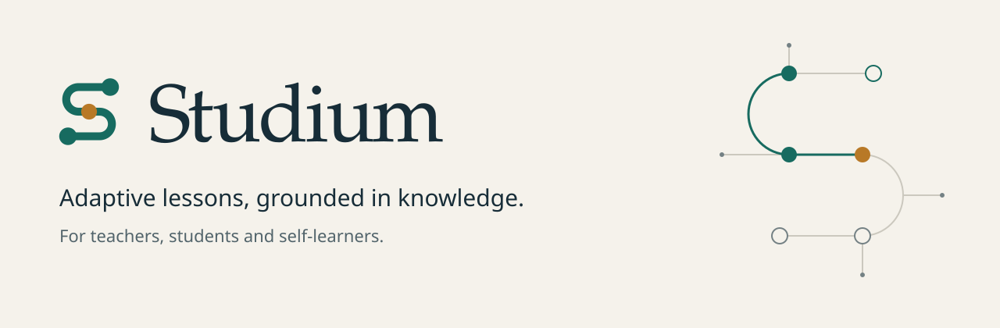
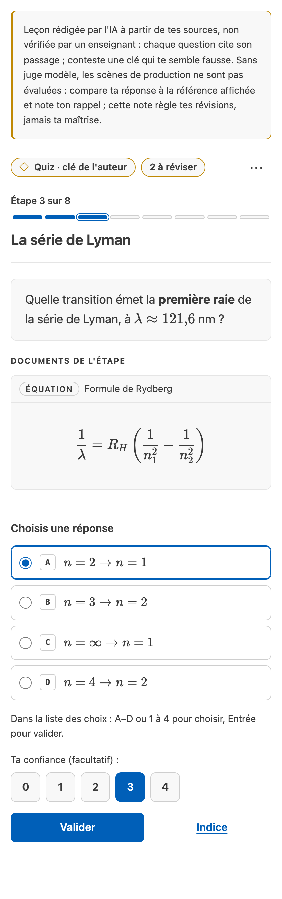
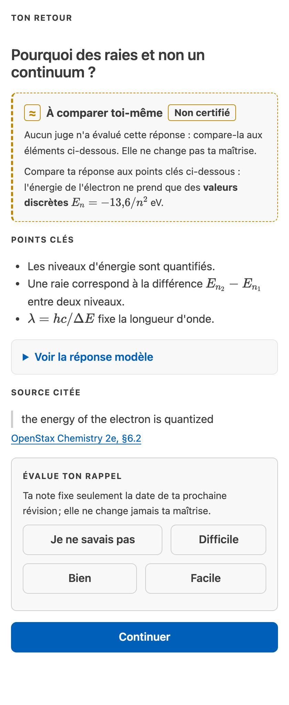

[English](README.md) · Français

<p align="center">
  <picture>
    <source media="(prefers-color-scheme: dark)" srcset="docs/assets/hero-dark.svg">
    
  </picture>
</p>

# Studium

Studium transforme des sources que vous jugez fiables en leçons adaptatives, à suivre dans VS Code ou avec votre propre assistant IA. Chaque réponse dit qui a rédigé la clé de correction et si quelque chose l'a évaluée.

[eDIAM](https://ediam.cnrs.fr/) · Institut de Chimie de Nice · Université Côte d'Azur · CNRS · [HolobiomicsLab](https://holobiomicslab.cnrs.fr/)

## Choisir son parcours

| Je veux… | Commencer ici | Ce que vous obtenez |
|---|---|---|
| Apprendre seul un sujet avec un assistant IA | [Apprendre avec votre assistant](docs/learn/learn-with-your-assistant.fr.md) | Une leçon construite à partir des sources choisies, puis des révisions espacées les jours suivants |
| Étudier dans une classe | [Guide étudiant](docs/learn/student-guide.fr.md) | Une leçon approuvée par l'enseignant, dans VS Code ou dans votre assistant, avec un retour après chaque réponse |
| Enseigner | [Guide enseignant](docs/teach/teacher-guide.fr.md) | Une leçon sourcée, un enregistrement d'approbation lié à son contenu exact et un rapport de classe agrégé |
| Construire sur Studium | [Architecture](docs/develop/architecture.fr.md) et [outils MCP](docs/reference/mcp-tools.fr.md) | Les contrats du moteur, les 40 outils MCP et le format des leçons |

Le [portail de la documentation](docs/index.fr.md) classe toutes les pages par rôle.

<table>
  <tr>
<td width="50%" valign="top"><picture><source media="(prefers-color-scheme: dark)" srcset="docs/assets/screenshots/vscode-pane-choices-dark.png"></picture><br><em>Une étape de quiz dans le panneau de leçon de VS Code ; l'avis en tête dit qui a écrit la clé de correction.</em></td>
<td width="50%" valign="top"><picture><source media="(prefers-color-scheme: dark)" srcset="docs/assets/screenshots/vscode-pane-feedback-dark.png"></picture><br><em>Le retour après une réponse rédigée qu'aucun juge n'a évaluée : comparer aux points clés, puis évaluer son rappel.</em></td>
  </tr>
</table>

## Démarrage rapide

Prévoyez un quart d'heure environ. Il vous faut git, Node 22 et pnpm 9. Python n'est pas nécessaire pour apprendre.

```bash
git clone https://github.com/HolobiomicsLab/studium.git
cd studium
corepack enable        # provides the pnpm version pinned in package.json
./setup.sh             # installs, builds the libraries and the VS Code extension
```

Si le clonage répond `Repository not found`, le dépôt n'est pas encore visible depuis votre compte : lancez `gh auth login` puis clonez à nouveau.

**Dans VS Code.** Installez l'extension avec les deux commandes ci-dessous, puis lancez **Studium : Choisir un cours** et choisissez le dossier `fixtures` pour les leçons de démonstration, qui n'exigent aucune clé d'API. Les contributeurs peuvent appuyer sur F5 dans `apps/studium-vscode`. Voir [VS Code](docs/start/vscode.fr.md) et [Installation](docs/start/installation.fr.md).

```bash
pnpm --filter studium-vscode package
code --install-extension apps/studium-vscode/studium.vsix
```

**Dans votre assistant IA.** Déclarez, depuis la racine du dépôt, le serveur Studium construit par `setup.sh` (MCP est le protocole par lequel un assistant appelle des outils). `LITELLM_BASE_URL=` (vide) indique à Studium de n'utiliser aucun modèle juge, même si votre shell en définit un.

```bash
# Claude Code
claude mcp add --scope project studium -e LITELLM_BASE_URL= -- node "$PWD/apps/studium-vscode/dist/lesson-mcp.cjs"

# Codex
codex mcp add studium --env LITELLM_BASE_URL= -- node "$PWD/apps/studium-vscode/dist/lesson-mcp.cjs"
```

Redémarrez l'assistant et demandez : « Je veux apprendre la photosynthèse avec Studium ». L'assistant demande des sources, construit une leçon, puis vous pose la première question. Votre progression est conservée dans `~/.studium/data` ; les leçons que vous créez vont dans `~/.studium/library`. Copilot, OpenCode et Cursor sont décrits dans [Connecter votre assistant](docs/start/harnesses.fr.md). Pour aller plus loin : [démarrage rapide](docs/start/quickstart.fr.md) et [dépannage](docs/start/troubleshooting.fr.md).

## Ce qui distingue Studium

- **Un cours est un graphe.** Chaque leçon relie ses concepts par leurs prérequis ; navigation, remédiation et vue enseignant le lisent. [Comment fonctionne Studium](docs/concepts/how-studium-works.fr.md)
- **Une évaluation honnête, dont on connaît l'origine.** Chaque leçon dit qui a rédigé la clé de correction et si un modèle juge a évalué la réponse. [Honnêteté et provenance](docs/concepts/honesty-and-provenance.fr.md)
- **Des leçons sourcées.** Chaque item noté cite un passage, et chaque citation doit correspondre à sa source au caractère près.
- **Des révisions espacées.** Studium planifie les révisions (FSRS) ; votre auto-évaluation ne modifie jamais la maîtrise mesurée. [Réviser dans la durée](docs/learn/review-over-time.fr.md)
- **Local d'abord.** L'état de l'apprenant reste sur votre machine, sous pseudonyme, et vous pouvez l'effacer. [Confidentialité et limites](docs/concepts/privacy-and-limits.fr.md)
- **N'importe quel harnais.** Un seul contrat de séance sur MCP, une API HTTP locale et un canal fichier ; l'assistant relaie, l'apprenant répond.

## État et limites

Studium est un prototype de recherche, en version 0.4.0. Le moteur adaptatif, les outils d'auteur, les enregistrements de provenance et le banc d'évaluation sont implémentés et testés, mais l'effet de Studium sur les apprentissages n'a pas été évalué. Un enseignant doit relire et approuver une leçon avant que des étudiants l'utilisent. Une leçon construite par un assistant IA à partir de vos sources est signalée comme rédigée par un agent et non validée par un enseignant. Sans modèle juge configuré, les réponses ouvertes sont comparées à la référence plutôt que notées. L'adaptateur HTTP expose les 25 opérations de leçon et `rate_recall` ; les autres outils d'étude et tous les outils d'auteur et enseignant n'existent que par MCP. Le workflow de version peut publier sur la Marketplace VS Code, Open VSX et npm dès que leurs jetons sont configurés ; d'ici là, une version est une release GitHub en brouillon avec le VSIX et le fichier du serveur.

- [Capacités, surfaces et maturité](docs/concepts/capabilities.fr.md#surfaces-et-maturité) : ce que fait chaque surface et jusqu'où elle est prise en charge.
- [Architecture et carte du dépôt](docs/develop/architecture.fr.md) : le schéma, chaque application, paquet et service.
- Captures de la [bibliothèque enseignant](docs/teach/teacher-guide.fr.md) et de la [carte des notions](docs/learn/concept-map.fr.md).

## Une famille de projets

Studium assemble quatre projets frères du laboratoire : [Perspicacité](https://github.com/HolobiomicsLab/Perspicacite-AI) ancre les prérequis dans des passages de la littérature, [indicium](https://github.com/HolobiomicsLab/indicium) représente le graphe sous forme d'assertions liées à leurs preuves, [ASTRA](https://github.com/LightconeResearch/astra-spec) enregistre chaque décision d'adaptation pour qu'on puisse la rejouer, et [ASB](https://github.com/HolobiomicsLab/AgenticScienceBuilder) fournit les capsules de reproduction et le standard d'étape agentique.

## Qui fait Studium

Studium est développé par le [HolobiomicsLab](https://holobiomicslab.cnrs.fr/), au sein de l'[équipe eDIAM](https://ediam.cnrs.fr/) (Équipe d'Intelligence Artificielle pour les Sciences Moléculaires) de l'Institut de Chimie de Nice (ICN, UMR 7272), Université Côte d'Azur et CNRS.

Nous remercions l'[EUR Spectrum](https://spectrum.univ-cotedazur.fr/), école universitaire de recherche en sciences fondamentales et ingénierie d'Université Côte d'Azur, pour son soutien. Studium est né de questions d'enseignement soulevées autour de l'école.

## Licence

Le code est distribué sous [licence Apache 2.0](LICENSE). La documentation, l'identité visuelle et les leçons écrites par le projet sont sous licence [Creative Commons Attribution 4.0](LICENSES/CC-BY-4.0.txt). Les extraits de sources cités dans une leçon gardent leur propre licence, indiquée sur chaque ligne de source, et une leçon construite à partir de vos propres sources vous appartient. Le matériel pédagogique tiers utilisé par le banc d'évaluation sous `eval/corpus/` n'est pas redistribué ; son manifeste indique la licence de chaque source. Le fichier [NOTICE](NOTICE) précise quelle licence couvre quel dossier.

## Citer Studium

Si vous utilisez Studium dans un travail de recherche, citez-le avec les métadonnées de [`CITATION.cff`](CITATION.cff). GitHub en tire un bouton « Cite this repository ». Aucun DOI n'est encore attribué.

## Contribuer et sécurité

[Signaler un problème ou contribuer](docs/start/report-and-contribute.fr.md) · [Contribuer](CONTRIBUTING.fr.md) · [Code de conduite](CODE_OF_CONDUCT.fr.md) · [Politique de sécurité](SECURITY.fr.md) · [Tester Studium](TESTING.fr.md) · [Journal des modifications](CHANGELOG.md) (en anglais)
