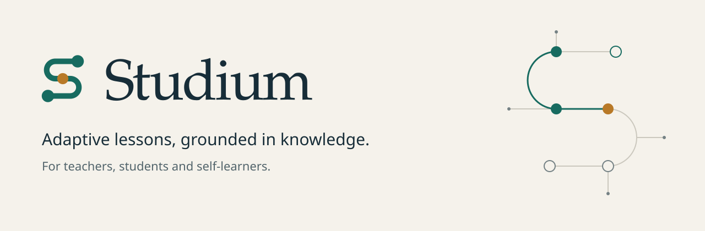
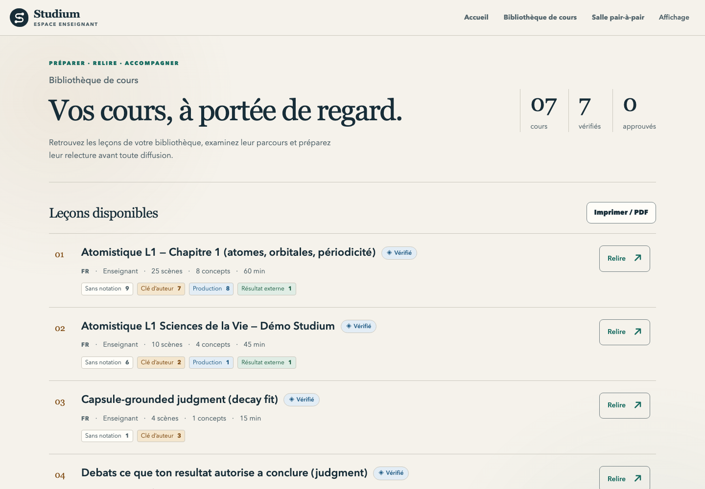

English · [Français](README.fr.md)

<p align="center">
  <picture>
    <source media="(prefers-color-scheme: dark)" srcset="docs/assets/hero-dark.svg">
    
  </picture>
</p>

# Studium

Studium turns sources you trust into adaptive lessons that you can play in VS Code or through your own AI assistant, with assessment that always says who wrote the answer key and whether anything was actually measured.

## Choose your path

| I want to… | Start here | What you get |
|---|---|---|
| Learn a topic on my own with an AI assistant | [Learn with your assistant](docs/learn/learn-with-your-assistant.md) | A lesson built from the sources you chose, then reviews spaced over the following days |
| Study in a class | [Student guide](docs/learn/student-guide.md) | A teacher-approved lesson in VS Code or in your assistant, with feedback after each answer |
| Teach | [Teacher guide](docs/teach/teacher-guide.md) | A sourced lesson, an approval record bound to its exact content, and an aggregated class report |
| Build on Studium | [Architecture](docs/develop/architecture.md) and [MCP tools](docs/reference/mcp-tools.md) | The runtime contracts, the 34 MCP tools and the lesson bundle format |

The [documentation portal](docs/index.md) lists every page by role.

## Screenshots

<table>
  <tr>
    <td width="50%" valign="top">
      <picture>
        <source media="(prefers-color-scheme: dark)" srcset="docs/assets/screenshots/vscode-pane-choices-dark.png">
        
      </picture>
      <br><em>A quiz step in the VS Code lesson pane; the notice on top says who wrote the answer key.</em>
    </td>
    <td width="50%" valign="top">
      <picture>
        <source media="(prefers-color-scheme: dark)" srcset="docs/assets/screenshots/vscode-pane-feedback-dark.png">
        
      </picture>
      <br><em>Feedback after a written answer that no judge assessed: compare with the key points, then rate your recall.</em>
    </td>
  </tr>
</table>

<picture>
  <source media="(prefers-color-scheme: dark)" srcset="docs/assets/screenshots/teacher-library-dark.png">
  
</picture>

<em>The teacher dashboard library: each lesson with who holds its answer keys and its review status.</em>

## Quickstart (5 minutes)

You need git, Node 22 (Node 20 or newer works) and pnpm 9. Python is not needed to learn.

```bash
git clone https://github.com/HolobiomicsLab/studium.git
cd studium
corepack enable        # provides the pnpm version pinned in package.json
./setup.sh             # installs, builds the libraries and the VS Code extension
```

If the clone answers `Repository not found`, the repository is not visible to your account yet: run `gh auth login` and clone again.

Then pick one of the two surfaces.

**In VS Code.** Open the folder `apps/studium-vscode`, press F5 (fn+F5 on a Mac), and in the window that opens run **Studium: Open lesson** from the Command Palette. The demo lessons under `fixtures/` play without an API key or network access.

**In your AI assistant.** Register the Studium MCP server that `setup.sh` built, from the repository root:

```bash
# Claude Code
claude mcp add studium -e BUNDLES_ROOT="$PWD/fixtures" -- node "$PWD/apps/studium-vscode/dist/lesson-mcp.cjs"

# Codex
codex mcp add studium --env BUNDLES_ROOT="$PWD/fixtures" -- node "$PWD/apps/studium-vscode/dist/lesson-mcp.cjs"
```

Restart the assistant and ask: "I want to learn photosynthesis with Studium". The assistant follows the server's instructions: it checks your study plan, gathers sources with its own tools, builds a lesson with `prepare_sources` and `create_lesson`, and asks you the first question. Your progress is kept in `~/.studium/data`; lessons you create go to `~/.studium/library`. Other harnesses (Copilot, OpenCode, Cursor) are covered in [Connect a harness](docs/start/harnesses.md).

More detail: [Quickstart](docs/start/quickstart.md), [Installation](docs/start/installation.md), [Troubleshooting](docs/start/troubleshooting.md).

## What makes Studium different

- **A course is a graph.** Each lesson carries a Learning Workflow Graph: concepts and tasks linked by typed edges such as `prerequisite_for` and `assesses`. Navigation, remediation and the teacher's view all read the same graph. See [How Studium works](docs/concepts/how-studium-works.md).
- **Honest assessment, with provenance.** Every lesson says whether its answer key was written by a teacher, by the learner or by an AI agent, and whether a judge model assessed the answer. Without a judge, an open answer is shown next to the reference for you to compare; it is never given a keyword score. See [Honesty and provenance](docs/concepts/honesty-and-provenance.md).
- **Sourced lessons.** A lesson built from your sources cites a passage for each graded item, and each quote must match its source character for character before the lesson is written.
- **Spaced review.** After a lesson, Studium schedules reviews (FSRS). One call, `get_study_plan`, says what is due across all your lessons. Rating your own recall schedules reviews but never changes measured mastery. See [Review over time](docs/learn/review-over-time.md).
- **Local-first.** Learner state stays on your machine, in folders named by pseudonyms, and you can erase it. Class reports are aggregated, with at least five learners behind each figure. See [Privacy and limits](docs/concepts/privacy-and-limits.md).
- **Any harness.** The same session contract is served over MCP, a local HTTP API and a file channel, so Codex, Claude Code, Copilot, OpenCode or Cursor can drive a lesson. The assistant relays; the learner answers.

## Architecture

<picture>
  <source media="(prefers-color-scheme: dark)" srcset="docs/assets/diagrams/architecture-dark.svg">
  
</picture>

### Repository map

| Area | Where | What it does |
|---|---|---|
| Learner clients | [`apps/studium-vscode`](apps/studium-vscode) | VS Code extension: lesson pane, notebook, chat participant, reviews in the status bar |
| Hosts | [`apps/lesson-mcp`](apps/lesson-mcp), [`packages/lesson-session-host`](packages/lesson-session-host), [`apps/lesson-server`](apps/lesson-server) | MCP server (34 tools), multi-session host with durable state, HTTP adapters |
| Adaptive runtime | [`packages/lesson-session`](packages/lesson-session), [`packages/adaptation-engine`](packages/adaptation-engine), [`packages/learner-state`](packages/learner-state) | Graph-aware navigation, mastery, remediation, hints, calibration, spaced review |
| Contracts | [`packages/lesson-bundle-schema`](packages/lesson-bundle-schema), [`packages/learning-workflow-schema`](packages/learning-workflow-schema), [`packages/telemetry-events`](packages/telemetry-events) | Typed schemas (Zod, with Pydantic mirrors) for lessons, graphs and events |
| Authoring and review | [`services/`](services), [`tools/`](tools), [`eval/`](eval) | Python planner, scene synthesis, ingestion, Observatory, authoring CLI (`tools/experience_packet.py`), evaluation harness |
| Teaching surfaces and identity | [`apps/teacher-dashboard`](apps/teacher-dashboard), [`skills/`](skills), [`design/`](design) | Teacher library and review pages, harness skills, design tokens and components |

## Surfaces and maturity

| Surface | Status | Meaning |
|---|---|---|
| Any MCP harness (Codex, Claude Code, Copilot, OpenCode, Cursor) and the file channel | Supported | Tested in CI, documented, the recommended way in |
| VS Code extension (lesson pane, chat participant) | Supported | Tested in CI, built as a VSIX by CI |
| `lesson-server` (HTTP, answer keys redacted), teacher dashboard, Observatory | Maintained | Kept working and tested; fewer new features |
| Tauri student app ([`apps/student-runtime`](apps/student-runtime)) | Frozen | No new work; built only on manual request |
| [`apps/author-web`](apps/author-web) | Legacy | Kept for the M1 demonstration; use the teacher dashboard instead |

## Status and limits

Studium is a research prototype, version 0.2.0. The adaptive runtime, the authoring tools, the provenance records and the evaluation harness are implemented and tested, but Studium has not been evaluated for learning outcomes. A teacher must review and approve a lesson before students use it. A lesson built by an AI assistant from your sources is labelled as agent-drafted and not teacher-validated. Without a configured judge model, open answers are compared with the reference rather than scored. The HTTP adapter exposes the 25 lesson operations plus `rate_recall`; the other study tools and all authoring and teacher tools are MCP-only. The release workflow can publish to the VS Code Marketplace, Open VSX and npm once their tokens are configured; until then, a release is a GitHub draft with the VSIX and the server file. [Capabilities](docs/concepts/capabilities.md) gives the detail per surface.

## Part of a family

Studium composes four sibling projects of the lab: [Perspicacité](https://github.com/HolobiomicsLab/Perspicacite-AI) grounds prerequisites in literature passages, [indicium](https://github.com/HolobiomicsLab/indicium) represents the graph as evidence-bound claims, [ASTRA](https://github.com/LightconeResearch/astra-spec) records each adaptive decision so it can be replayed, and [ASB](https://github.com/HolobiomicsLab/AgenticScienceBuilder) supplies reproduction capsules and the agentic-step standard.

## Licence

The code is licensed under the [Apache License 2.0](LICENSE). The documentation, the visual identity and the lessons written by the project are licensed under [Creative Commons Attribution 4.0](LICENSES/CC-BY-4.0.txt). Source excerpts quoted in a lesson keep their own licence, named on each source line, and a lesson you build from your own sources belongs to you. Teaching material used by the evaluation harness under `eval/corpus/` is not redistributed; its manifest lists each source's licence. [NOTICE](NOTICE) says which licence covers which folder.

## Citation

If you use Studium in research, cite it with the metadata in [`CITATION.cff`](CITATION.cff). GitHub shows a "Cite this repository" button from that file. No DOI has been assigned yet.

## Contributing and security

- [Contributing](CONTRIBUTING.md): setup, the checks a change must pass, tests first, bilingual documentation.
- [Code of conduct](CODE_OF_CONDUCT.md).
- [Security policy](SECURITY.md): report vulnerabilities privately.
- [Testing Studium](TESTING.md): the guided path for a colleague trying the demo lesson.
- [Changelog](CHANGELOG.md).
