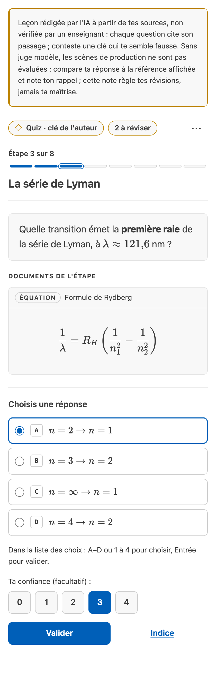

# Studium

Studium turns sources you trust into adaptive lessons. This extension plays a lesson in a pane beside your
editor: one question at a time, with its figures, equations, plots and 3D molecules. Feedback comes after
your answer and says who wrote the answer key and whether anything assessed what you wrote. Reviews bring
each idea back on later days, before you forget it.

Studium is a research prototype from eDIAM (Institut de Chimie de Nice, Université Côte d'Azur, CNRS) and
HolobiomicsLab, under the Apache-2.0 licence. La version française est plus bas.

## Who does what

Knowing this saves the first ten minutes:

| Part | What it does | What it does not do |
|---|---|---|
| **An AI assistant** connected to the Studium server (Copilot in VS Code, which this extension connects for you, Claude Code, Codex, Cursor) | builds a lesson from the sources you name, and can play it with you in the conversation | answer for you |
| **This extension** | shows a lesson in a pane, keeps your progress, tells you when reviews are due | build a lesson: right after installation its **Lessons** view says "No lesson of your own yet" and offers only the demo lesson it ships with |

So a new lesson starts in an assistant. A lesson someone already made plays here with nothing else.

## Try the demo lesson

To see how Studium works, select the **Studium** icon in the activity bar, then **Try the demo lesson**, or
run **Studium: Try the demo lesson** from the Command Palette. « Discover Studium » takes about ten minutes, in
English or French, and ships with the extension: you read a step, answer a quiz with its optional confidence
scale, ask for a hint, write an answer and compare it with the reference, rate your recall, and open the concept
map. An AI agent drafted it from Studium's documentation and no teacher has checked it yet, as its first screen
says. It is not saved as your course and never replaces a lesson of yours.

## Play a lesson you were given

No Node, no terminal and no AI account are needed.

1. Have a folder of lessons: the one your teacher gave you, or the demo lessons, which are the `fixtures`
   folder of the [repository archive](https://github.com/HolobiomicsLab/studium/archive/refs/heads/main.zip) (about 30 MB; unzip it first).
2. Select the **Studium** icon in the activity bar, then **Pick a course**, **Choose another course
   folder…**, and select that folder. The Command Palette offers the same as **Studium: Pick a course**.
3. Choose a course. It opens in a pane, at its first step.

For computers an IT team prepares for a class, see
[Classroom workstations](https://github.com/HolobiomicsLab/studium/blob/main/docs/start/classroom-workstations.md).

## Build a lesson from your own sources

### 1. Connect your assistant to Studium

**Copilot in VS Code, agent mode: nothing to do.** From VS Code 1.101, this extension offers its own Studium
server to Copilot: no Node, no terminal. Run **MCP: List Servers** to see **Studium** in the list. If you
already added `studium` yourself, the extension adds no second one. The setting
`studium.registerMcpServer` turns this off. The first time Copilot calls a Studium tool, open the arrow next to
**Allow Once** and choose **Allow Tools from Studium in this Session** or **Always Allow Tools from Studium**;
otherwise VS Code asks again at each tool. This has not yet been tried in a real Copilot session; see
[Connect Copilot](https://github.com/HolobiomicsLab/studium/blob/main/docs/start/copilot.md).

**Other assistants.** You need Node 20 or later (`node --version`). Run the line for your assistant once, in
a terminal, then restart the assistant:

| Assistant | Command |
|---|---|
| Copilot in VS Code, without this extension | `code --add-mcp '{"name":"studium","command":"npx","args":["-y","studium-mcp"],"env":{"LITELLM_BASE_URL":""}}'` |
| Claude Code | `claude mcp add --scope user studium -e LITELLM_BASE_URL= -- npx -y studium-mcp` |
| Codex | `codex mcp add studium --env LITELLM_BASE_URL= -- npx -y studium-mcp` |

The server is the npm package `studium-mcp`; `npx` fetches it the first time. Studium needs no API key of
its own: the assistant works with the model you already have, a Copilot plan for example. The empty
`LITELLM_BASE_URL=` keeps Studium from calling any paid model. In Cursor, Claude Desktop or another
assistant, declare an MCP server named `studium` whose command is `npx` with the arguments `-y` and
`studium-mcp`; each assistant has its page under [Installation](https://github.com/HolobiomicsLab/studium/blob/main/docs/start/installation.md). Which
model to use, with a Copilot plan or a model on your machine, is in [Choose your model](https://github.com/HolobiomicsLab/studium/blob/main/docs/start/models.md).

### 2. Ask for a lesson

In a new conversation with your assistant (in Copilot Chat, choose the agent mode), in your own words:

> I want to learn how the water cycle works with Studium. Use these two pages: (two links you trust).

The assistant builds a lesson from your sources, shows you its outline and asks the first question. The
lesson is saved on your machine, in `~/.studium/library`. Each step is described in
[Learn with your assistant](https://github.com/HolobiomicsLab/studium/blob/main/docs/learn/learn-with-your-assistant.md).

### 3. Open it here

Building the lesson takes a few minutes; it is done once. Meanwhile the status bar says
**Studium · preparing a lesson…**, and you can try the demo lesson. When the lesson is ready, VS Code tells
you, with **Open**; if you were in another window, the notice waits until you come back. The lesson is also
in the **Lessons** view (select the **Studium** icon in the activity bar). Select it to play it.

For a guided tour in five steps, run **Studium: Getting started**.

## What a lesson looks like

- **One step at a time.** A step is something to read, a question with choices, a short written answer,
  a claim made by an AI to check, or a calculation to run.
- **Feedback that says what was checked.** A tick appears only on an answer marked right, a cross only on one marked
  wrong. An answer that nothing assessed is shown as recorded, with the reference to compare with; you then
  rate your own recall.
- **Reviews.** When no lesson is playing, the status bar says how many ideas are waiting ("Studium · 2 to
  review"), and the sidebar lists them, or gives the date of the next review.
- **Nothing runs without you.** Before a lesson's command runs, the extension shows the exact command and
  the folder, and waits for your choice. It asks again each time, unless you chose to trust that course.
- **Your editor's theme and language.** The interface follows VS Code, in English or French, and works
  with the keyboard and a screen reader.

## Commands

| Command | What it does |
|---|---|
| **Studium: Pick a course** | choose a lesson, or another folder of lessons |
| **Studium: Open lesson** | reopen the current lesson |
| **Studium: Open this lesson** | on a `lesson.json` file (right-click): open that lesson |
| **Studium: Getting started** | the guided tour |
| **Studium: Forget my data** | after confirmation, erase what this extension keeps |

In Copilot Chat, `@studium` plays the current lesson in the conversation.

## Your data

- Your progress and review dates stay on your machine, in the storage VS Code gives this extension. Your
  lessons are files in `~/.studium/library`.
- The extension calls no AI model. A judge model for written answers is optional and off, unless
  `LITELLM_BASE_URL` is set in the environment VS Code was started from.
- Class telemetry is off unless you turn on `studium.telemetryConsent`.
- Copilot, with the Studium server this extension offers, plays the pane's learner (`studium.learnerId`) and
  keeps its progress in the extension's storage: a lesson started in the conversation goes on in the pane at
  the step you reached, and the reverse (finish or close it in one before going on in the other). Another
  assistant, or a Studium server added to VS Code by hand, keeps its own progress: a lesson started there
  starts again from its first step in the pane. **Studium: Forget my data** does not stop the server offered
  to Copilot, so stop **Studium** in **MCP: List Servers** first.

## Requirements

VS Code 1.95 or later. The extension carries its own lesson server and viewer libraries and works offline.
Offering that server to Copilot needs version 1.101 or newer; elsewhere, connecting an assistant (step 1)
needs Node 20 or later.

## Documentation and help

- [Studium in VS Code](https://github.com/HolobiomicsLab/studium/blob/main/docs/start/vscode.md): the pane, the reviews and the settings in detail.
- [The documentation](https://github.com/HolobiomicsLab/studium/blob/main/docs/index.md), for learners, teachers and developers.
- [The Studium site](https://ediam.cnrs.fr/studium/), the project page at eDIAM.
- [Report a problem or suggest a change](https://github.com/HolobiomicsLab/studium/issues).

## En français

Studium transforme des sources que vous jugez fiables en leçons adaptatives. Cette extension joue une leçon
dans un panneau à côté de votre éditeur : une question à la fois, avec ses figures, ses équations, ses
graphiques et ses molécules en 3D. Le retour vient après votre réponse et dit qui a écrit le corrigé et si
quelque chose a évalué ce que vous avez écrit. Les révisions ramènent chaque idée les jours suivants,
avant que vous l'oubliiez.

Studium est un prototype de recherche d'eDIAM (Institut de Chimie de Nice, Université Côte d'Azur, CNRS) et
du HolobiomicsLab, sous licence Apache-2.0.

### Qui fait quoi

Le savoir épargne les dix premières minutes :

| Partie | Ce qu'elle fait | Ce qu'elle ne fait pas |
|---|---|---|
| **Un assistant IA** relié au serveur Studium (Copilot dans VS Code, que cette extension relie pour vous, Claude Code, Codex, Cursor) | construit une leçon à partir des sources que vous nommez, et peut la jouer avec vous dans la conversation | répondre à votre place |
| **Cette extension** | affiche une leçon dans un panneau, garde votre progression, vous dit quand des révisions sont dues | construire une leçon : juste après l'installation, sa vue **Leçons** dit « Pas encore de leçon à vous » et ne propose que la leçon de démonstration livrée avec elle |

Une nouvelle leçon commence donc dans un assistant. Une leçon déjà faite se joue ici sans rien d'autre.

### Essayer la leçon de démonstration

Pour voir comment fonctionne Studium, sélectionnez l'icône **Studium** dans la barre d'activité, puis
**Essayer la leçon de démonstration**, ou lancez **Studium : Essayer la leçon de démonstration** depuis la
palette de commandes. « Découvrir Studium » prend une dizaine de minutes, en français ou en anglais, et est
livrée avec l'extension : vous lisez une étape, répondez à un quiz avec son échelle de confiance facultative,
demandez un indice, rédigez une réponse et la comparez à la référence, notez votre rappel et ouvrez la carte des
notions. Un agent d'IA l'a rédigée à partir de la documentation de Studium et aucun enseignant ne l'a encore
vérifiée, comme le dit son premier écran. Elle n'est pas enregistrée comme votre cours et ne remplace jamais une
de vos leçons.

### Jouer une leçon qu'on vous a donnée

Ni Node, ni terminal, ni compte d'assistant IA ne sont nécessaires.

1. Munissez-vous d'un dossier de leçons : celui que votre enseignant vous a donné, ou les leçons de
   démonstration, qui sont le dossier `fixtures` de l'[archive du dépôt](https://github.com/HolobiomicsLab/studium/archive/refs/heads/main.zip) (environ 30 Mo ;
   décompressez-la d'abord).
2. Sélectionnez l'icône **Studium** dans la barre d'activité, puis **Choisir un cours**, **Choisir un autre
   dossier de cours…**, et sélectionnez ce dossier. La palette de commandes offre la même chose avec
   **Studium : Choisir un cours**.
3. Choisissez un cours. Il s'ouvre dans un panneau, à sa première étape.

Pour des ordinateurs qu'une équipe informatique prépare pour une classe, voir
[Postes de salle de TP](https://github.com/HolobiomicsLab/studium/blob/main/docs/start/classroom-workstations.fr.md).

### Construire une leçon à partir de vos sources

**1. Reliez votre assistant à Studium.** **Copilot dans VS Code, mode agent : rien à faire.** Depuis
VS Code 1.101, cette extension propose son propre serveur Studium à Copilot : ni Node, ni terminal. Lancez
**MCP: List Servers** pour voir **Studium** dans la liste. Si vous avez déjà ajouté `studium` vous-même,
l'extension n'en ajoute pas un second. Le réglage `studium.registerMcpServer` le désactive. La première fois
que Copilot appelle un outil Studium, ouvrez la flèche à côté de **Autoriser une fois** et choisissez
**Autoriser les outils de Studium dans cette session** ou **Toujours autoriser les outils de Studium** ; sinon
VS Code redemande à chaque outil. Cela n'a pas encore été essayé dans une vraie session Copilot ; voir
[Connecter Copilot](https://github.com/HolobiomicsLab/studium/blob/main/docs/start/copilot.fr.md).

**Autres assistants.** Il vous faut Node 20 ou plus récent (`node --version`). Lancez une fois, dans un
terminal, la ligne de votre assistant, puis redémarrez-le :

| Assistant | Commande |
|---|---|
| Copilot dans VS Code, sans cette extension | `code --add-mcp '{"name":"studium","command":"npx","args":["-y","studium-mcp"],"env":{"LITELLM_BASE_URL":""}}'` |
| Claude Code | `claude mcp add --scope user studium -e LITELLM_BASE_URL= -- npx -y studium-mcp` |
| Codex | `codex mcp add studium --env LITELLM_BASE_URL= -- npx -y studium-mcp` |

Le serveur est le paquet npm `studium-mcp` ; `npx` le télécharge la première fois. Studium n'a besoin
d'aucune clé d'API : l'assistant travaille avec le modèle que vous avez déjà, un abonnement Copilot par
exemple. Le `LITELLM_BASE_URL=` vide empêche Studium d'appeler un modèle payant. Dans Cursor, Claude
Desktop ou un autre assistant, déclarez un serveur MCP nommé `studium` dont la commande est `npx` avec les
arguments `-y` et `studium-mcp` ; chaque assistant a sa page sous
[Installation](https://github.com/HolobiomicsLab/studium/blob/main/docs/start/installation.fr.md). Quel modèle utiliser, avec un abonnement Copilot ou un
modèle sur votre machine, est dit dans [Choisir son modèle](https://github.com/HolobiomicsLab/studium/blob/main/docs/start/models.fr.md).

**2. Demandez une leçon.** Dans une nouvelle conversation avec votre assistant (dans Copilot Chat,
choisissez le mode agent), avec vos mots :

> Je veux apprendre comment fonctionne le cycle de l'eau avec Studium. Utilise ces deux pages : (deux liens
> que vous jugez fiables).

L'assistant construit une leçon à partir de vos sources, vous montre son plan et pose la première question.
La leçon est enregistrée sur votre machine, dans `~/.studium/library`. Chaque étape est décrite dans
[Apprendre avec votre assistant](https://github.com/HolobiomicsLab/studium/blob/main/docs/learn/learn-with-your-assistant.fr.md).

**3. Ouvrez-la ici.** Construire la leçon prend quelques minutes ; c'est fait une fois. Pendant ce temps, la
barre d'état indique **Studium · leçon en préparation…**, et vous pouvez essayer la leçon de démonstration.
Quand la leçon est prête, VS Code vous prévient, avec **Ouvrir** ; si vous étiez dans une autre fenêtre, l'avis
attend votre retour. La leçon est aussi dans la vue **Leçons** (icône **Studium** de la barre d'activité).
Sélectionnez-la pour la jouer.

Pour une visite guidée en cinq étapes, lancez **Studium : Prise en main**.

### À quoi ressemble une leçon

- **Une étape à la fois.** Une étape est un texte à lire, une question à choix, une courte réponse rédigée,
  une affirmation d'une IA à vérifier, ou un calcul à lancer.
- **Un retour qui dit ce qui a été vérifié.** Une coche n'apparaît que sur une réponse notée juste, une croix que
  sur une réponse notée fausse. Une réponse que rien n'a évaluée est affichée comme enregistrée, avec la
  référence à laquelle la comparer ; vous évaluez alors vous-même votre rappel.
- **Les révisions.** Quand aucune leçon n'est en cours, la barre d'état dit combien d'idées attendent
  (« Studium · 2 à réviser »), et la barre latérale les liste, ou donne la date de la prochaine révision.
- **Rien ne s'exécute sans vous.** Avant qu'une commande d'une leçon s'exécute, l'extension montre la
  commande exacte et le dossier, et attend votre choix. Elle redemande à chaque fois, sauf si vous avez
  choisi de faire confiance à ce cours.
- **Le thème et la langue de votre éditeur.** L'interface suit VS Code, en français ou en anglais, et
  fonctionne au clavier et avec un lecteur d'écran.

### Commandes

| Commande | Ce qu'elle fait |
|---|---|
| **Studium : Choisir un cours** | choisir une leçon, ou un autre dossier de leçons |
| **Studium : Ouvrir une leçon** | rouvrir la leçon courante |
| **Studium : Ouvrir cette leçon** | sur un fichier `lesson.json` (clic droit) : ouvrir cette leçon |
| **Studium : Prise en main** | la visite guidée |
| **Studium : Oublier mes données** | après confirmation, effacer ce que cette extension garde |

Dans Copilot Chat, `@studium` joue la leçon courante dans la conversation.

### Vos données

- Votre progression et vos dates de révision restent sur votre machine, dans l'espace de stockage que
  VS Code donne à cette extension. Vos leçons sont des fichiers dans `~/.studium/library`.
- L'extension n'appelle aucun modèle d'IA. Un modèle juge pour les réponses rédigées est facultatif et
  désactivé, sauf si `LITELLM_BASE_URL` est défini dans l'environnement d'où VS Code a été lancé.
- La télémétrie de classe est désactivée tant que vous n'activez pas `studium.telemetryConsent`.
- Copilot, avec le serveur Studium que propose cette extension, joue l'apprenant du panneau
  (`studium.learnerId`) et garde sa progression dans l'espace de stockage de l'extension : une leçon
  commencée dans la conversation se poursuit dans le panneau à l'étape où vous en étiez, et inversement
  (terminez-la ou fermez-la dans l'un avant de continuer dans l'autre). Un autre assistant, ou un serveur
  Studium ajouté à la main dans VS Code, garde sa propre progression : une leçon commencée là reprend à sa
  première étape dans le panneau. **Studium : Oublier mes données** n'arrête pas le serveur proposé à
  Copilot : arrêtez d'abord **Studium** dans **MCP: List Servers**.

### Prérequis

VS Code 1.95 ou plus récent. L'extension embarque son propre serveur de leçons et ses bibliothèques
d'affichage, et fonctionne hors ligne. Proposer ce serveur à Copilot demande la version 1.101 ou plus
récente ; ailleurs, relier un assistant (étape 1) demande Node 20 ou plus récent.

### Documentation et aide

- [Studium dans VS Code](https://github.com/HolobiomicsLab/studium/blob/main/docs/start/vscode.fr.md) : le panneau, les révisions et les réglages en détail.
- [La documentation](https://github.com/HolobiomicsLab/studium/blob/main/docs/index.fr.md), pour les apprenants, les enseignants et les développeurs.
- [Le site de Studium](https://ediam.cnrs.fr/studium/), la page du projet chez eDIAM.
- [Signaler un problème ou proposer un changement](https://github.com/HolobiomicsLab/studium/issues).
