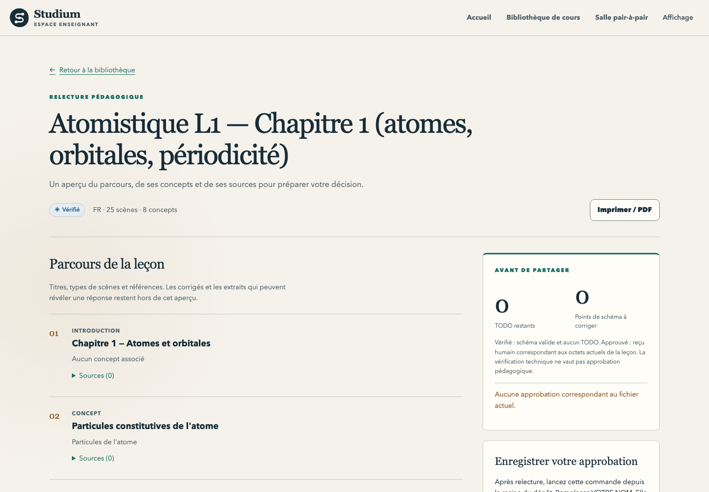

[English](README.md) · Français

# Tableau de bord enseignant

Une application web locale pour les enseignants : parcourir et relire les leçons d'une bibliothèque,
voir si chacune est un brouillon, vérifiée ou approuvée, et lire des analyses à l'échelle de la classe
(progression, calibration, raisonnement, confiance) derrière un plancher de cinq apprenants.

<picture>
  <source media="(prefers-color-scheme: dark)" srcset="../../docs/assets/screenshots/teacher-library-dark.png">
  
</picture>

| | |
|---|---|
| Statut | **maintenu** (décision D6) |
| Lancer | `pnpm --filter @studium/teacher-dashboard dev` (développement) ou `build` puis `start` |
| Port | 3001 |
| Appelle | collecteur d'analyses (8003), serveur de leçons (8010), scene-synth (8002) pour les contributions des apprenants, Observatory (8004) pour les liens vers les rapports |
| Tests | `pnpm --filter @studium/teacher-dashboard test` ; tests navigateur avec `test:e2e` |

Guide d'utilisation : [Relire et approuver une leçon](../../docs/teach/review-and-approve.fr.md) et
[Suivre une classe](../../docs/teach/follow-a-class.fr.md).

## Le lancer

Pour les leçons d'exemple du dépôt, depuis la racine :

```bash
BUNDLES_ROOT="$PWD/fixtures" pnpm --filter @studium/teacher-dashboard dev
```

Une construction de production :

```bash
NEXT_TELEMETRY_DISABLED=1 pnpm --filter @studium/teacher-dashboard build
pnpm --filter @studium/teacher-dashboard start
```

Ouvrez `http://localhost:3001`. La page d'accueil mène à la bibliothèque (`/library`) ; un identifiant
de cours saisi sur cette page ouvre ses analyses sous `/courses/<id>/…`.

## Configuration

| Variable | Valeur par défaut | Rôle |
|---|---|---|
| `BUNDLES_ROOT` | `$STUDIUM_HOME/library` | dossier de la bibliothèque ; il peut contenir directement `lesson.json` ou des dossiers de leçons imbriqués |
| `STUDIUM_HOME` | `~/.studium` | utilisé si `BUNDLES_ROOT` n'est pas défini |
| `ANALYTICS_BASE_URL` | `http://localhost:8003` | [collecteur d'analyses](../../services/analytics-collector/README.fr.md) |
| `LESSON_SERVER_BASE_URL` | `http://localhost:8010` | [serveur de leçons](../lesson-server/README.fr.md) (salles entre pairs) |
| `SCENE_SYNTH_BASE_URL` | `http://localhost:8002` | [scene-synth](../../services/scene-synth/README.fr.md) (modération des contributions des apprenants) |
| `OBSERVATORY_BASE_URL` | `http://localhost:8004` | [Observatory](../../services/observatory/README.fr.md) |

Une page de relecture interroge l'API MySTRA de l'Observatory avec le nom du dossier de la leçon. Elle
renvoie vers le rapport seulement s'il existe ; sinon elle explique comment lancer ou configurer
l'Observatory. Le tableau de bord ne crée pas d'enregistrement MySTRA et ne déduit pas de rapport d'un
identifiant de bundle.

La langue suit le cookie `studium-locale` (`fr` ou `en`) avant `Accept-Language`. Le menu d'affichage de
l'en-tête enregistre langue et thème ; `studium-theme` accepte `light`, `dark` ou `system`. Les textes
d'analyse existants restent en français.

## Statuts et contrat de relecture

| Statut | Signification |
| --- | --- |
| Brouillon | Le bundle échoue à son schéma ou contient encore un TODO. |
| Vérifiée | Le bundle passe le schéma partagé et ne contient aucun TODO. Cela ne prétend ni à un lint complet ni à une approbation humaine. |
| Approuvée | Un enregistrement `studium-approval/1` complet correspond au SHA-256 des octets exacts de `lesson.json`. |

Un enregistrement d'approbation doit contenir un relecteur, un horodatage, une liste de contrôle, un lint
réussi et l'identifiant de l'outil, tels qu'écrits par `tools/experience_packet.py approve`. Modifier ne
serait-ce qu'un espace dans la leçon rompt la correspondance d'empreinte. Une métadonnée libre
`validated_by` n'accorde jamais ce statut. La correspondance d'un enregistrement ancien ne dépend pas des
évolutions ultérieures du validateur de schéma installé.

La page de relecture affiche les titres, types de scène, notions et références bibliographiques et, replié
sous chaque ligne de la boîte de relecture, le visage public de la scène : ce que lit l'apprenant (les 280
premiers caractères de son texte) et le texte des choix d'un quiz dans l'ordre de rédaction. Elle n'envoie
au navigateur aucun champ de notation (le choix juste, rétroactions, indices, affirmations, points clés,
corrigés) ni aucun extrait de preuve. La commande d'approbation affichée cite le chemin local exact et doit être lancée depuis la
racine du dépôt ; la page elle-même n'écrit rien. Pour une leçon d'auto-apprentissage, la page affiche la
règle de refus de l'outil au lieu d'une commande vouée à l'échec.

Au-dessus du parcours, la boîte de relecture donne une ligne par scène, triée selon ce que coûterait
une erreur à cet endroit : bloque (erreur de schéma ou TODO dans la scène), note (la scène porte une
clé), formulation, média. Chaque ligne dit si la scène est nouvelle, modifiée ou inchangée depuis le
dernier reçu du dossier `reviews/` de la leçon, et donne les vérifications automatiques (schéma, TODO,
lint). `readLesson` lance le linter dans le processus (`lintBundleData` de `tools/bundle_lint.mjs`, comme
`review_lesson`) : une ERROR de lint qui nomme une scène la rend bloquante ; les messages du linter
n'atteignent jamais la page. Quand le linter ne peut pas tourner, la vérification lint disparaît de chaque
ligne et la page le dit en une ligne (`lintUnavailable`). Pour une ligne
« note », l'avis automatique reste replié tant que l'enseignant n'a pas cliqué Correct ou À corriger.
Avant l'approbation, la page signale, sans bloquer, les lignes « note » non ouvertes. Une ligne « note » n'est jamais comptée ouverte par la page, puisqu'elle n'affiche aucune clé. La page n'écrit
toujours rien : les identifiants ouverts à l'écran entrent dans l'option `--opened` des deux commandes
affichées, `experience_packet.py approve` et `experience_packet.py receipt --decision returned` (renvoyer
la leçon), et le reçu est écrit quand l'enseignant en lance une. Les empreintes des scènes n'atteignent
jamais le navigateur.

Correct et À corriger passent dans ces commandes sous la forme d'une seule option `--verdict`, ordonnée comme les scènes, puis dans le reçu ; une ligne inchangée montre l'avis précédent, tandis qu'À corriger place la commande de renvoi en premier puisque la CLI refuse l'approbation.

Le panneau d'approbation a un champ pour le nom de l'enseignant : les deux commandes le reprennent, et le
panneau montre la ligne que les apprenants liront sur chaque écran, « Leçon validée par NOM » / "validated
by NOM", avec une note quand le nom est une adresse électronique (les apprenants la verraient). Rien n'est
refusé ; le nom reste sur la page jusqu'à ce que l'enseignant lance la commande.
Sur la page française, les deux commandes finissent par `--lang fr` : l'outil affiche alors son
résumé et ses refus en français ; les fichiers qu'il enregistre sont les mêmes dans les deux langues.

<picture>
  <source media="(prefers-color-scheme: dark)" srcset="../../docs/assets/screenshots/teacher-review-dark.png">
  
</picture>

## Frontière du système de fichiers

Les lectures restent sous la racine canonique de la bibliothèque. Les références de route sont des
encodages base64url canoniques de noms de dossiers relatifs ; chemins absolus, remontées, barres
obliques inverses, NUL et dossiers ou fichiers enfants liés sont refusés. Chaque fichier doit être
ordinaire et faire au plus 10 Mio. Le parcours s'arrête à huit niveaux et 500 leçons ; les dossiers
illisibles ou ignorés sont signalés à côté des leçons saines.

L'ouverture utilise `O_NOFOLLOW`, puis revérifie l'identité et le confinement du dossier et du fichier.
Un test déterministe couvre un dossier remplacé par un lien symbolique pendant l'ouverture. Ces
vérifications détectent les substitutions observées ; cette application locale suppose des auteurs de
bibliothèque de confiance et ne prétend pas isoler d'un processus qui remplacerait sans cesse des
éléments du chemin.

Une leçon absente reçoit un 404. JSON invalide, fichier illisible ou racine indisponible reçoivent un
message de réparation localisé, sans erreur amont. Un fichier d'approbation absent, mal formé, périmé ou
lié n'accorde jamais l'approbation.

## Thème

`app/globals.css` importe `../../../design/tokens.css` : les [jetons de design](../../design/README.fr.md)
canoniques sont intégrés directement par Next. Les styles d'analyse, de bibliothèque et de relecture les
partagent. Les graphiques ont une légende et un tableau de données ; la feuille d'impression révèle ces
tableaux et garde le titre du cours. Aucune police web ni ressource distante n'est nécessaire.

## Tests

```bash
pnpm --filter @studium/teacher-dashboard test
pnpm --filter @studium/teacher-dashboard exec tsc --noEmit
pnpm --filter @studium/teacher-dashboard test:e2e     # Playwright, tests/integration
```

Les instructions de capture des copies d'écran sont dans
[`docs/assets/screenshots/v2-verification.md`](../../docs/assets/screenshots/v2-verification.md).
