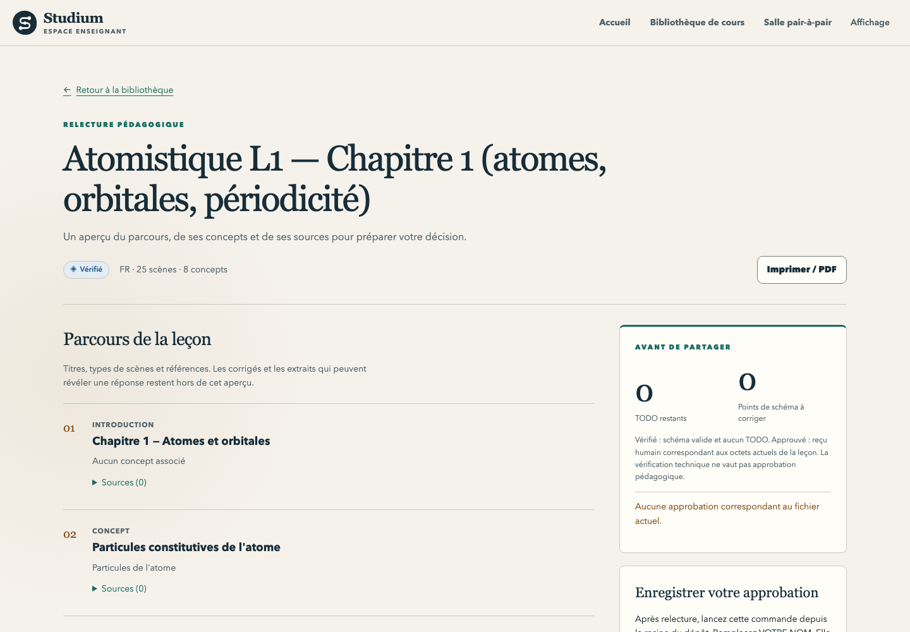

English · [Français](README.fr.md)

# Teacher dashboard

A local web app for teachers: browse and review the lessons in a library, see whether each one is a
draft, checked or approved, and read class-level analytics (progress, calibration, reasoning, trust)
behind a floor of five learners.

<picture>
  <source media="(prefers-color-scheme: dark)" srcset="../../docs/assets/screenshots/teacher-library-dark.png">
  
</picture>

| | |
|---|---|
| Status | **maintained** (decision D6) |
| Run | `pnpm --filter @studium/teacher-dashboard dev` (development) or `build` then `start` |
| Port | 3001 |
| Calls | analytics collector (8003), lesson server (8010), scene-synth (8002) for learner contributions, Observatory (8004) for report links |
| Tests | `pnpm --filter @studium/teacher-dashboard test`; browser tests with `test:e2e` |

User guide: [Review and approve a lesson](../../docs/teach/review-and-approve.md),
[Follow a class](../../docs/teach/follow-a-class.md) and
[Learner contributions](../../docs/teach/learner-contributions.md).

On `/courses/<id>/submissions`, approving a learner's item needs the teacher's name, typed in the
field above the queue: learners read it as "Lesson contributed by a classmate, validated by <name>".
The browser posts it as `reviewer_name` to the dashboard's own `/api/learner-items/<id>/decide`,
which refuses an empty name, more than 200 characters, a control character or a `urn:` identifier,
and calls scene-synth from the server with `STUDIUM_REVIEW_TOKEN`. The name is remembered in this
browser's local storage only. A decision also needs a signed-in session: see [Sign in](#sign-in).

## Run it

For the repository's teaching fixtures, from the repository root:

```bash
BUNDLES_ROOT="$PWD/fixtures" pnpm --filter @studium/teacher-dashboard dev
```

A production build:

```bash
NEXT_TELEMETRY_DISABLED=1 pnpm --filter @studium/teacher-dashboard build
pnpm --filter @studium/teacher-dashboard start
```

Open `http://localhost:3001`. The home page leads to the library (`/library`); a course id typed there
opens its analytics under `/courses/<id>/…`.

## Sign in

Set an access code on the dashboard's server, at least 16 characters, for example:

```bash
export STUDIUM_DASHBOARD_ACCESS_CODE="$(openssl rand -hex 16)"
```

Give it to the teachers who use this dashboard. With the code set, every page and API route asks for
it: a page sends you to `/login`, then back to the page you asked for; an API call without a session
gets `401`. The session is a signed cookie (`studium_teacher_session`, `HttpOnly`, `SameSite=Strict`,
`Secure` over https) that lasts 12 hours. **Sign out** in the header ends it. Changing the code ends
every session. After 10 wrong codes in 5 minutes, sign-in answers `429` until the window passes; this
count lives in the server process's memory.

Without the code (or with a shorter value, which the server reports once on its error output), the
dashboard is open to anyone who can reach its port, as before: pages, the lesson review pages and class
aggregates. A notice in the header says so, and every decision on a learner contribution is refused
(`503`) until the code is set. Keep such a dashboard on `localhost`.

The session says that the browser knew the code. It does not say who the teacher is: the reviewer's
name on an approval is the name typed in the queue. Details and limits: [SECURITY.md](../../SECURITY.md#decisions-on-learner-contributions).

## Configuration

| Variable | Default | Meaning |
|---|---|---|
| `BUNDLES_ROOT` | `$STUDIUM_HOME/library` | library folder; it may hold `lesson.json` directly or nested lesson folders |
| `STUDIUM_HOME` | `~/.studium` | used when `BUNDLES_ROOT` is unset |
| `ANALYTICS_BASE_URL` | `http://localhost:8003` | [analytics collector](../../services/analytics-collector/README.md) |
| `LESSON_SERVER_BASE_URL` | `http://localhost:8010` | [lesson server](../lesson-server/README.md) (peer rooms) |
| `SCENE_SYNTH_BASE_URL` | `http://localhost:8002` | [scene-synth](../../services/scene-synth/README.md) (moderation of learner contributions) |
| `STUDIUM_REVIEW_TOKEN` | none | teacher review token, same value as on scene-synth, read by the server only; decisions on [learner contributions](../../docs/teach/learner-contributions.md) are disabled without it |
| `STUDIUM_DASHBOARD_ACCESS_CODE` | none | teacher access code, at least 16 characters, read by the server only; with it every page and API route needs a session ([Sign in](#sign-in)); without it the dashboard is open and decisions are disabled |
| `OBSERVATORY_BASE_URL` | `http://localhost:8004` | [Observatory](../../services/observatory/README.md) |

A review page probes the Observatory's MySTRA API for the lesson folder's name. It links to the report
only when that report exists; otherwise it explains how to start or configure the Observatory. The
dashboard does not create MySTRA records or infer a report from a bundle id.

Language uses the `studium-locale` cookie (`fr` or `en`) before `Accept-Language`. The header's display
menu saves language and theme; `studium-theme` accepts `light`, `dark` or `system`. Existing analytics
copy remains French.

## Status and review contract

| Status | Meaning |
| --- | --- |
| Draft | The bundle fails its schema or still contains a TODO placeholder. |
| Checked | The bundle passes the shared schema and contains no TODO. This does not claim a full lint run or human approval. |
| Approved | A valid `studium-approval/1` record matches the SHA-256 of the exact `lesson.json` bytes. |

The dashboard reads an approval record by the lesson host's rule (`parseApproval` in
`packages/lesson-session-host/src/authoring.ts`), so a lesson reads approved here exactly when it does for
learners: the schema is `studium-approval/1`, `reviewer` is a non-empty string and `bundle_sha256` is the
SHA-256 of the exact `lesson.json` bytes. The other fields that `tools/experience_packet.py approve` or
scene-synth write (timestamp, checklist, lint summary, tool) are not required; the review page shows the
reviewer and the date when the record has them, and nothing in their place when it does not. A record that
cannot be parsed or lacks one of the three required fields reads as no approval. Changing even whitespace in the lesson
breaks the digest match. Free-form `validated_by` metadata never grants this status. Matching a
historical record does not depend on later changes to the installed schema validator.

The review page shows titles, scene types, concepts and bibliographic references, and, folded under each
inbox line, the scene's public face: what the learner reads (its first 280 characters of text) and a quiz's
choice texts in authored order. It sends no grading field (which choice is correct, feedback, hints, claims,
key points, reveals) and no evidence excerpt to the browser. The approval command it
displays quotes the exact local file path and must be run from the repository root; the page itself writes
nothing. Self-study lessons show the tool's refusal rule instead of a command that cannot succeed.

Above the outline, the review inbox lists one line per scene, sorted by what a mistake there would
cost: blocks (a schema error or TODO on the scene), grading (the scene holds a key), wording, media.
Each line says whether the scene is new, changed or unchanged since the last receipt in the lesson
folder's `reviews/`, and gives the automatic checks (schema, TODO, lint). `readLesson` runs the bundle
linter in process (`lintBundleData` from `tools/bundle_lint.mjs`, as `review_lesson` does), so a lint
ERROR naming a scene makes it blocking; the linter's messages never reach the page. When the linter
cannot run, the lint check is left out of every line and the page says so in one line
(`lintUnavailable`). For a grading line, the automatic verdict stays folded until the teacher
clicks Correct or To fix. Before approving, the page warns, without blocking, about grading lines not
opened. A grading line is never counted opened by the page, because it shows no key. The page still writes nothing: the ids opened on screen go into `--opened` of the two commands
it shows, `experience_packet.py approve` and `experience_packet.py receipt --decision returned` (send the
lesson back), and the receipt is written when the teacher runs one. Scene fingerprints never reach the
browser.

Correct and To fix travel in those commands as one scene-ordered `--verdict` flag and into the receipt; an unchanged row shows its previous verdict, while To fix puts the send-back command first because the CLI refuses approval.

The approval panel has a field for the teacher's name: both commands carry it, and the panel shows the
line learners will read on every screen, « Leçon validée par NAME » / "validated by NAME", with a note
when the name is an e-mail address (learners would see it). Nothing is refused; the name stays on the page
until the teacher runs the command.
On the French page both commands end with `--lang fr`, so the CLI prints its summary and its
refusals in French; the files it records are the same in either language.

<picture>
  <source media="(prefers-color-scheme: dark)" srcset="../../docs/assets/screenshots/teacher-review-dark.png">
  
</picture>

## Filesystem boundary

Reads stay under the canonical library root. Route references are canonical base64url encodings of
relative folder names; absolute paths, traversal, backslashes, NULs and linked child folders or files are
refused. Each file must be regular and at most 10 MiB. Traversal stops at eight levels and 500 lessons;
unreadable or skipped folders are reported next to healthy lessons.

Opening uses `O_NOFOLLOW`, then rechecks folder and file identity and confinement. A deterministic test
covers a folder replaced by a symlink during opening. These checks detect observed swaps; this local
application assumes trusted library writers and does not claim isolation against a process that keeps
replacing path components.

Missing lessons get a 404. Invalid JSON, unreadable files and unavailable roots get a localized repair
message without upstream errors. A missing, malformed, stale or linked approval file never grants approval.

## Theme

`app/globals.css` imports `../../../design/tokens.css`, so the canonical [design tokens](../../design/README.md)
are bundled directly by Next. Analytics, library and review styles share them. Charts include captions and
data tables; print CSS reveals those tables and keeps the course heading. No webfont or remote asset is
needed.

## Tests

```bash
pnpm --filter @studium/teacher-dashboard test
pnpm --filter @studium/teacher-dashboard exec tsc --noEmit
pnpm --filter @studium/teacher-dashboard test:e2e     # Playwright, tests/integration
```

The browser capture instructions for the screenshots are in
[`docs/assets/screenshots/v2-verification.md`](../../docs/assets/screenshots/v2-verification.md).
