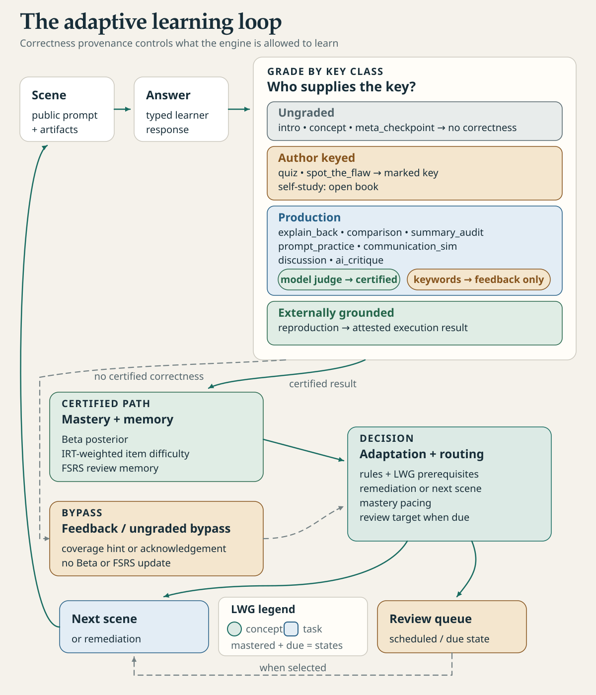

[English](how-studium-works.md) · Français

# Comment fonctionne Studium

Studium joue une leçon comme une suite de scènes rattachées à un graphe explicite de concepts. Chaque réponse est évaluée par celui qui détient sa clé, seules les preuves évaluées font évoluer la maîtrise, et des révisions espacées ramènent un concept quand son rappel s'estompe. Cette page présente la boucle entière ; chaque partie a sa propre page.

<picture>
  <source media="(prefers-color-scheme: dark)" srcset="../assets/diagrams/learning-loop-dark.svg">
  
</picture>

## Le bundle de leçon

Une leçon tient dans un fichier, `lesson.json`, appelé *bundle de leçon*. Il contient :

- les métadonnées : titre, langue et auteur de la leçon (`metadata.authoring`) ;
- les concepts et le Learning Workflow Graph (graphe de parcours) qui les relie ;
- les scènes, dans l'ordre, chacune rattachée à un ou plusieurs concepts ;
- les règles d'adaptation et, si besoin, des *univers* (un parcours de base et une variante de remédiation plus guidée) ;
- `validated_by`, le nom écrit par `approve`, ou un marqueur `DRAFT` / `SELF-STUDY`. Que la leçon soit validée se lit dans son registre d'approbation (`approval.json`), jamais dans ce texte.

Le format est décrit dans la [référence du bundle](../reference/lesson-bundle.fr.md). Pour vérifier un bundle :

```bash
node tools/bundle_lint.mjs chemin/vers/lesson.json
```

Une leçon peut avoir quatre origines :

| Origine | Fabrication | Rédigée par | Validée par un enseignant |
|---|---|---|---|
| Cours d'enseignant | `tools/experience_packet.py` (`passages`, `prepare`, `check`, `bundle`), puis `approve` | l'enseignant | oui, après approbation |
| Leçon tirée de vos sources, en conversation | outils MCP `get_authoring_guide`, `prepare_sources`, `create_lesson` | un agent | non |
| Auto-apprentissage à partir de vos références | `experience_packet.py bundle --self-study` | l'apprenant | non |
| Contribution d'apprenant | proposée par un apprenant, relue puis diffusée par un enseignant | l'apprenant | oui, une fois diffusée |

Voir [Apprendre avec votre assistant](../learn/learn-with-your-assistant.fr.md) et [Rédiger une leçon](../teach/author-a-lesson.fr.md).

## Les scènes

Une scène est une étape de la leçon : une introduction, un concept, une question, un texte à auditer, une reproduction à exécuter. Il existe 13 types de scènes. Chacun attend une réponse typée : un choix, un texte, un niveau de confiance ou un résultat d'exécution ne sont pas interchangeables. Chaque type appartient à une *classe de clé*, qui dit qui peut l'évaluer. Voir [Types de scènes](scene-types.fr.md).

Aucune clé n'est montrée avant la réponse, sur aucune surface. La réponse de référence et les passages cités d'une scène évaluée arrivent après la réponse, quand l'apprenant quitte la scène pour de bon.

## Le graphe

Le Learning Workflow Graph (LWG) comporte deux sortes de nœuds, les *concepts* et les *tâches*, reliés par des arêtes typées : `prerequisite_for`, `part_of`, `decomposes_into`, `assesses`, `aligns_with`. Le graphe fait partie du bundle : un enseignant peut le lire et le corriger.

Un concept devient accessible quand chacun de ses prérequis directs atteint une maîtrise de 0,8 (0,6 dans un univers marqué `lenient`). Si un prérequis manque, la séance peut y conduire l'apprenant, puis revenir. Le graphe est visible dans le panneau VS Code et via `get_workflow_graph`.

## Maîtrise et adaptation

Pour chaque concept, Studium tient une estimation bêta de la maîtrise, nourrie uniquement par des réponses réellement évaluées : un choix noté, un jeu de verdicts comparé à sa clé, ou un juge modèle. Une correspondance de mots-clés ne compte jamais. Les indices réduisent le crédit d'une bonne réponse. La maîtrise n'est certifiée qu'après au moins trois tentatives évaluées et une estimation d'au moins 0,8.

Après chaque réponse, les règles d'adaptation du bundle et le graphe décident de la suite : rejouer après des erreurs répétées, passer un concept déjà maîtrisé, afficher un panneau de calibration quand la confiance déclarée et la maîtrise mesurée divergent, ou faire un détour par un prérequis. `explain_last_adaptation` renvoie la règle appliquée et son *modulateur*, l'étiquette de son intention pédagogique. Voir [Modèle de l'apprenant](learner-model.fr.md) et [Modulateurs](modulators.fr.md).

## Réviser sur plusieurs jours

Chaque réponse évaluée, et chaque auto-évaluation, met à jour une mémoire FSRS par concept : sa stabilité et la probabilité que l'apprenant s'en souvienne maintenant. `get_study_plan` liste ce qui est dû, toutes leçons confondues, et `start_review_session` le joue. Une auto-évaluation règle les révisions mais ne modifie jamais la maîtrise. Voir [Réviser dans la durée](../learn/review-over-time.fr.md).

## Qui a écrit la clé

Chaque démarrage de leçon et chaque présentation portent un bloc `authoring` : qui a rédigé la leçon, si un enseignant l'a validée, si un juge modèle est configuré, le registre d'approbation s'il existe, et un avis pour les leçons qu'aucun enseignant n'a écrites. Une leçon rédigée par un assistant à partir de vos sources l'indique dès son premier écran. Voir [Honnêteté et provenance](honesty-and-provenance.fr.md).

## Les surfaces

Le même contrat de séance est servi à toutes les surfaces.

| Surface | Statut |
|---|---|
| Tout harnais MCP (Codex, Claude Code, Copilot, OpenCode, Cursor), et le canal fichier pour les harnais sans MCP | pris en charge |
| Extension VS Code : panneau de leçon et participant de chat | pris en charge |
| `lesson-server` (HTTP, clés de réponse masquées), tableau de bord enseignant, Observatory | maintenu |
| Application étudiante Tauri (`apps/student-runtime`) | gelée |
| `author-web` | historique |

Studium garde la leçon, les clés, la progression et le protocole d'exécution. Le harnais possède ses outils, son modèle et son environnement d'exécution : il relaie les scènes et lance les reproductions, l'apprenant répond, l'enseignant décide de ce qui est diffusé. Voir [Harnais](../start/harnesses.fr.md), [VS Code](../start/vscode.fr.md) et [Architecture](../develop/architecture.fr.md).
