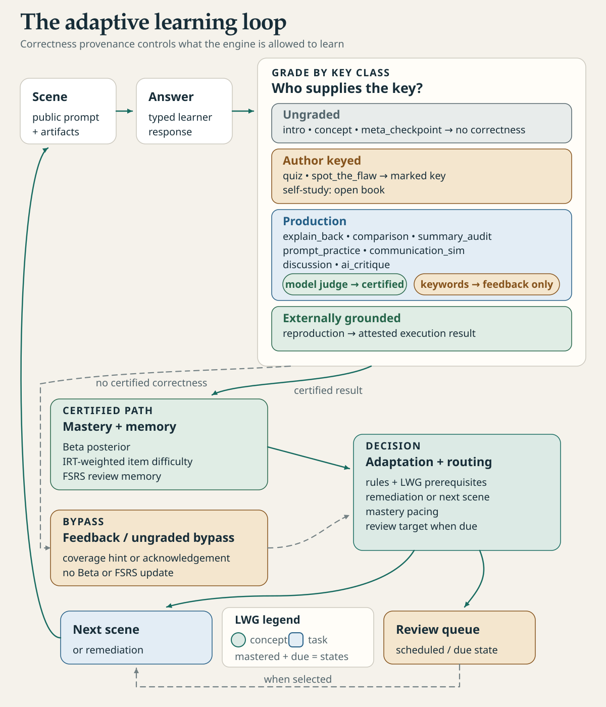

English · [Français](how-studium-works.fr.md)

# How Studium works

Studium plays a lesson as a series of scenes tied to an explicit graph of concepts. Each answer is graded by whoever holds its key, only graded evidence moves the learner's mastery, and spaced reviews bring a concept back when recall fades. This page shows the whole loop; each part has its own page.

<picture>
  <source media="(prefers-color-scheme: dark)" srcset="../assets/diagrams/learning-loop-dark.svg">
  
</picture>

## The lesson bundle

A lesson is one file, `lesson.json`, called a *lesson bundle*. It holds:

- metadata: title, language, and who drafted the lesson (`metadata.authoring`);
- the concepts and the Learning Workflow Graph that links them;
- the scenes, in order, each tied to one or more concepts;
- adaptation rules, and optionally *universes* (a baseline and a more scaffolded remedial variant);
- `validated_by`, the name `approve` wrote, or a `DRAFT` / `SELF-STUDY` placeholder. Whether the lesson is validated is read from its approval record (`approval.json`), never from this text.

The format is described in the [lesson bundle reference](../reference/lesson-bundle.md). Check any bundle with:

```bash
node tools/bundle_lint.mjs path/to/lesson.json
```

A lesson can come from four places:

| Origin | How it is made | Drafted by | Teacher-validated |
|---|---|---|---|
| Teacher course | `tools/experience_packet.py` (`passages`, `prepare`, `check`, `bundle`), then `approve` | teacher | yes, once approved |
| Lesson from your sources, in a conversation | MCP tools `get_authoring_guide`, `prepare_sources`, `create_lesson` | agent | no |
| Self-study from your references | `experience_packet.py bundle --self-study` | learner | no |
| Learner contribution | proposed by a learner, reviewed and released by a teacher | learner | yes, once released |

See [Learn with your assistant](../learn/learn-with-your-assistant.md) and [Author a lesson](../teach/author-a-lesson.md).

## Scenes

A scene is one step of the lesson: an introduction, a concept, a question, a text to audit, a reproduction to run. There are 13 scene types. Each expects a typed answer: a choice, a text, a confidence level or a run result are not interchangeable. Each type belongs to a *key class* that says who can grade it. See [Scene types](scene-types.md).

The learner never sees a key before answering, on any surface. The reference answer and the cited source passages of a graded scene are released after the answer, when the learner leaves the scene for good.

## The graph

The Learning Workflow Graph (LWG) has two kinds of nodes, *concepts* and *tasks*, and typed edges: `prerequisite_for`, `part_of`, `decomposes_into`, `assesses`, `aligns_with`. The graph is part of the bundle, so a teacher can read and correct it.

A concept becomes available once each of its direct prerequisites reaches a mastery of 0.8 (0.6 in a universe marked `lenient`). When a prerequisite is missing, the session can route the learner to it first and then return. The graph is visible in the VS Code pane and through `get_workflow_graph`.

## Mastery and adaptation

For each concept Studium keeps a Beta estimate of mastery, fed only by answers that were actually graded: a marked choice, a verdict deck scored against its key, or a model judge. A keyword match never counts. Hints reduce the credit of a correct answer. Mastery is certified only after at least three graded attempts and a posterior of 0.8 or more.

After each answer, the bundle's adaptation rules and the graph decide what comes next: replay after repeated errors, skip a concept already mastered, show a calibration panel when declared confidence and measured mastery diverge, or detour to a prerequisite. `explain_last_adaptation` returns the rule that fired and its *modulator*, the label of its pedagogical intent. See [Learner model](learner-model.md) and [Modulators](modulators.md).

## Reviews over days

Each graded answer, and each self-rating, updates an FSRS memory per concept: how stable the memory is and how likely the learner is to recall it now. `get_study_plan` lists what is due across all lessons, and `start_review_session` plays it. A self-rating schedules reviews but never moves mastery. See [Review over time](../learn/review-over-time.md).

## Who wrote the key

Every lesson start and every presentation carries an `authoring` block: who drafted the lesson, whether a teacher validated it, whether a judge model is configured, an approval record if one exists, and a notice for lessons no teacher wrote. A lesson an assistant drafted from your sources says so on its first screen. See [Honesty and provenance](honesty-and-provenance.md).

## Surfaces

The same session contract is served to every surface.

| Surface | Status |
|---|---|
| Any MCP harness (Codex, Claude Code, Copilot, OpenCode, Cursor), and the file channel for harnesses without MCP | supported |
| VS Code extension: lesson pane and chat participant | supported |
| `lesson-server` (HTTP, answer keys redacted), teacher dashboard, Observatory | maintained |
| Tauri student app (`apps/student-runtime`) | frozen |
| `author-web` | legacy |

Studium keeps the lesson, the keys, the progression and the run protocol. The harness owns its tools, its model and its execution environment: it relays scenes and runs reproductions, the learner answers, and the teacher decides what is released. See [Harnesses](../start/harnesses.md), [VS Code](../start/vscode.md) and [Architecture](../develop/architecture.md).
