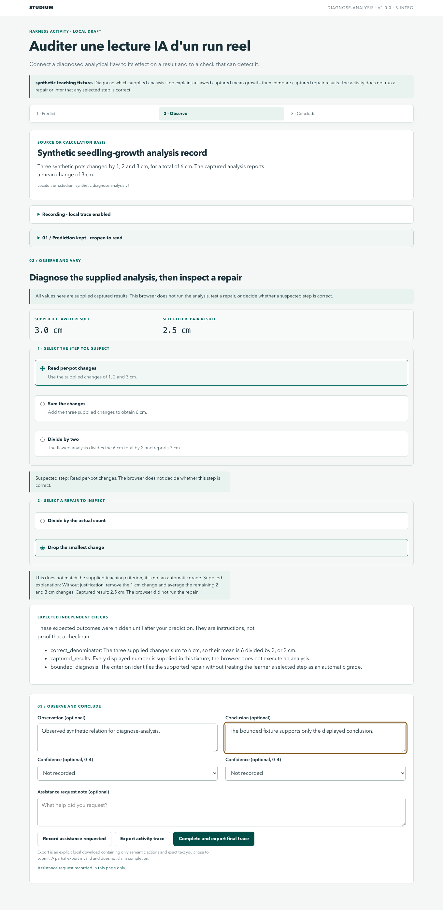
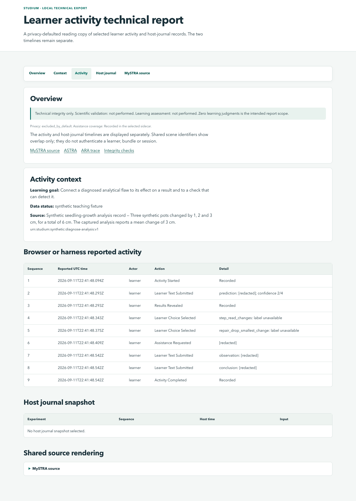

# Charte des viewers Studium

Cette charte couvre les activités préparées, les rapports HTML portables et
l’Observatory/MySTRA. Elle vise une lecture scientifique sobre : distinguer les
sources, les choix, les observations et les limites sans décoration concurrente.
La source commune est [`ui/studium-theme.css`](../../ui/studium-theme.css).

## Lecture et interaction

- Fond gris très clair, surfaces blanches, texte sombre et accent vert profond.
  L’ambre signale une incertitude ou un point d’attention ; la couleur accompagne
  toujours une explication. Les nombres et identifiants utilisent une chasse fixe.
- Titres courts, taille contenue, texte limité en largeur, bordures légères.
  Avenir Next/Avenir, puis Segoe UI et sans-serif local ; aucune police distante.
- Navigation de section persistante. Sur mobile, elle défile horizontalement sans
  élargir la page. Les tableaux larges ont leur propre région de défilement,
  nommée et accessible au clavier dans les rapports.
- Les choix de traçage et la prédiction se replient après leur validation.
  Leur résumé reste accessible ; rouvrir la prédiction montre le texte initial,
  sans le rendre modifiable après la révélation. Le focus suit l’étape active.
- Les contrôles principaux font au moins 44 px de haut. Focus visible, préférence
  de mouvement réduit respectée. Le rapport imprimé conserve titre et tableaux,
  avec répétition des en-têtes ; la navigation interactive disparaît.

Les figures scientifiques futures doivent conserver axes, unités, légendes et
provenance. Un visuel généré pour expliquer une idée doit être identifié comme
tel, séparément de la figure originale et d’un résultat calculé.

## Intégration

Les trois consommateurs utilisent le même CSS : inclusion au moment de préparer
une activité, inclusion dans le rapport portable, inclusion Jinja locale pour
l’Observatory. Les règles propres à chaque disposition restent dans son renderer.
La classe `studium-viewer` délimite les styles. Pas de CDN, de requête de police ou
 de JavaScript ajouté aux rapports portables.

Cette charte change la présentation, pas les contrats ASTRA, ARA, les traces
Studium, les décisions pédagogiques ou les règles de confidentialité. Les anciens
exports HTML continuent d’être vérifiés par leur renderer historique exact. Les
exports nouveaux sont vérifiés contre le renderer actuel, CSS compris.
**Une prochaine révision du thème doit conserver le renderer et le CSS de cette
version avant de les modifier**, puis tester les exports de chaque génération.
La vérification ne doit jamais accepter du HTML arbitraire parce que ses hashes
ont été recalculés.

## Galerie et reproduction

Toutes les captures ci-dessous montrent des interactions automatiques
**synthétiques**, sans étudiant réel ni mesure d’apprentissage.





[MySTRA sur mobile](../assets/viewers/mystra-mobile.png).

Depuis la racine du dépôt, avec le venv, les dépendances Node et Chrome disponibles :

```sh
.venv/bin/python tools/demo-template-reports.py /tmp/studium-viewer-demo
```

Choisir un répertoire neuf. Le portail créé relie cinq activités, leurs cinq
rapports et un rapport séparé du journal moteur. Les sous-dossiers `audit`,
`practical-audit` et `report-audit` conservent contrôles et captures ;
`report-audit/diagnosis-portable.pdf` permet de relire une impression A4.

Les essais couvrent desktop 1360 px, mobile 390 px, clavier, révélation après
prédiction, export, absence de traçage, impression et intégrité des artefacts.
Ils ne constituent pas un audit WCAG complet ni une étude d’usage auprès d’étudiants.

## Aide contextuelle commune

Le symbole `?` donne accès à une explication progressive : définition, contribution
attendue, objectif, méthode, limites et source. Les perspectives enseignant et
étudiant viennent du même [catalogue](../../ui/context-help.json).
Consulter le [guide d’intégration](../learn/language-and-supports.fr.md) pour les renderers,
les langues, les garanties et la couverture. Garder toute consigne indispensable
hors du panneau d’aide. La lecture d’une aide ne devient jamais une évaluation.

La révision INT051 conserve le thème et le renderer v2 sans modification ; les
nouveaux rapports ajoutent un CSS d’aide distinct. Une modification future de ce
catalogue/CSS/renderer doit préserver la génération exacte INT051 avant de changer
le rendu, au même titre que les générations v1 et v2 déjà supportées.
