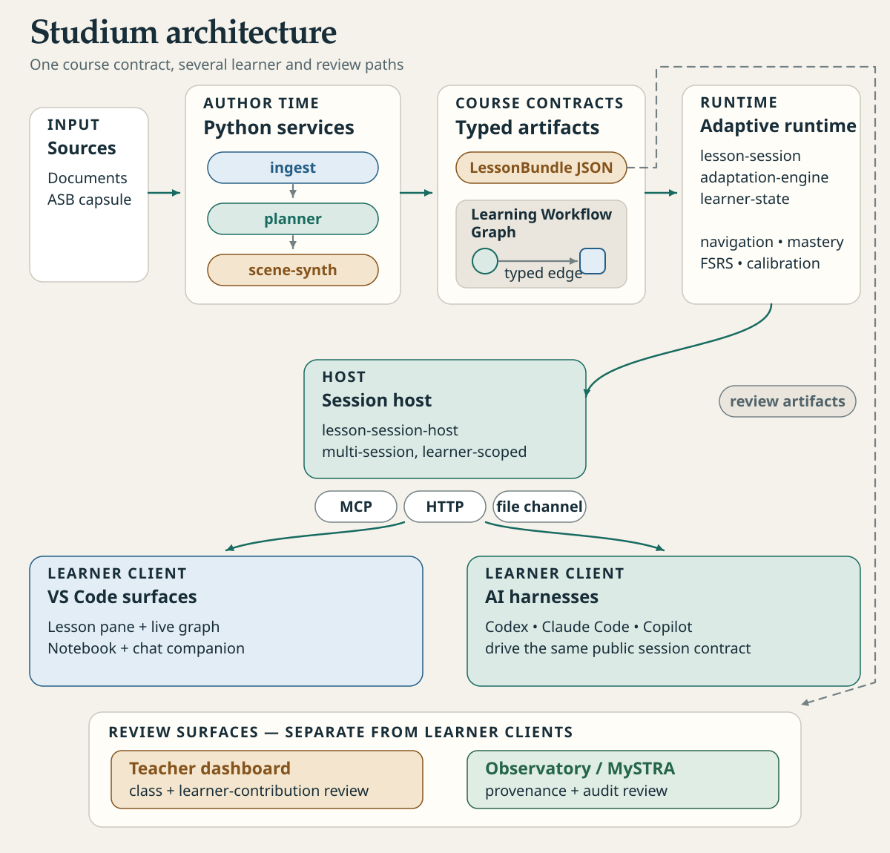

[English](architecture.md) · Français

# Architecture

Cette page montre comment Studium est assemblé : quelle unité fait quoi, comment une leçon va des sources
jusqu'à la réponse d'un apprenant, et où l'état est conservé. Lisez-la avant de modifier du code qui
traverse une frontière entre paquets. Les termes *scène*, *classe de clé* ou *FSRS* sont définis dans le
[glossaire](../concepts/glossary.fr.md).

<picture>
  <source media="(prefers-color-scheme: dark)" srcset="../assets/diagrams/architecture-dark.svg">
  
</picture>

## Un seul contrat, plusieurs surfaces

Tout ce que joue un apprenant est un **bundle de leçon** : un fichier `lesson.json` validé par le schéma
LessonBundle (version 1.4, [`packages/lesson-bundle-schema`](../../packages/lesson-bundle-schema/src/index.ts)).
Il contient les scènes, les concepts et le graphe de parcours (Learning Workflow Graph, LWG) qui les relie.
Les outils d'auteur écrivent des bundles ; toutes les surfaces les lisent par le même hôte. Les couches :

| Couche | Unités | Rôle |
|---|---|---|
| Contrat de cours | `lesson-bundle-schema`, `learning-workflow-schema` | le format du bundle et le graphe typé |
| Moteur adaptatif | `lesson-session`, `adaptation-engine`, `learner-state`, `reasoning-scorer` | correction, navigation, maîtrise, planification des révisions |
| Hôte de sessions | `lesson-session-host` | une session par apprenant et par leçon ; persistance ; masquage des clés ; plan d'étude ; contrôles d'auteur |
| Transports | `apps/lesson-mcp` (MCP en stdio, adaptateur HTTP), `apps/lesson-server` (HTTP), canal fichier `.studium-session/` | le contrat public de session |
| Clients apprenant | extension VS Code, tout assistant MCP | présentation |
| Surfaces de relecture | tableau de bord enseignant, Observatory | vues enseignant et opérateur, séparées des clients apprenant |

## Le trajet d'une réponse

1. Un client appelle `start_lesson_session` avec une référence de bundle. L'hôte la cherche dans
   `BUNDLES_ROOT`, puis dans la bibliothèque de l'apprenant, charge le bundle et le valide.
2. L'hôte renvoie la scène courante sous forme de **projection publique** :
   [`public-scene.ts`](../../packages/lesson-session-host/src/public-scene.ts) retire tous les champs qui
   portent la réponse (bonnes réponses, points clés, réponses modèles) avant que quoi que ce soit ne sorte
   du serveur, que ce soit par MCP, par HTTP ou par le canal fichier.
3. Le client envoie la réponse avec `submit_response`. La session la corrige, applique le signal au modèle
   de l'apprenant, choisit l'étape suivante et se déplace dans le graphe.
4. Seule une réponse mesurée fait bouger la maîtrise. Sans modèle juge (`LITELLM_BASE_URL` vide), une
   réponse ouverte reçoit la référence à laquelle se comparer, jamais un décompte de couverture ;
   l'auto-évaluation (`rate_recall`) planifie les révisions mais ne touche jamais la maîtrise. Voir
   [honnêteté et provenance](../concepts/honesty-and-provenance.fr.md).
5. Les passages cités et la référence ne sont libérés que lorsque l'apprenant quitte la scène pour de bon.
6. L'hôte écrit l'état de l'apprenant dans le répertoire de données. Si `STUDIUM_TELEMETRY_CONSENT` est
   activé et le stockage durable, il ajoute aussi des événements pseudonymisés à `telemetry.jsonl`, que
   `class_report` agrège au-dessus d'un seuil de cinq apprenants.

### Où vit l'état

| Quoi | Par défaut | Réglé par |
|---|---|---|
| Leçons lues | `BUNDLES_ROOT`, puis `~/.studium/library` | `BUNDLES_ROOT`, `STUDIUM_HOME` |
| Leçons et sources écrites par la création | `~/.studium/library` seulement, jamais `BUNDLES_ROOT` | `STUDIUM_HOME` |
| État de l'apprenant | `~/.studium/data` | `STUDIUM_DATA_DIR`, `STUDIUM_HOME` |
| Tout en mémoire | désactivé | `STUDIUM_EPHEMERAL=1` (tests, démos, CI) |
| Dossiers d'apprenant sur disque | pseudonymes HMAC | `STUDIUM_PSEUDO_SECRET`, sinon `<répertoire de données>/.studium-secret` |

Seul le point d'entrée stdio applique ces défauts
([`persistence.ts`](../../packages/lesson-session-host/src/persistence.ts)) ; le code de bibliothèque et
ses tests restent en mémoire tant qu'ils ne configurent pas de répertoire. La liste complète est dans la
[configuration](../reference/configuration.fr.md).

## Deux voies d'auteur

| | Voie conversation | Voie paquet |
|---|---|---|
| Pour | un apprenant autonome avec son assistant IA | un enseignant qui prépare un cours |
| Entrée | outils MCP `get_authoring_guide`, `prepare_sources`, `create_lesson` | `tools/experience_packet.py passages`, `prepare`, `check`, `bundle`, `approve` |
| Code | [`apps/lesson-mcp/src/authoring-tools.ts`](../../apps/lesson-mcp/src/authoring-tools.ts), [`authoring-draft/`](../../packages/lesson-session-host/src/authoring-draft) | [`tools/experience_packet.py`](../../tools/experience_packet.py) |
| Contrôles | citations comparées aux passages caractère par caractère, aucun `TODO`, graphe de concepts cohérent, lint du bundle | validation du schéma, constats structurés (`check --json`), lint du bundle |
| Résultat | `<bibliothèque>/<course_id>/lesson.json`, marqué rédigé par l'IA, non validé par un enseignant | un dossier de cours ; `approve` écrit `approval.json`, lié à l'empreinte SHA-256 de `lesson.json` |
| Guide | [Apprendre un sujet en conversation](../tutorials/learn-a-topic-in-a-conversation.fr.md) | [Écrire une leçon](../teach/author-a-lesson.fr.md) |

Les deux voies aboutissent au même format de bundle et passent toutes deux par
[`tools/bundle_lint.mjs`](../../tools/bundle_lint.mjs). Les services FastAPI `planner` et `scene-synth`
sont conservés comme code hérité et de recherche ; ce n'est pas une voie d'auteur prise en charge.

## Carte des unités

### Applications

| Unité | Rôle | README |
|---|---|---|
| `apps/lesson-mcp` | serveur MCP (36 outils, stdio) et adaptateur HTTP des opérations de leçon | [README](../../apps/lesson-mcp/README.fr.md) |
| `apps/studium-vscode` | extension VS Code : panneau de leçon, participant de chat, serveur MCP embarqué | [README](../../apps/studium-vscode/README.fr.md) |
| `apps/lesson-server` | serveur HTTP Fastify pour les leçons, clés masquées | [README](../../apps/lesson-server/README.fr.md) |
| `apps/teacher-dashboard` | tableau de bord Next.js : analyses de classe, bibliothèque et relecture des leçons | [README](../../apps/teacher-dashboard/README.fr.md) |
| `apps/student-runtime` | application de bureau Tauri, gelée | [README](../../apps/student-runtime/README.fr.md) |
| `apps/author-web` | application d'auteur Next.js, héritée | [README](../../apps/author-web/README.fr.md) |

### Paquets TypeScript

| Unité | Rôle | README |
|---|---|---|
| `lesson-bundle-schema` | schéma LessonBundle 1.4 (Zod) et son miroir Python | [README](../../packages/lesson-bundle-schema/README.fr.md) |
| `learning-workflow-schema` | graphe de parcours : nœuds concept et tâche, arêtes typées | [README](../../packages/learning-workflow-schema/README.fr.md) |
| `lesson-plan-schema` | sous-schéma de plan de leçon (JSON Schema, types, miroir Pydantic) | [README](../../packages/lesson-plan-schema/README.fr.md) |
| `lesson-schema` | ancien schéma de leçon v1 (ADR 003) ; le schéma de bundle fait foi | [README](../../packages/lesson-schema/README.fr.md) |
| `lesson-session` | un apprenant dans une leçon : correction, navigation, tuteur | [README](../../packages/lesson-session/README.md) |
| `lesson-session-host` | hôte multi-sessions : persistance, masquage, plan d'étude, auteur | [README](../../packages/lesson-session-host/README.md) |
| `adaptation-engine` | mise à jour bêta de la maîtrise, planification FSRS, routage dans le graphe | [README](../../packages/adaptation-engine/README.fr.md) |
| `learner-state` | types du modèle de l'apprenant : maîtrise, calibration, confiance | [README](../../packages/learner-state/README.fr.md) |
| `reasoning-scorer` | classe le raisonnement d'un tour de tutorat | [README](../../packages/reasoning-scorer/README.fr.md) |
| `llm-client` | client de modèle : simulé ou point d'accès compatible LiteLLM | [README](../../packages/llm-client/README.fr.md) |
| `perspicacite-client` | métadonnées de DOI via le service Perspicacité, repli hors ligne | [README](../../packages/perspicacite-client/README.fr.md) |
| `telemetry-events` | schéma des événements de télémétrie (TypeScript et Python) | [README](../../packages/telemetry-events/README.fr.md) |
| `typed-graph-lens` | vue de graphe typé avec état en direct, pour le panneau graphe de VS Code | [README](../../packages/typed-graph-lens/README.fr.md) |
| `activity-presentation` | rendus HTML portables, KaTeX intégré, pour viewers et rapports | [README](../../packages/activity-presentation/README.fr.md) |

### Services Python

| Unité | Rôle | README |
|---|---|---|
| `services/analytics-collector` | stocke la télémétrie et sert des agrégats de classe (service de développement et de démo) | [README](../../services/analytics-collector/README.fr.md) |
| `services/observatory` | page opérateur en lecture seule : provenance, évaluations, validité | [README](../../services/observatory/README.md) |
| `services/ingest` | ingestion des sources : extraction PDF, BibTeX, résolution de DOI | [README](../../services/ingest/README.fr.md) |
| `services/planner` | planificateur hérité et de recherche ; répond 503 sans modèle configuré | [README](../../services/planner/README.md) |
| `services/scene-synth` | synthèse de scènes héritée et de recherche | [README](../../services/scene-synth/README.md) |

### Autres dossiers

| Dossier | Contenu |
|---|---|
| [`design/`](../../design/README.fr.md) | jetons de design, pont VS Code, composants, aperçu |
| `ui/` | thème commun des viewers et catalogue d'aide contextuelle |
| `tools/` | scripts d'auteur, de lint, de rapport et d'audit ; `pytest_all.py` |
| [`eval/`](../../eval/README.md) | banc d'évaluation et études de validité |
| `fixtures/` | leçons d'exemple, dont `atomistique-l1` |
| `skills/` | skills d'assistant pour étudiants, enseignants et apprenants autonomes ([skills](../start/skills.fr.md)) |

## Limites

L'adaptateur HTTP expose les 25 opérations de leçon et `rate_recall` ; les autres outils d'étude et les
outils d'auteur et enseignant n'existent qu'en MCP. Aucun canal unique ne relie l'hôte aux deux surfaces de relecture : elles lisent sur
disque les artefacts de cours et de relecture.
