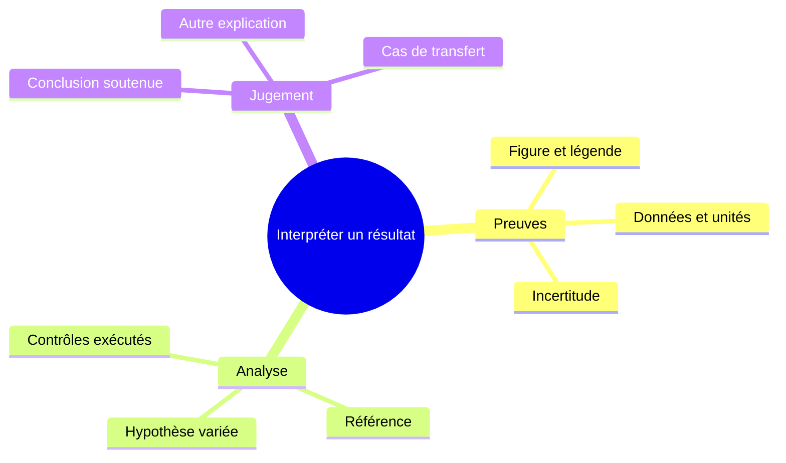

# Figures, cartes conceptuelles et supports adaptés

Studium peut s’appuyer sur le harnais pour expliquer une figure, composer un
schéma ou produire un support visuel contextualisé. Le harnais apporte les outils ;
Studium conserve la scène, les objectifs, les réponses personnelles et la progression.
Le skill [`studium-visual-support`](../../skills/studium-visual-support/SKILL.md)
formalise cette pratique sans imposer un fournisseur.

## Ce qui fonctionne et ce qui reste à relier

| Besoin | État dans ce dépôt |
|---|---|
| Images, SVG, équations, spectres, tableaux et figures de runs | Contrat `RenderAsset` existant ; rendu riche dans l’extension VS Code, sous-ensemble dans le notebook |
| Figure locale d’une leçon en répertoire | Chemin résolu à partir du répertoire de la leçon ; le fichier doit exister et être accessible |
| Figure extraite automatiquement d’un PDF | Non : l’ingest repère des métadonnées de figures, sans importer leurs pixels dans le cours |
| Images arbitraires d’une capsule ASB | Import partiel : l’ancien extracteur reconnaît quelques noms de fichiers ; pas un import général de figures |
| Images référencées dans une leçon ZIP | Incomplet : le transport actuel ne restitue pas les fichiers image du ZIP |
| Mermaid dans MySTRA | Source textuelle consultable ; pas de moteur Mermaid intégré |
| Nouvelle image dans la conversation du harnais | Possible si ce harnais dispose effectivement d’un outil de génération d’images |
| Génération automatique selon l’historique étudiant | Non implémentée ; le contexte public exclut cet historique |
| Adaptation déjà existante | Routage/remédiation selon les signaux du moteur ; préférence de modalité VS Code réordonnant les supports existants |

Les cinq templates d’activité et les rapports HTML portables ne sont pas des
renderers génériques de tous les `RenderAsset`. Le runtime web ne présente pas
non plus toutes les modalités disponibles dans VS Code. Toujours tester la surface
choisie ; la présence d’un champ dans un schéma ne garantit pas son affichage.

## Trois familles de figures, un contrat média

**Figure de source.** Conserver le fichier, sa légende, le DOI ou l’identifiant de
capsule, la page/panneau et les éventuels recadrages. Noter la provenance et le
statut de réutilisation avant d’en distribuer une copie. L’étudiant peut demander
une lecture des axes, une vue rapprochée ou une comparaison de panneaux. Une
lecture multimodale reste une interprétation à vérifier.

**Graphique calculé.** Produire le tracé à partir des données réellement utilisées,
avec script, paramètres, unités et contrôles. Utiliser un outil de tracé ou un
`plot_spec` quand les valeurs exactes comptent. Garder les échecs et résultats nuls.

**Support explicatif généré.** Une carte, une analogie visuelle ou un abstract
schématique peut résumer le contexte et une difficulté particulière. L’identifier
comme tel ; conserver la source originale séparément. Les pixels générés ne sont
pas une mesure, une validation scientifique ou un résultat de capsule.

Un [fragment JSON d’asset](../../examples/visual-support/figure-asset.json) montre
l’enveloppe `image` existante, à placer dans `scene.render_assets` après préparation
et revue. Le fichier PNG du fragment n’est volontairement pas fourni : ce n’est
pas un bundle exécutable. Pour une livraison locale, mettre le vrai fichier dans
`assets/` à côté du `lesson.json` de la leçon en répertoire. Les chemins relatifs
et absolus internes sont acceptés ; un fichier situé hors de cette leçon, même
via un symlink, doit être copié explicitement dans son dossier. Ce resserrement
remplace l’ancien accès à des chemins absolus arbitraires. Le pipeline plan → ZIP
et l’attachement automatique à une séance en cours restent à compléter.

## Différencier sans enfermer l’étudiant dans un profil

Utiliser deux axes indépendants : familiarité avec le domaine et familiarité avec
la méthode ou l’outil. Un biologiste peut connaître le phénomène mais découvrir
le matching spectral ; un informaticien peut être à l’aise avec les graphes mais
pas avec les incertitudes d’annotation. Le diplôme ne suffit pas à choisir le support.

Un brief de session suffit souvent : « Je connais les spectres, je découvre le
réseau moléculaire, je confonds similarité et identité ; explique-moi cette
relation avec un exemple court. » Il vient des mots de l’étudiant et peut être
corrigé. Si une difficulté est seulement supposée par le harnais, la présenter
comme une hypothèse, puis demander une interprétation ou un essai court.

Le projet [Audience-aware skills de Lightcone](https://github.com/LightconeResearch/audience-aware-skills)
propose un entretien bref puis un profil de communication éditable. Il distingue
les connaissances du domaine de celles du projet et traite les rôles comme des
points de départ corrigibles. Nous reprenons ce principe pour un brief pédagogique
local, sans installer une nouvelle règle globale de communication. Le projet
amont est un brouillon, pas une démonstration d’efficacité pédagogique.

Exemples de différenciation proposée :

| Situation exprimée ou observée | Support possible | Vérification suivante |
|---|---|---|
| Axes ou unités mal compris | Figure originale avec repères textuels et un exemple simple | Faire lire un autre point ou panneau |
| Confusion similarité/identité | Carte des relations et contre-exemple explicitement sourcé | Faire formuler ce que le score ne prouve pas |
| Difficulté à suivre la méthode | Diagramme des entrées, opérations et sorties | Faire identifier où une hypothèse intervient |
| Familiarité élevée | Vue compacte, hypothèses et cas limites | Nouvelle variation choisie par l’étudiant |
| Besoin de synthèse après l’expérience | Abstract schématique référence → variation → observation → limites | Conclusion personnelle, puis cas nouveau sans support |

Ces choix sont des hypothèses de conception à tester. La préférence pour un format
n’est pas un « style d’apprentissage » fixe. Les erreurs ne doivent pas devenir un
profil médical ou psychologique. Ne pas changer silencieusement le barème.

## Génération multimodale par le harnais

L’API OpenAI propose un outil de génération d’images, avec images d’entrée et
révisions successives dans une conversation. Cela permet techniquement de
réviser un support à partir d’un contexte choisi ; cela ne connecte pas, à soi
seul, cet outil au moteur Studium. Voir la [documentation officielle](https://developers.openai.com/api/docs/guides/tools-image-generation).
Le modèle qui dialogue et l’outil qui produit les pixels peuvent être distincts.
Vérifier leurs noms réellement utilisés, la disponibilité et le budget de la route.

La [documentation vision](https://developers.openai.com/api/docs/guides/images-vision)
signale notamment des erreurs possibles sur les petits textes et les graphiques.
Conserver les légendes exactes hors des pixels générés et confronter toute lecture
quantitative aux données ou au texte source.

Workflow conseillé :

1. Lire la scène publique et les matériaux pertinents. Si le support révèle le
   résultat attendu, recueillir d’abord la prédiction personnelle.
2. Choisir figure existante, tracé calculé, Mermaid ou illustration selon le besoin.
   Éviter une génération coûteuse à chaque mouvement de curseur : la déclencher
   sur une demande ou une étape pédagogique pertinente.
3. Fournir seulement les éléments nécessaires au générateur : source sélectionnée,
   contexte conceptuel, question et bref besoin de soutien. Pas d’historique privé
   complet ni de clés de réponse.
4. Examiner le visuel : lisibilité, symboles, valeurs, flèches causales, provenance.
   Si la génération échoue, conserver la source ou une explication textuelle.
5. Demander à l’étudiant d’interpréter le support, sans rédiger sa réponse pour lui.
   Une explication nouvelle hors du périmètre prévu reste un brouillon enseignant.
6. Conserver un reçu d’exploration avec entrées choisies, sources, prompt, prompt
   révisé si retourné, modèle/outil, sorties et contrôles. Le lien vers MySTRA reste
   un résumé technique ; l’image n’y est pas automatiquement incorporée aujourd’hui.

Aucune génération payante ni adaptation automatique sur un étudiant réel n’a été
exécutée pour ce guide. Les profils et réponses demeurent locaux ; leur inclusion
dans un reçu exportable est un choix explicite, distinct du simple usage du support.

## Mermaid : source lisible et rendu passif

L’[exemple `.mmd`](../../examples/visual-support/concept-map.mmd) est une carte
conceptuelle originale et généraliste. Le dialecte est celui des
[mindmaps Mermaid](https://mermaid.js.org/syntax/mindmap.html). Voici une version courte :

Le texte de la carte est aussi son alternative accessible. Pour un viewer Studium,
faire rendre la source par un outil disponible dans l’espace du harnais, puis
utiliser une image PNG passive. Garder le `.mmd` avec cette image. Le SVG peut être
utilisé après contrôle/sanitisation ; le panneau historique accepte du SVG inline
et ne constitue pas une frontière de sécurité pour du contenu arbitraire.

La [configuration Mermaid](https://mermaid.js.org/config/usage.html) fournit un mode
strict ; l’utiliser dans un renderer isolé, sans liens externes ni configuration
fournie librement par le diagramme. Aucun moteur Mermaid ni installation réseau
n’est ajouté au viewer par ce guide. Le rendu des cartes par un harnais particulier
reste à vérifier ; sans renderer, livrer honnêtement le texte et la source.

## Reçu et reprise entre harnais

Appliquer le [guide d’exploration sourcée](grounded-exploration.md), avec les
commandes existantes `experience_exploration.py prepare`, `seal` et `verify`.
Le schéma généré fixe les champs valides. Classer sources, prompt et diagramme,
fichiers produits, environnement et contrôles dans les rôles existants.
Conserver un log expurgé des secrets ; ne pas inventer une commande ou une preuve
d’exécution pour un outil seulement envisagé.

Le reçu prouve l’intégrité des fichiers choisis, pas leur vérité scientifique.
Le [rapport étudiant](../user/learner-report.md) garde les actions personnelles
séparées du travail du harnais. Changer de harnais ne transforme pas une génération
IA en action de l’étudiant ni une aide reçue en réussite autonome.
