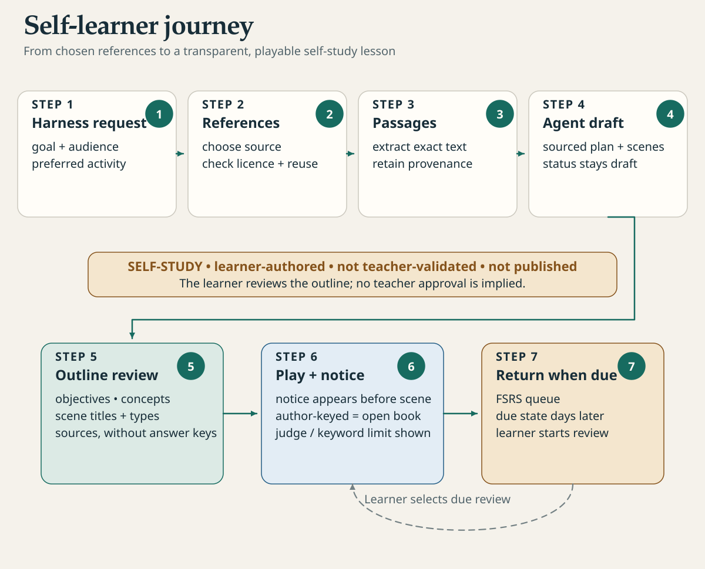

[English](learn-with-your-assistant.md) · Français

# Apprendre un sujet avec votre assistant

Dites à votre assistant IA ce que vous voulez apprendre et à partir de quelles sources. Il en tire une courte
leçon, la joue avec vous une question à la fois, puis fait revenir les idées clés les jours suivants. Ni
enseignant ni terminal : l'assistant dialogue avec Studium par MCP (Model Context Protocol, le moyen par lequel
un assistant appelle des outils extérieurs).

Cela fonctionne dans Codex, Claude Code et tout assistant capable d'utiliser un serveur MCP. Pour brancher
Studium, voir [harnais](../start/harnesses.fr.md).

<picture>
  <source media="(prefers-color-scheme: dark)" srcset="../assets/diagrams/self-learner-journey-dark.svg">
  
</picture>

## 1. Demander

Formulez-le simplement, par exemple :

> Je veux apprendre le cycle de l'eau avec Studium. Voici deux pages auxquelles je fais confiance : <liens>.

L'assistant commence par `get_study_plan`, dans votre langue. Si une de vos leçons couvre déjà le sujet, il
vous la propose ; sinon il en prépare une. Indiquez ce que vous savez déjà, le temps dont vous disposez par
jour ou une date visée : l'assistant est alors invité à ouvrir la leçon par deux courtes questions sur vos
acquis. Ces deux questions sont jouées une fois et ne reviennent jamais en révision. Ce que vous savez et ce
qui vous intéresse orientent le brouillon mais ne sont pas conservés ; la leçon ne garde que vos minutes par
jour et votre date visée, et le plan d'étude se sert des minutes pour dimensionner chaque étape.

Studium fournit aussi les prompts `learn` et `review`, qui formulent cette demande à votre place. Dans Claude
Code, les prompts MCP apparaissent comme des commandes slash (`/mcp__studium__learn` avec la configuration
d'exemple).

## 2. Choisir les sources et leurs licences

C'est vous qui choisissez les sources ; l'assistant les récupère avec ses propres outils (web, fichiers) et
transmet leur texte à `prepare_sources`, qui les découpe en passages numérotés. Une source est traitée comme une
donnée : une consigne écrite dans une page n'est jamais suivie.

| Limite | Valeur |
|---|---|
| Sources par leçon | jusqu'à 20 |
| Texte au total | jusqu'à 200 000 caractères |
| Licence | un identifiant comme `CC-BY-4.0` ou `Public-Domain` ; `unknown` si rien n'est indiqué |

Précisez la licence de chaque source : elle est recopiée dans la leçon et affichée avec la source. Un texte
du domaine public se réutilise librement ; un PDF d'éditeur ou
une licence `NC`, `ND` ou inconnue restreint ce que vous pouvez faire du résultat. La leçon reste dans votre
bibliothèque personnelle et n'est jamais publiée, mais l'usage de la source sous ses conditions vous revient.
Une source cohérente donne souvent une meilleure leçon que plusieurs.

## 3. Relire le plan

L'assistant rédige la leçon et appelle `create_lesson`. Studium la vérifie avant d'écrire quoi que ce soit :
chaque citation doit correspondre à un passage au caractère près (seuls les espaces insécables, les suites
d'espaces et les apostrophes typographiques sont tolérés), rien ne doit rester inachevé et l'ordre des notions
doit tenir. L'assistant corrige ce que Studium refuse. Studium peut aussi avertir, par exemple quand la leçon
dure plus que vos minutes par jour ou qu'aucune question ne vérifie un prérequis.

La leçon est écrite dans votre bibliothèque, `~/.studium/library/<cours>/lesson.json`, quel que soit le
dossier de leçons que le serveur lit par ailleurs.

Vous voyez ensuite le plan : titres des scènes, types de scènes et notions, jamais une réponse. S'il ne
correspond pas à ce que vous vouliez, dites-le ; l'assistant reprend le brouillon et reconstruit la leçon.

## 4. Jouer, dans le chat ou dans VS Code

Dans le chat, chaque étape arrive prête à lire : son titre, votre progression (« Étape 2 sur 6 »), la question
et la façon d'y répondre (une lettre, un chiffre de 0 à 4 ou vos propres mots). Répondez vous-même :
l'assistant transmet vos mots et ne doit ni répondre, ni choisir, ni noter à votre place.

Pour jouer dans VS Code, faites un clic droit sur le `lesson.json` de la leçon et choisissez **Studium : Ouvrir
cette leçon**, ou suivez le lien donné par l'assistant
(`vscode://holobiomicslab.studium-vscode/open?bundle=<chemin absolu>`). Voir [VS Code](../start/vscode.fr.md).
Le panneau garde sa propre progression dans le stockage de VS Code : les réponses données là n'apparaissent
pas dans le plan d'étude que lit votre assistant, et inversement.

## 5. Lire l'avis d'autorat

Le premier écran d'une leçon rédigée par un assistant porte un avis. Sans juge modèle, il dit :

> Leçon rédigée par l'IA à partir de vos sources, non vérifiée par un enseignant : chaque question cite son
> passage ; contestez une clé qui vous semble fausse. Sans juge modèle, les scènes de production ne sont pas
> évaluées : comparez votre réponse à la réponse modèle et notez votre rappel ; cette note règle vos révisions,
> jamais votre maîtrise. Seules les reproductions exécutées portent une évaluation externe.

Concrètement :

- **Qui a écrit la clé.** L'assistant a rédigé les bonnes réponses. Elles citent les passages sur lesquels
  elles reposent, vous pouvez donc les vérifier ; une clé peut néanmoins être fausse.
- **Ce qui est évalué.** Les réponses aux quiz sont comparées à cette clé : ✓ si elles sont justes, ✗ si elles
  sont fausses, et une fois que vous quittez une question à laquelle vous avez mal répondu, la bonne réponse
  s'affiche. Vos réponses rédigées
  (explications, comparaisons, audits) ne sont pas notées sans juge modèle configuré (`LITELLM_BASE_URL`). Vous
  recevez les points clés et une réponse modèle pour comparer, jamais un décompte de mots-clés qui prétendrait
  mesurer la couverture.
- **Ce que fait votre note.** Après une réponse rédigée, vous notez votre rappel : `again`, `hard`, `good` ou
  `easy`. Cette note fixe la date de la prochaine révision. Elle ne monte ni ne baisse jamais votre maîtrise.

Aucune clé, aucun passage cité ni aucune réponse modèle n'apparaît avant votre réponse, sur aucune surface. Ils
s'affichent quand vous quittez la question ; une nouvelle tentative sur la même question les retient encore.
Pour aller plus loin : [honnêteté et provenance](../concepts/honesty-and-provenance.fr.md).

## 6. Revenir quelques jours plus tard

Ouvrez une nouvelle conversation et demandez « Qu'est-ce que je révise avec Studium aujourd'hui ? ».
L'assistant appelle `get_study_plan` dans votre langue, qui liste les révisions dues, les leçons en cours et la leçon suivante, et
nomme la seule étape à faire maintenant. `start_review_session` joue ensuite toutes les révisions dues, toutes
leçons confondues. Voir [réviser dans la durée](review-over-time.fr.md).

Votre progression survit par défaut aux redémarrages, dans `~/.studium`. Pour la retrouver depuis un autre
assistant, gardez le même dossier de données et le même identifiant : demandez à l'assistant de transmettre un
`learner_id` stable (votre prénom, par exemple) à chaque appel.

## 7. Fermer ou oublier

| Vous dites | L'assistant appelle | Effet |
|---|---|---|
| « On s'arrête là pour aujourd'hui. » | `end_session` | Ferme la séance et garde votre progression. Relancer la leçon la reprend. |
| « Efface mes données pour cette leçon. » | `forget_session {session_id}` | Efface votre progression dans la leçon, son journal d'expérience, ainsi que votre profil inter-leçons et votre historique d'étude. Irréversible. |
| « Efface toutes mes données Studium. » | `forget_session {learner_id}` | La même chose, plus votre progression dans toutes les autres leçons, sans leçon ouverte. Irréversible. |

L'assistant montre ensuite ce qui a été effacé et ce qui reste. L'oubli ne supprime ni les leçons de votre
bibliothèque (`~/.studium/library/<cours>/`) ni les sources préparées (`~/.studium/library/_sources/`), ni la
conversation conservée par l'assistant. Supprimez-les vous-même si vous le souhaitez. Voir
[confidentialité et limites](../concepts/privacy-and-limits.fr.md).

## Exemple de conversation

> **Vous :** Je veux apprendre le cycle de l'eau avec Studium, à partir de cette page d'encyclopédie. Elle est
> sous CC-BY-SA.
>
> **Assistant :** J'ai préparé 4 passages et rédigé une leçon. Plan : 1. Le cycle de l'eau (introduction) ·
> 2. L'évaporation (quiz) · 3. Condensation et nuages (explication) · 4. De la pluie aux rivières
> (comparaison). On commence ?
>
> **Vous :** Oui.
>
> **Assistant :** *Leçon rédigée par l'IA à partir de vos sources, non vérifiée par un enseignant …* Étape 2
> sur 4. Qu'est-ce qui fait s'évaporer l'eau des océans ? A, B ou C ?
>
> **Vous :** B.
>
> **Assistant :** Juste. Étape 3 sur 4 : explique avec tes mots comment se forme un nuage.
>
> **Vous :** La vapeur monte, se refroidit et se transforme en gouttelettes.
>
> **Assistant :** Réponse enregistrée ; aucun juge ne l'a évaluée. Compare-la aux points clés et à la réponse
> modèle. Note ton rappel : again, hard, good ou easy ?
>
> **Vous :** Good.
>
> **Assistant :** Note enregistrée. Prochaine révision : <date>. Elle règle tes révisions, jamais ta maîtrise.

## Pour aller plus loin

- Pas à pas avec une vraie source : [apprendre un sujet dans une conversation](../tutorials/learn-a-topic-in-a-conversation.fr.md).
- La même démarche avec les outils Python, pour tout contrôler : [auto-apprentissage à partir de ses références](../tutorials/self-study-from-references.fr.md).
- Chaque outil et ses arguments : [outils MCP](../reference/mcp-tools.fr.md) ; le code se trouve dans
  [apps/lesson-mcp/src/authoring-tools.ts](../../apps/lesson-mcp/src/authoring-tools.ts) et
  [apps/lesson-mcp/src/server.ts](../../apps/lesson-mcp/src/server.ts).
