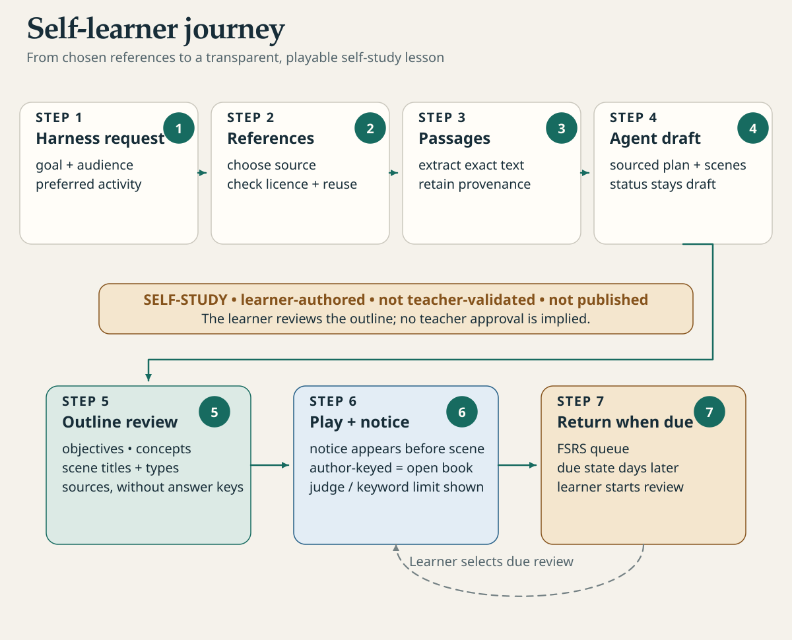

[English](learn-with-your-assistant.md) · Français

# Apprendre un sujet avec votre assistant

Dites à votre assistant IA ce que vous voulez apprendre et à partir de quelles sources. Il en tire une courte
leçon, la joue avec vous une question à la fois, puis fait revenir les idées clés les jours suivants. Ni
enseignant ni terminal : l'assistant dialogue avec Studium par MCP (Model Context Protocol, le moyen par lequel
un assistant appelle des outils extérieurs).

Cela fonctionne dans Codex, Claude Code et tout assistant capable d'utiliser un serveur MCP. Pour brancher
Studium, voir [harnais](../start/harnesses.fr.md).

<picture>
  <source media="(prefers-color-scheme: dark)" srcset="../assets/diagrams/self-learner-journey-dark.svg">
  
</picture>

## 1. Demander

Formulez-le simplement, par exemple :

> Je veux apprendre le cycle de l'eau avec Studium. Voici deux pages auxquelles je fais confiance : <liens>.

L'assistant commence par `get_study_plan`, dans votre langue. Si une de vos leçons couvre déjà le sujet, il
vous la propose ; sinon il en prépare une. Sans aucune leçon, le plan propose d'abord « Découvrir Studium », une
démonstration d'une dizaine de minutes livrée avec Studium, qui montre comment il fonctionne ; dites que vous
préférez apprendre votre sujet et l'assistant prépare votre leçon à la place. Indiquez ce que vous savez déjà, le temps dont vous disposez par
jour ou une date visée : l'assistant est alors invité à ouvrir la leçon par deux courtes questions sur vos
acquis. Ces deux questions sont jouées une fois et ne reviennent jamais en révision. Ce que vous savez et ce
qui vous intéresse orientent le brouillon mais ne sont pas conservés ; la leçon ne garde que vos minutes par
jour et votre date visée, et le plan d'étude se sert des minutes pour dimensionner chaque étape.

Studium fournit aussi les prompts `learn` et `review`, qui formulent cette demande à votre place. Dans Claude
Code, les prompts MCP apparaissent comme des commandes slash (`/mcp__studium__learn` avec la configuration
d'exemple).

## 2. Choisir les sources et leurs licences

C'est vous qui choisissez les sources. Pour une page web, l'assistant la récupère avec son propre outil web et
transmet son texte à `prepare_sources`. Pour un fichier de votre ordinateur, il donne à `prepare_sources` le
chemin du fichier et Studium lit le fichier lui-même, ce qui évite à l'assistant d'en recopier tout le texte.
`prepare_sources` découpe les sources en passages numérotés et enregistre, pour un fichier, son chemin complet,
sa taille et son empreinte SHA-256. Une source est traitée comme une donnée : une consigne écrite dans une page
n'est jamais suivie.

Studium ne lit que des fichiers locaux, jamais le réseau. Il ne lit un fichier que s'il s'agit de texte UTF-8
avec une extension de texte (`.txt`, `.md`, `.tex`, `.csv` et quelques autres). Il refuse un PDF ou un fichier
Word (enregistrez-le d'abord en texte, ou laissez l'assistant en extraire le texte), son propre dossier de
données et les emplacements qui contiennent d'ordinaire des secrets, comme `.ssh`, `.env` ou un trousseau.

| Limite | Valeur |
|---|---|
| Sources par leçon | jusqu'à 20 |
| Texte au total | jusqu'à 200 000 caractères |
| Un fichier désigné par son chemin | du texte UTF-8, au plus 800 000 octets |
| Licence | un identifiant comme `CC-BY-4.0` ou `Public-Domain` ; `unknown` si rien n'est indiqué |

Précisez la licence de chaque source : elle est recopiée dans la leçon et affichée avec la source. Un texte
du domaine public se réutilise librement ; un PDF d'éditeur ou
une licence `NC`, `ND` ou inconnue restreint ce que vous pouvez faire du résultat. La leçon reste dans votre
bibliothèque personnelle et n'est jamais publiée, mais l'usage de la source sous ses conditions vous revient.
Une source cohérente donne souvent une meilleure leçon que plusieurs.

## 3. Relire l'esquisse, puis la leçon

Avant d'écrire la leçon, l'assistant vous montre une courte esquisse : l'objectif, les notions, et le titre et
le type de chaque étape, jamais une réponse. Il continue sans attendre votre accord ; dites à tout moment ce que
vous changeriez. Il écrit ensuite la leçon une seule fois, directement dans son appel à `create_lesson`. Studium la vérifie avant d'écrire quoi que ce soit :
chaque citation doit correspondre à un passage au caractère près (seuls les espaces insécables, les suites
d'espaces et les apostrophes typographiques sont tolérés), rien ne doit rester inachevé et l'ordre des notions
doit tenir. Quand Studium refuse, rien n'est écrit : il garde le brouillon, et l'assistant corrige et renvoie
seulement les scènes que le refus nomme (tout le brouillon seulement si une erreur porte sur les notions,
l'objectif, le titre ou l'ordre des scènes). Studium peut aussi avertir, par exemple quand la leçon
dure plus que vos minutes par jour ou qu'aucune question ne vérifie un prérequis.

La leçon est écrite dans votre bibliothèque, `~/.studium/library/<cours>/lesson.json`, quel que soit le
dossier de leçons que le serveur lit par ailleurs.

Une fois la leçon écrite, l'assistant ne montre que ce qui diffère de l'esquisse, jamais une réponse. Si elle ne
correspond pas à ce que vous vouliez, dites-le ; l'assistant reprend le brouillon et reconstruit la leçon. Si
votre assistant tient une liste de tâches, il y coche les étapes : sources, esquisse, rédaction, vérification.

## 4. Jouer, dans le chat ou dans VS Code

Dans le chat, chaque étape arrive prête à lire : son titre, la question, la façon d'y répondre (une lettre, un
chiffre de 0 à 4 ou vos propres mots) et, sur sa dernière ligne, où vous en êtes (`étape 2/6 · 4 min · à toi de répondre`).
Répondez vous-même : l'assistant transmet vos mots et ne doit ni répondre, ni choisir, ni noter à votre
place.

La carte des notions (demandez « où en suis-je ? ») nomme chaque notion avec son identifiant, par exemple
« Nombres quantiques (`c-nombres-quantiques`) : à venir ». Si vous connaissez déjà une notion que la carte ne
montre pas acquise, ou doutez d'une notion qu'elle montre acquise, dites-le : l'assistant la conteste pour
vous avec `submit_response {kind: "contest", concept_id, claim}` (`known` ou `unsure`), et jamais de lui-même.
Votre déclaration ne change rien à votre maîtrise et ne saute aucune scène. La leçon s'ouvre sur une ligne,
« Contrôle sur « Nombres quantiques » : 2 questions. Ta déclaration ne change rien à ta maîtrise ; la
leçon reprend ensuite où tu étais. », pose une ou deux questions de contrôle sur cette notion, évaluées comme
toute réponse (la dernière ligne dit `contrôle 1/2`), puis reprend où vous étiez. En formulaires, refusez le
formulaire et dites-le dans la conversation.

Si chaque réponse tarde, jouez la leçon dans une session neuve et courte, sur le modèle rapide de votre
assistant (dans Claude Code, `claude --agent studium-lesson`) : voir
[Garder des réponses rapides](../start/fast-answers.fr.md).

Pour jouer dans VS Code, ouvrez la leçon depuis la vue **Leçons** de l'extension Studium : elle y apparaît dès
qu'elle est prête, et VS Code vous prévient. Vous pouvez aussi suivre le lien donné par l'assistant
(`vscode://holobiomicslab.studium-vscode/open?bundle=<chemin absolu>`). Voir [VS Code](../start/vscode.fr.md).
Le panneau garde sa propre progression dans le stockage de VS Code : les réponses données là n'apparaissent
pas dans le plan d'étude que lit votre assistant, et inversement.

## 5. Lire l'avis d'autorat

Le premier écran d'une leçon rédigée par un assistant porte un avis. Sans juge modèle, il dit :

> Leçon rédigée par l'IA à partir de tes sources, non vérifiée par un enseignant : chaque question cite son
> passage ; signale à l'agent une clé qui te semble fausse. Sans juge modèle, les scènes de production ne sont pas
> évaluées : compare ta réponse à la référence affichée et note ton rappel ; cette note règle tes
> révisions, jamais ta maîtrise. Les reproductions exécutées portent une évaluation externe.

Concrètement :

- **Qui a écrit la clé.** L'assistant a rédigé les bonnes réponses. Elles citent les passages sur lesquels
  elles reposent, vous pouvez donc les vérifier ; une clé peut néanmoins être fausse. Sur un panneau ou un volet, la ligne
  au-dessus d'un verdict de quiz le dit aussi : « Évalué par la clé rédigée par l'IA — vérifie-la avec le
  passage cité » (une leçon que vous avez rédigée vous-même dit « Évalué par la clé que tu as rédigée » ;
  la leçon d'un enseignant, « Évalué par la clé de l'auteur »).
- **Ce qui est évalué.** Les réponses aux quiz sont comparées à cette clé : ✓ si elles sont justes, ✗ si elles
  sont fausses, et une fois que vous quittez une question à laquelle vous avez mal répondu, la bonne réponse
  s'affiche. Vos réponses rédigées
  (explications, comparaisons, audits) ne sont pas notées sans juge modèle configuré (`LITELLM_BASE_URL`). Vous
  recevez les points clés et une réponse modèle pour comparer, jamais un décompte de mots-clés qui prétendrait
  mesurer la couverture.
- **Ce que fait votre note.** Après une réponse rédigée, vous notez votre rappel : `again`, `hard`, `good` ou
  `easy`. Cette note fixe la date de la prochaine révision. Elle ne monte ni ne baisse jamais votre maîtrise.

Aucune clé, aucun passage cité ni aucune réponse modèle n'apparaît avant votre réponse, sur aucune surface. Ils
s'affichent quand vous quittez la question ; une nouvelle tentative sur la même question les retient encore.
Pour aller plus loin : [honnêteté et provenance](../concepts/honesty-and-provenance.fr.md).

## 6. Revenir quelques jours plus tard

Ouvrez une nouvelle conversation et demandez « Qu'est-ce que je révise avec Studium aujourd'hui ? ».
L'assistant appelle `get_study_plan` dans votre langue, qui liste les révisions dues, les leçons en cours et la leçon suivante, et
nomme la seule étape à faire maintenant. `start_review_session` joue ensuite toutes les révisions dues, toutes
leçons confondues. Voir [réviser dans la durée](review-over-time.fr.md). Si Studium a refusé un brouillon de
votre leçon et qu'aucune leçon n'a été écrite pour vous depuis, le plan propose de la terminer, après une leçon
en cours, pendant 14 jours, et à vous seulement (l'assistant passe votre identifiant d'apprenant) ; dites que
vous n'en voulez plus et elle ne vous est plus proposée.

Si vous reprenez simplement une leçon, son premier écran le dit et, quand des révisions sont dues, les propose au début
de la séance, ou à la première pause qui suit quand la séance a commencé sur une question, une fois par séance :

> **Proposition :** 1 notion à revoir aujourd'hui (proposition `review_due:start`)
> _Tu peux accepter, ou dire « plus tard »._

Répondez avec vos mots. Si vous acceptez, l'assistant lance la séance de révision ; si vous dites « plus
tard », la leçon continue. Le même genre de proposition vient à une pause, jamais par-dessus une question :
jouer en formulaires quand votre client sait les afficher, la carte des notions à la fin de la leçon. Chacune
n'est faite qu'une fois.

Votre progression survit par défaut aux redémarrages, dans `~/.studium`. Pour la retrouver depuis un autre
assistant, gardez le même dossier de données et le même identifiant : demandez à l'assistant de transmettre un
`learner_id` stable (votre prénom, par exemple) à chaque appel.

## 7. Fermer ou oublier

| Vous dites | L'assistant appelle | Effet |
|---|---|---|
| « On s'arrête là pour aujourd'hui. » | `end_session` | Ferme la séance et garde votre progression. Relancer la leçon la reprend. |
| « Efface mes données pour cette leçon. » | `forget_session {session_id}` | Efface votre progression dans la leçon, son journal d'expérience, ainsi que votre profil inter-leçons et votre historique d'étude. Irréversible. |
| « Efface toutes mes données Studium. » | `forget_session {learner_id}` | La même chose, plus votre progression dans toutes les autres leçons et les brouillons que Studium a gardés pour vous, sans leçon ouverte. Irréversible. |

L'assistant montre ensuite ce qui a été effacé et ce qui reste. L'oubli ne supprime ni les leçons de votre
bibliothèque (`~/.studium/library/<cours>/`) ni les sources préparées (`~/.studium/library/_sources/`), ni la
conversation conservée par l'assistant. Supprimez-les vous-même si vous le souhaitez. Voir
[confidentialité et limites](../concepts/privacy-and-limits.fr.md).

## Exemple de conversation

> **Vous :** Je veux apprendre le cycle de l'eau avec Studium, à partir de cette page d'encyclopédie. Elle est
> sous CC-BY-SA.
>
> **Assistant :** J'ai préparé 4 passages et rédigé une leçon. Plan : 1. Le cycle de l'eau (introduction) ·
> 2. L'évaporation (quiz) · 3. Condensation et nuages (explication) · 4. De la pluie aux rivières
> (comparaison). On commence ?
>
> **Vous :** Oui.
>
> **Assistant :** *Leçon rédigée par l'IA à partir de tes sources, non vérifiée par un enseignant …* Étape 2
> sur 4. Qu'est-ce qui fait s'évaporer l'eau des océans ? A, B ou C ?
>
> **Vous :** B.
>
> **Assistant :** Juste. Étape 3 sur 4 : explique avec tes mots comment se forme un nuage.
>
> **Vous :** La vapeur monte, se refroidit et se transforme en gouttelettes.
>
> **Assistant :** Réponse enregistrée ; aucun juge ne l'a évaluée. Compare-la aux points clés et à la réponse
> modèle. Note ton rappel : again, hard, good ou easy ?
>
> **Vous :** Good.
>
> **Assistant :** Note enregistrée. Prochaine révision : <date>. Elle règle tes révisions, jamais ta maîtrise.

## Pour aller plus loin

- Pas à pas avec une vraie source : [apprendre un sujet dans une conversation](../tutorials/learn-a-topic-in-a-conversation.fr.md).
- La même démarche avec les outils Python, pour tout contrôler : [auto-apprentissage à partir de ses références](../tutorials/self-study-from-references.fr.md).
- Chaque outil et ses arguments : [outils MCP](../reference/mcp-tools.fr.md) ; le code se trouve dans
  [apps/lesson-mcp/src/authoring-tools.ts](../../apps/lesson-mcp/src/authoring-tools.ts) et
  [apps/lesson-mcp/src/server.ts](../../apps/lesson-mcp/src/server.ts).
