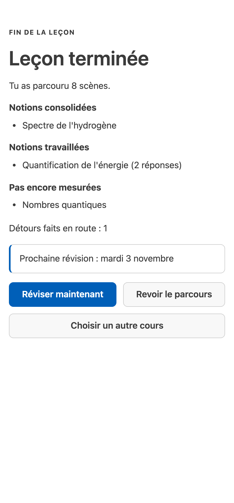

[English](review-over-time.md) · Français

# Réviser dans la durée

Revenez à Studium n'importe quel jour suivant : une seule question, « qu'est-ce que je révise maintenant ? »,
obtient une seule réponse : les révisions dues, les leçons en cours et l'étape suivante. Une séance de
révision fait ensuite revenir chaque notion due, toutes leçons confondues, juste avant que vous risquiez de
l'oublier. C'est la révision espacée : chaque rappel réussi repousse le suivant. Studium la planifie avec FSRS
(Free Spaced Repetition Scheduler), un modèle de l'oubli ; voir le [glossaire](../concepts/glossary.fr.md).

## Demander votre plan d'étude

Dans un chat, dites « Qu'est-ce que je révise avec Studium aujourd'hui ? » ou utilisez le prompt `review`.
L'assistant appelle `get_study_plan` dans votre langue (français ou anglais ; à défaut, celle de votre dernière
leçon) et affiche le plan tel quel :

| Rubrique | Ce qu'elle liste |
|---|---|
| **À réviser** | Les notions maîtrisées dont le rappel est dû, la plus urgente d'abord |
| **À reprendre** | Les notions évaluées sous le seuil de maîtrise et de nouveau dues |
| **À revoir** | Les notions dues que seule votre auto-évaluation a planifiées : rien ne les a mesurées, elles ne sont donc pas dites fragiles |
| **En cours** | Les leçons commencées et non terminées, avec le nombre d'étapes faites |
| **Leçon suivante** | La leçon suivante d'un cours que vous suivez, ou la plus récente que vous n'avez pas ouverte |
| **Maintenant** | La seule étape à faire |

L'étape proposée suit un ordre fixe : jouer les révisions dues, sinon reprendre une leçon en cours, sinon
commencer la leçon suivante, sinon préparer une leçon à partir de vos sources (si vous n'en avez aucune),
sinon attendre, avec la date de la prochaine révision. Une notion qu'aucune leçon ne peut reposer sous forme
de question reste listée, avec la mention « aucune question de révision ne la reprend pour l'instant », mais
n'est jamais proposée comme étape. Les dates sont des jours du calendrier dans le fuseau horaire de la machine
qui fait tourner Studium.

Si vous avez donné vos minutes par jour quand votre assistant a préparé une leçon, le plan dimensionne l'étape
avec elles : une leçon plus longue est proposée en plusieurs fois, et une séance de révision est réduite à ce
qui tient dans la journée.

Dans VS Code, la barre d'état indique combien de notions vous attendent (« Studium · 2 à réviser » quand ce
sont toutes des révisions dues, « Studium · 3 à travailler » sinon) ; son info-bulle et la barre latérale
séparent les trois groupes : à réviser, à reprendre, pas encore mesurées. Le panneau ne compte que sa propre progression ; voir
[apprendre avec votre assistant](learn-with-your-assistant.fr.md#4-jouer-dans-le-chat-ou-dans-vs-code).

## Jouer une séance de révision

`start_review_session` compose une courte séance, avec une question par notion due, prise dans la leçon où
vous l'avez apprise, parmi les scènes dont c'est la notion principale. Elle préfère une autre question que
celle de la dernière fois et, sans modèle juge, une question notée par une clé. La séance se joue comme une
leçon : vous répondez avec vos mots ou en choisissant, et vous notez votre rappel quand on vous le demande. Au
plus 50 questions par séance.

- Les questions viennent des scènes quiz, défaut à repérer, explication, comparaison, audit de résumé et
  rédaction de prompt. Les scènes de lecture ne sont pas rejouées, ni le diagnostic d'ouverture d'une leçon
  (« que sais-tu déjà ? »), ni les scènes qui dépendent d'une exécution faite dans la leçon.
- Les réponses mettent à jour votre mémoire de révision et votre maîtrise. Une séance de révision n'est jamais
  enregistrée comme une leçon terminée.
- Quand rien n'est dû, vous obtenez la date de la prochaine révision. Une notion due dont la leçon n'est plus
  sur le disque est signalée comme ne pouvant plus être révisée.

À la fin, vous voyez la date de la prochaine révision et trois listes : **Consolidées** (au moins trois
réponses notées et une maîtrise au seuil de révision), **Travaillées** (notées, avec le nombre de réponses,
pas encore consolidées) et **Pas encore mesurées** (rien ne les a notées).

<picture>
  <source media="(prefers-color-scheme: dark)" srcset="../assets/screenshots/vscode-pane-completion-dark.png">
  
</picture>

## Ce qui planifie une révision, et ce qui ne la planifie pas

| Ce qui s'est passé | Planifie une révision | Change la maîtrise |
|---|---|---|
| Une réponse à un quiz ou à un défaut à repérer | Oui : faux compte comme « again », juste après un indice comme « hard », juste comme « good » | Oui |
| Une réponse rédigée qu'aucun juge n'a évaluée, puis votre auto-évaluation | Oui, d'après votre note | Non |
| Une réponse rédigée qu'aucun juge n'a évaluée, sans note | Non | Non |
| Une réponse rédigée évaluée par un juge modèle | Aucune auto-évaluation n'est demandée ; l'évaluation du juge sert de preuve notée | Oui |
| Une scène de lecture ou un point de confiance | Non | Non |

Votre auto-évaluation (`again`, `hard`, `good`, `easy`) est votre propre jugement, après avoir comparé votre
réponse aux points clés et à la réponse modèle. Elle dit au planificateur quand vous reposer la question,
pour chaque notion de la question notée. Elle n'est jamais prise pour une preuve que vous savez, d'où la rubrique **À revoir** plutôt que **À reprendre**.
Une réponse que personne n'a évaluée ne compte pas comme un rappel, ni réussi ni manqué. Pour le fond :
[le modèle de l'apprenant](../concepts/learner-model.fr.md).

## Où sont vos données

La progression est durable par défaut : elle survit au redémarrage de l'assistant ou de l'ordinateur.

| Quoi | Où |
|---|---|
| Leçons écrites par l'assistant | `~/.studium/library/<cours>/lesson.json`, quel que soit `BUNDLES_ROOT` |
| Sources préparées | `~/.studium/library/_sources/` |
| Progression, maîtrise, mémoire de révision, historique d'étude | `~/.studium/data/`, un dossier par pseudonyme d'apprenant |
| Secret des pseudonymes | `~/.studium/data/.studium-secret`, créé avec un nouveau dossier de données |
| Progression du panneau VS Code | Le stockage propre de l'extension dans VS Code |

`STUDIUM_HOME` déplace `~/.studium` ; `STUDIUM_DATA_DIR` déplace le seul dossier de données ;
`STUDIUM_EPHEMERAL=1` garde tout en mémoire, et l'assistant vous prévient alors que la progression sera perdue
au redémarrage. Voir [configuration](../reference/configuration.fr.md).

Les dossiers sur disque portent un pseudonyme calculé à partir de votre identifiant et du secret, jamais
l'identifiant lui-même. Pour déplacer vos données vers une autre machine, copiez le dossier de données entier,
secret compris : sans lui, vos dossiers ne peuvent plus être rattachés à votre identifiant. Gardez le même
`learner_id` dans tous vos assistants pour n'avoir qu'un historique.

## Limites

- Seul ce qui a été évalué ou auto-évalué est révisé : une leçon lue sans répondre ne planifie rien.
- Les dates de révision sont l'estimation d'un modèle de l'oubli, pas une garantie.
- Effacer les données d'une leçon avec `forget_session` efface aussi votre mémoire inter-leçons et votre
  historique d'étude ; les leçons de votre bibliothèque et leurs sources restent jusqu'à ce que vous les
  supprimiez. Détails : [confidentialité et limites](../concepts/privacy-and-limits.fr.md).

Le code du plan d'étude se trouve dans [packages/lesson-session-host/src/study-plan.ts](../../packages/lesson-session-host/src/study-plan.ts)
et celui de la séance de révision dans [packages/lesson-session-host/src/review-session.ts](../../packages/lesson-session-host/src/review-session.ts).
