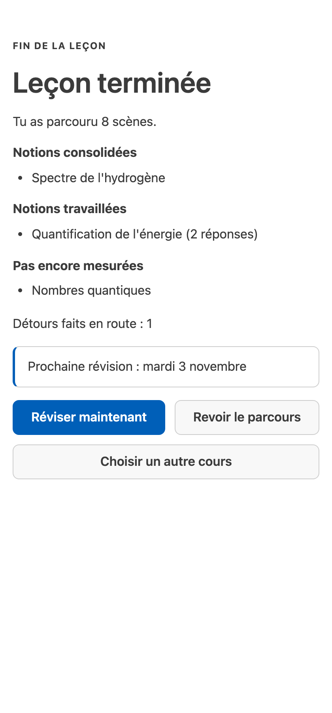

English · [Français](review-over-time.fr.md)

# Review over time

Come back to Studium on any later day and one question, "what should I study now?", gets one answer: the
reviews due, the lessons in progress and the next step. A review session then brings back every concept due,
across all your lessons, just before you are likely to forget it. This is spaced review: each successful
recall pushes the next one further away. Studium schedules it with FSRS (Free Spaced Repetition Scheduler),
a model of how memory fades; see the [glossary](../concepts/glossary.md).

## Ask for your study plan

In a chat, say "What should I study with Studium today?" or use the `review` prompt. The assistant calls
`get_study_plan` in your language (French or English; without one, the language of your last lesson) and
shows the plan as it comes:

| Section | What it lists |
|---|---|
| **To review** | Concepts you mastered whose recall is now due, most urgent first |
| **To relearn** | Concepts graded below the mastery threshold and due again |
| **Due for review** | Concepts due that only your self-rating scheduled: nothing measured them, so they are not called weak |
| **In progress** | Lessons started and not finished, with the number of steps done |
| **Next lesson** | The next lesson of a course you follow, or the newest lesson you have not opened |
| **Now** | The one step to take |

The step to take follows a fixed order: play the reviews due, otherwise continue a lesson in progress,
otherwise start the next lesson, otherwise build a lesson from your sources (when you have none), otherwise
wait, with the date of the next review. A concept that no lesson can replay as a question stays listed, marked
"no review question covers it yet", but is never proposed as the next step. Dates are calendar days in the
time zone of the machine that runs Studium.

If you gave your minutes a day when your assistant built a lesson, the plan sizes the step with them: a
lesson longer than that is proposed in several sittings, and a review session is cut to what fits today.

In VS Code, the status bar shows how many concepts are waiting ("Studium · 2 to review" when all are due
reviews, "Studium · 3 to work on" otherwise); its tooltip and the sidebar keep the three groups apart: to
review, to take up again, not measured yet. The pane counts its own progress only; see [learn with your assistant](learn-with-your-assistant.md#4-play-it-in-the-chat-or-in-vs-code).

## Play a review session

`start_review_session` builds one short session with a question for each concept due, taken from the lesson
you learned it in, among the scenes whose main concept it is. It prefers a question other than the one you
answered last time and, when no judge model is configured, a question graded against a key. It plays like a
lesson: you answer in your own words or by choosing, and rate your recall when asked. At most 50 questions per
session.

- Questions come from quiz, spot-the-flaw, explain-back, comparison, summary-audit and prompt-practice scenes.
  Reading scenes are not replayed, nor the opening diagnostic of a lesson ("what do you already know?"), nor
  scenes that depend on a run you made inside the lesson.
- Answers update your review memory and your mastery. A review session is never recorded as a lesson completed.
- When nothing is due, you get the date of the next review instead. A concept due whose lesson is no longer
  on disk is named as one that cannot be reviewed any more.

At the end you see the next review date and three lists: **Consolidated** (at least three graded answers and a
mastery at the review threshold), **Practised** (graded, with the number of answers, not yet consolidated)
and **Not measured yet** (nothing graded them).

<picture>
  <source media="(prefers-color-scheme: dark)" srcset="../assets/screenshots/vscode-pane-completion-dark.png">
  
</picture>

## What schedules a review, and what does not

| What happened | Schedules a review | Changes mastery |
|---|---|---|
| A quiz or spot-the-flaw answer | Yes: wrong reads as "again", right after a hint as "hard", right as "good" | Yes |
| A written answer no judge assessed, then your self-rating | Yes, from your rating | No |
| A written answer no judge assessed, not rated | No | No |
| A written answer assessed by a judge model | No self-rating is asked; the judge's assessment is the graded evidence | Yes |
| A reading scene or a confidence check | No | No |

Your self-rating (`again`, `hard`, `good`, `easy`) is your own judgement after comparing your answer with the
key points and the model answer. It tells the scheduler how soon to ask again, for every concept of the
question you rated. It is never treated as proof that you know the concept, which is why such concepts appear under **Due for review** and not **To relearn**.
An answer nobody graded is not counted as a recall, neither a success nor a failure. Background:
[the learner model](../concepts/learner-model.md).

## Where your data lives

Progress is durable by default: it survives a restart of the assistant or the computer.

| What | Where |
|---|---|
| Lessons your assistant writes | `~/.studium/library/<course>/lesson.json`, whatever `BUNDLES_ROOT` names |
| Prepared sources | `~/.studium/library/_sources/` |
| Progress, mastery, review memory, study record | `~/.studium/data/`, one folder per learner pseudonym |
| Pseudonym secret | `~/.studium/data/.studium-secret`, created with a new data folder |
| VS Code pane progress | VS Code's own extension storage |

`STUDIUM_HOME` moves `~/.studium`; `STUDIUM_DATA_DIR` moves the data folder alone; `STUDIUM_EPHEMERAL=1`
keeps everything in memory, and the assistant then warns you that progress is lost at restart. See
[configuration](../reference/configuration.md).

Folders on disk are named by a pseudonym computed from your learner id and the secret, never by your id
itself. To move your data to another machine, copy the whole data folder, secret included: without it your
folders can no longer be matched to your id. Use the same `learner_id` in every assistant to keep one history.

## Limits

- Reviews only exist for what was graded or self-rated: a lesson read without answering schedules nothing.
- Review dates are an estimate from a model of forgetting, not a guarantee.
- Erasing a lesson's data with `forget_session` also erases your cross-lesson memory and study record; the
  lessons in your library and their sources stay until you delete them. Details:
  [privacy and limits](../concepts/privacy-and-limits.md).

The study plan code is in [packages/lesson-session-host/src/study-plan.ts](../../packages/lesson-session-host/src/study-plan.ts)
and the review session in [packages/lesson-session-host/src/review-session.ts](../../packages/lesson-session-host/src/review-session.ts).
