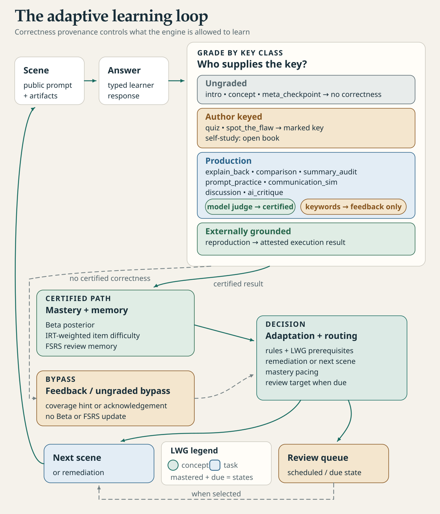

[English](student-guide.md) · Français

# Guide étudiant

Studium joue une leçon étape par étape et choisit la suite d'après vos réponses : un indice, un détour par un
prérequis ou la notion suivante. Un assistant IA peut vous expliquer un outil, préparer un calcul ou tracer un
graphique. **Votre prédiction, votre raisonnement et votre conclusion restent les vôtres.** Cette page dit quoi
faire dans une leçon, comment vous servir de l'assistant sans lui céder le travail, et comment interrompre puis
reprendre.

<picture>
  <source media="(prefers-color-scheme: dark)" srcset="../assets/diagrams/learning-loop-dark.svg">
  
</picture>

## Avant la première séance

Demandez à votre enseignant la leçon du cours (un `lesson.json` et ses ressources), la version de Studium et
les expériences autorisées. Un PDF seul n'est pas une leçon jouable. Pour essayer tout de suite, utilisez la
leçon `atomistique-l1` fournie dans `fixtures/`.

1. Suivez le [démarrage rapide](../start/quickstart.fr.md).
2. Choisissez où jouer : le [panneau de leçon VS Code](../start/vscode.fr.md), sans compte IA, ou un assistant
   comme Codex, Claude Code, Copilot ou OpenCode par MCP ([harnais](../start/harnesses.fr.md)).
3. Faites le [tutoriel première séance](../tutorials/first-lesson.fr.md).

Si l'enseignant vous fournit une activité portable (`index.html`), ouvrez-la dans un navigateur : rien à
installer.

La télémétrie de classe reste désactivée tant que vous ne l'activez pas. Pour vos essais, utilisez un
identifiant de test plutôt que votre vrai nom ; l'enseignant précise les règles d'un pilote avant toute
collecte. Pour apprendre sans enseignant, à partir de vos propres sources, voir
[apprendre avec votre assistant](learn-with-your-assistant.fr.md).

## Que faire dans chaque scène

| Scène | Votre contribution |
|---|---|
| Introduction, concept | Lire, regarder les figures, puis continuer |
| Quiz | Raisonner d'abord, puis choisir ; demander un indice au besoin |
| Point de confiance | Indiquer votre propre confiance, de 0 à 4 |
| Reproduction | Lire le protocole, prédire, puis examiner des résultats réellement exécutés |
| Défaut à repérer, audit de résumé, critique d'IA | Relier chaque objection à un fait ou une preuve |
| Explication, comparaison | Rédiger votre formulation et ses limites |
| Discussion | Construire l'argument sur plusieurs échanges |
| Rédaction de prompt, communication | Rédiger, puis améliorer votre propre proposition |

Un cours n'utilise pas tous les types ; voir [types de scènes](../concepts/scene-types.fr.md). Le panneau
affiche les contrôles adaptés à chaque scène. Dans un chat, chaque étape indique comment répondre : une lettre,
un chiffre ou vos propres mots.

<picture>
  <source media="(prefers-color-scheme: dark)" srcset="../assets/screenshots/vscode-pane-choices-dark.png">
  
</picture>

## Se servir de l'assistant sans lui céder l'activité

Des demandes qui vous laissent la main :

> Donne-moi un indice sur la démarche, puis attends mon essai.

> Affiche ces données avec leurs unités. Demande-moi d'abord ce que je prédis quand on change le seuil. Garde
> la référence visible à côté de la variante.

> Voici mon explication : […]. Pose-moi une question qui teste sa limite, sans remplacer mon texte avant que je
> le soumette.

> Explique la dernière adaptation avec l'outil Studium. Distingue ce qu'il rapporte de ton interprétation.

Un indice réduit le crédit de maîtrise de la réponse qui suit ; il reste utile quand vous bloquez. Un détour
vous envoie vers un prérequis, puis vous ramène. Les indicateurs de maîtrise aident à apprendre ; ce ne sont
ni une note officielle ni un diagnostic. Voir [le modèle de l'apprenant](../concepts/learner-model.fr.md).

## Expérimenter avec un article ou une capsule

Suivez le [tutoriel d'expérience agentique](../tutorials/agentic-experiment.fr.md) : choisissez une question,
prédisez un effet, exécutez une référence, changez un facteur et jugez la différence. Notez votre prédiction
avant de voir un résultat, dans le [journal d'expérience](experiment-journal.fr.md).

L'assistant peut chercher une documentation ou lire un skill, mais il doit dire ce qu'il a réellement consulté
et exécuté. Vérifiez unités, données, cas limites et provenance : un graphique produit par une IA peut être
faux. Gardez les sorties dans votre dossier d'expérience. Une capsule marquée `type-checked` n'est pas une
exécution réussie. Si une dépendance manque ou qu'un calcul échoue, gardez cet échec ; ne demandez jamais à
l'assistant d'inventer un résultat. Dans VS Code, une reproduction vous demande de confirmer la commande exacte
avant que rien ne s'exécute.

## Langue, représentations et rapports

Demandez une autre langue à tout moment (« Continue en français ») ; vos réponses et les sources originales
restent telles quelles. Vous pouvez demander une équation lisible, un schéma, une structure chimique ou une
explication en texte. Voir [langue et supports](language-and-supports.fr.md).

Pour garder une trace de vos propres actions, voir le [rapport d'activité](learner-report.fr.md) et le
[tutoriel activité → rapport](../tutorials/activity-to-report.fr.md). Vous choisissez ce qui y figure ; produire
un rapport ne l'envoie pas à l'enseignant.

## Interrompre et reprendre

- **Pause.** Dites « on s'arrête là » : l'assistant appelle `end_session`, qui ferme la séance et garde votre
  progression. Fermer une fenêtre n'efface rien.
- **Reprise.** Relancez la même leçon avec le même identifiant : Studium reprend à la première étape
  inachevée. Une leçon terminée recommence au début, comme une reprise.
- **Plusieurs endroits.** Le panneau VS Code et un assistant gardent des progressions distinctes. Deux
  assistants la partagent s'ils utilisent le même dossier de données et le même identifiant.
- **Effacement.** Demandez à l'assistant d'oublier vos données pour une leçon, ou toutes vos données
  (`forget_session`) ; il vous dit ensuite ce qui reste sur le disque. Voir
  [apprendre avec votre assistant](learn-with-your-assistant.fr.md#7-fermer-ou-oublier). Dans VS Code,
  **Studium : Oublier mes données** efface ce que garde l'extension, pas les données d'un assistant. Les
  dossiers d'expérience et l'historique de l'assistant suivent leurs propres règles de conservation.

Les révisions espacées font revenir les notions les jours suivants : voir
[réviser dans la durée](review-over-time.fr.md). En cas de souci, voir le [dépannage](../start/troubleshooting.fr.md)
et n'envoyez à l'enseignant qu'un petit exemple anonymisé. Détails sur les données :
[confidentialité et limites](../concepts/privacy-and-limits.fr.md).
