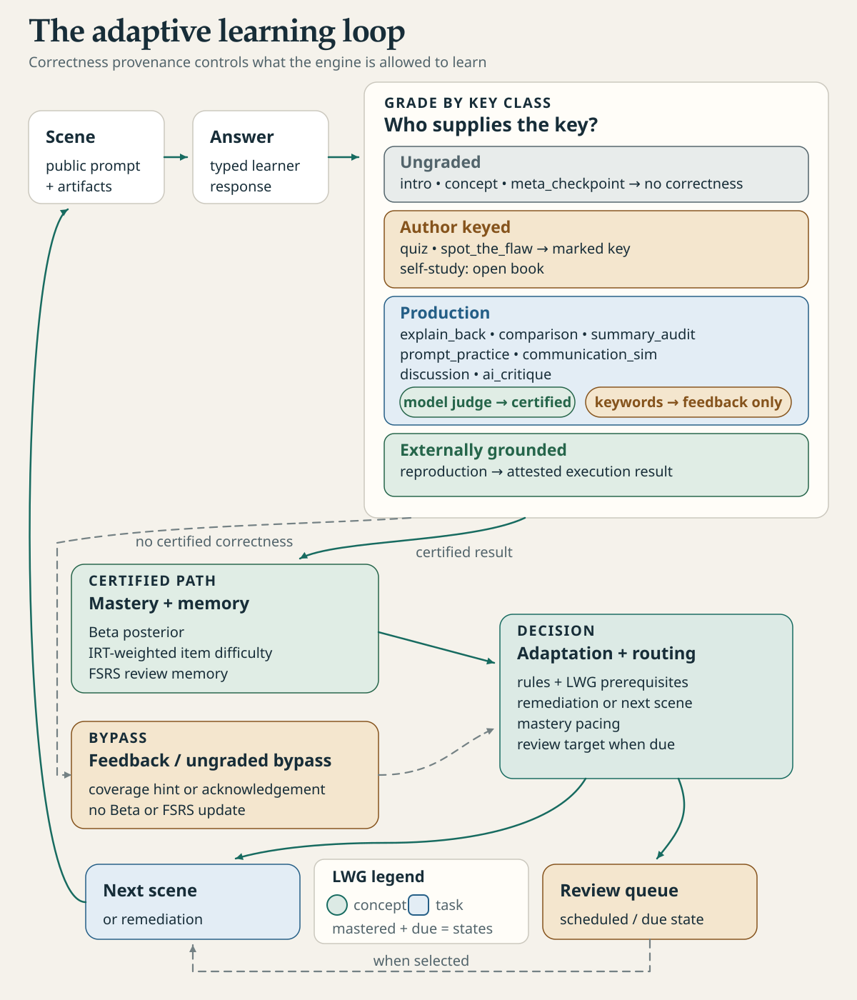

English · [Français](student-guide.fr.md)

# Student guide

Studium plays a lesson one step at a time and chooses what comes next from your answers: a hint, a detour
through a prerequisite, or the next idea. An AI assistant can explain a tool, prepare a calculation or draw a
graph for you. **Your prediction, your reasoning and your conclusion stay yours.** This page covers what to
do in a lesson, how to use the assistant without handing it the work, and how to stop and resume.

<picture>
  <source media="(prefers-color-scheme: dark)" srcset="../assets/diagrams/learning-loop-dark.svg">
  
</picture>

## Before your first session

Ask your teacher for the course lesson (a `lesson.json` with its assets), the Studium version and which
experiments you may run. A PDF alone is not a playable lesson. To try right away, use the `atomistique-l1`
lesson shipped in `fixtures/`.

1. Follow the [quickstart](../start/quickstart.md).
2. Choose where to play: the [VS Code lesson pane](../start/vscode.md), which needs no AI account, or an
   assistant such as Codex, Claude Code, Copilot or OpenCode over MCP ([harnesses](../start/harnesses.md)).
3. Play the [first lesson tutorial](../tutorials/first-lesson.md).

If your teacher gives you a portable activity (`index.html`), open it in a browser: nothing to install.

Class telemetry is off unless you opt in. While you try things out, use a test learner id rather than your
real name; your teacher explains the rules of a class pilot before any collection. To learn without a
teacher, from your own sources, see [learn with your assistant](learn-with-your-assistant.md).

## What to do in each scene

| Scene | Your part |
|---|---|
| Introduction, concept | Read, look at the figures, then continue |
| Quiz | Reason first, then choose; ask for a hint if you need one |
| Confidence check | Give your own confidence, from 0 to 4 |
| Reproduction | Read the protocol, predict, then examine results that were really run |
| Spot the flaw, summary audit, AI critique | Tie each objection to a fact or a piece of evidence |
| Explain back, comparison | Write your own formulation and its limits |
| Discussion | Build the argument over several turns |
| Prompt practice, communication | Draft, then improve your own proposal |

Not every course uses every type; see [scene types](../concepts/scene-types.md). The pane shows the right
controls for each scene. In a chat, each step tells you how to answer: a letter, a number, or your own words.

<picture>
  <source media="(prefers-color-scheme: dark)" srcset="../assets/screenshots/vscode-pane-choices-dark.png">
  
</picture>

## Use the assistant without giving it the activity

Requests that keep you in charge:

> Give me a hint about the approach, then wait for my attempt.

> Show these data with their units. Ask me first what I predict when the threshold changes. Keep the reference
> visible next to the variant.

> Here is my explanation: […]. Ask me one question that tests its limit, without replacing my text before I
> submit it.

> Explain the last adaptation with the Studium tool. Separate what it reports from your own interpretation.

A hint lowers the mastery credit of your eventual answer; it is still worth asking when you are stuck. A
detour sends you to a prerequisite and then back. Mastery figures are a learning aid, not an official grade
or a diagnosis. See [the learner model](../concepts/learner-model.md).

## Experiment with an article or a capsule

Follow the [agentic experiment tutorial](../tutorials/agentic-experiment.md): pick a question, predict an
effect, run a reference, change one factor and judge the difference. Record your prediction before seeing any
result in the [experiment journal](experiment-journal.md).

The assistant may search documentation or read a skill, but it must say what it actually consulted and ran.
Check units, data, edge cases and provenance: a graph an AI produced can be wrong. Keep outputs in your
experiment folder. A capsule marked `type-checked` is not a successful run. If a dependency is missing or a
calculation fails, keep that failure; never ask the assistant to make up a result. In VS Code, a reproduction
asks you to confirm the exact command before anything runs.

## Language, representations and reports

Ask for another language at any time ("Continue in French"); your answers and the original sources are kept
as they are. You can ask for a readable equation, a diagram, a chemical structure or a plain-text explanation.
See [language and supports](language-and-supports.md).

To keep a record of your own actions, see the [learner report](learner-report.md) and the
[activity-to-report tutorial](../tutorials/activity-to-report.md). You choose what goes in; producing a report
does not send it to your teacher.

## Stop and resume

- **Pause.** Say "stop here"; the assistant calls `end_session`, which closes the session and keeps your
  progress. Closing a window alone does not erase anything.
- **Resume.** Start the same lesson with the same learner id: Studium resumes at the first unfinished step.
  A finished lesson starts again from the beginning as a retake.
- **Several places.** The VS Code pane and an assistant keep separate progress. Two assistants share it when
  they use the same data folder and learner id.
- **Erase.** Ask the assistant to forget your data for a lesson, or all your data (`forget_session`); it
  then tells you what stays on disk. See
  [learn with your assistant](learn-with-your-assistant.md#7-close-or-forget). In VS Code, **Studium: Forget
  my data** erases what the extension keeps, not an assistant's data. Experiment folders and the assistant's
  own history follow their own retention rules.

Spaced reviews bring concepts back over the following days: see [review over time](review-over-time.md). If
something goes wrong, see [troubleshooting](../start/troubleshooting.md) and send your teacher only a small,
anonymised example. Privacy details: [privacy and limits](../concepts/privacy-and-limits.md).
