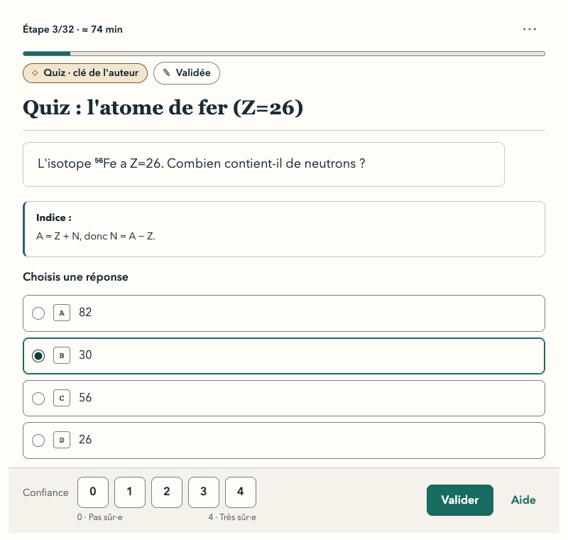

[English](browser.md) · Français

# Jouer une leçon dans votre navigateur

**Statut : expérimental.** Le lecteur dans le navigateur joue une leçon Studium existante dans un navigateur
web ordinaire, sans VS Code et sans assistant IA. Il tourne sur votre ordinateur, ou sur un poste de salle de
TP, et ne répond qu'à cet ordinateur. Il ne construit pas de leçon : il faut toujours un assistant pour cela
(voir le [Démarrage rapide](quickstart.fr.md)). Lisez les [Limites](#limites) avant de vous y fier.

<picture>
  <source media="(prefers-color-scheme: dark)" srcset="../assets/screenshots/browser-player-quiz-dark.png">
  
</picture>

## Avant de commencer

| Nécessaire | Pourquoi |
|---|---|
| Node.js 20 ou plus récent (22 conseillé) | il fait tourner le lecteur ; une commande dans un terminal le lance |
| Un dossier de leçons (facultatif) | chaque leçon est un dossier avec son `lesson.json` ; sans lui, la page liste votre bibliothèque et la courte leçon de démonstration livrée avec Studium ; d'autres leçons de démonstration sont dans le dossier `fixtures` de l'[archive du dépôt](https://github.com/HolobiomicsLab/studium/archive/refs/heads/main.zip) |
| Un navigateur web récent | la leçon s'y ouvre |

Ni VS Code, ni assistant, ni compte d'IA ne sont nécessaires.

## Lancer le lecteur

```bash
npx -y studium-mcp play /chemin/vers/les/lecons
```

Le lecteur affiche où il lit les leçons, où il garde la progression, et une adresse comme
`http://127.0.0.1:53817/play#token=…`, qu'il ouvre dans votre navigateur par défaut. Gardez le terminal
ouvert : le fermer, ou Ctrl+C, arrête le lecteur. Si aucun navigateur ne s'ouvre, copiez l'adresse dans un
navigateur.

La commande `play` est dans `studium-mcp` depuis la version 0.6.4.

| Option | Effet |
|---|---|
| `dossier` | le dossier de leçons ; sans lui, votre bibliothèque (`~/.studium/library`) |
| `--port N` | le port sur 127.0.0.1 ; sans lui, un port libre choisi par le système |
| `--no-open` | affiche l'adresse sans ouvrir le navigateur |

Les mêmes variables d'environnement que pour le serveur s'appliquent : `STUDIUM_HOME`, `STUDIUM_DATA_DIR`,
`STUDIUM_LEARNER_ID`, `STUDIUM_EPHEMERAL=1` (voir [Configuration](../reference/configuration.fr.md)).

## Jouer

1. La page liste les leçons du dossier et de votre bibliothèque, puis la leçon de démonstration livrée avec
   Studium, avec leur nombre d'étapes, si un enseignant les a validées, et où vous en êtes. Tant que cette
   liste est affichée, elle est relue chaque fois que vous revenez à son onglet ou à sa fenêtre : une leçon
   que votre assistant a enregistrée entre-temps dans votre bibliothèque apparaît sans recharger la page.
2. Choisissez-en une. Elle s'ouvre à votre première étape non terminée.
3. Répondez dans la page. Chaque étape est dessinée par le même moteur de rendu que le panneau de VS Code,
   avec les mêmes avis : qui a écrit la leçon et sa clé de correction, et, après une réponse, si la clé ou un
   juge l'a évaluée, ou personne. Vous avez aussi les indices, l'échelle de confiance, la note de rappel, la
   carte des notions, le français ou l'anglais (**⋯**, **Réglages**) et le bilan de fin de leçon.
4. **⋯**, **Choisir un autre cours** ramène à la liste ; **M'oublier** efface vos données d'apprentissage
   après une confirmation.

Ce que la page ne fait pas : les étapes de reproduction d'une capsule demandent le terminal de VS Code, et la
page le dit ; il n'y a pas d'assistant à qui poser une question, donc **Poser une question** n'est pas
proposé et le barreau d'explication de l'**Aide** est fermé avec sa raison.

## Où est gardée la progression

La progression est gardée dans `~/.studium/data` (ou `STUDIUM_DATA_DIR`), comme pour le serveur que lance
votre assistant : une leçon rouverte après un redémarrage reprend où vous vous étiez arrêté. Avec
`STUDIUM_EPHEMERAL=1`, rien n'est écrit et la progression s'arrête avec le lecteur. Un lecteur correspond à
un apprenant : `STUDIUM_LEARNER_ID`, sinon `anonymous`. Les personnes qui partagent un compte de
l'ordinateur partagent ce dossier ; sur un poste partagé, donnez un compte à chaque étudiant ou un
`STUDIUM_HOME` par étudiant.

## Qui peut l'atteindre

- Il n'écoute que sur 127.0.0.1 : les autres ordinateurs, du réseau de la salle ou d'ailleurs, ne
  l'atteignent pas.
- Son adresse porte une clé créée pour ce lancement. Sans elle, rien n'est répondu ; la clé ne vaut plus rien
  quand le lecteur s'arrête. Ne collez pas l'adresse dans une discussion ou un document partagé.
- Les autres sites ouverts dans le même navigateur ne peuvent pas l'appeler : il refuse les requêtes d'autres
  origines et ne leur donne jamais la permission de lire.
- La page ne reçoit jamais une clé de correction avant votre réponse : la correction reste dans le lecteur.

La [note de conception](../design-records/specs/2026-11-25-browser-player.md) (en anglais) donne le détail et
ce que demanderait une version hébergée, pour plusieurs utilisateurs (connexion, une identité par apprenant,
protection des données).

## Limites

- **Essayé par des scripts seulement, sous macOS.** Personne n'a encore utilisé le lecteur. Un Google
  Chrome sans fenêtre piloté par Playwright :
  - depuis la version du serveur construite dans ce dépôt, a ouvert la liste, joué les cinq premières étapes
    de `fixtures/atomistique-l1` (une introduction, une notion, un quiz avec un indice, noté par la clé de
    l'auteur, et un audit de résumé, avec son avis « non certifié » et la note de rappel), en thème clair et
    sombre, et repris la même étape après un rechargement de la page ; un second essai a vérifié qu'une
    progression gardée sur le disque reprend à la même étape après un redémarrage du lecteur ;
  - depuis `studium-mcp` 0.6.4 publié (`npx`), a joué jusqu'à sa fin la leçon de démonstration en
    anglais, Discover Studium, une fois avec le CDN (`cdn.jsdelivr.net`) joignable et une fois avec le CDN
    bloqué.
- **Pas essayé :** Windows et Linux (le navigateur s'ouvre avec `cmd /c start` et `xdg-open`), Firefox et
  Safari, un lecteur d'écran, un ordinateur sans réseau, l'affichage en texte simple des équations,
  graphiques et molécules (la leçon de démonstration jouée avec le CDN bloqué n'en contient aucun), une salle
  de TP, plusieurs étudiants sur un poste.
- Après une note de rappel, le cadre de la note se ferme sans afficher « C'est noté » ; la note est bien
  enregistrée.
- Lancer le lecteur demande toujours Node et une commande. Rien ne le lance encore depuis un raccourci du
  bureau ou depuis VS Code.
- Signalez ce que vous rencontrez : [Signaler un problème ou contribuer](report-and-contribute.fr.md).
