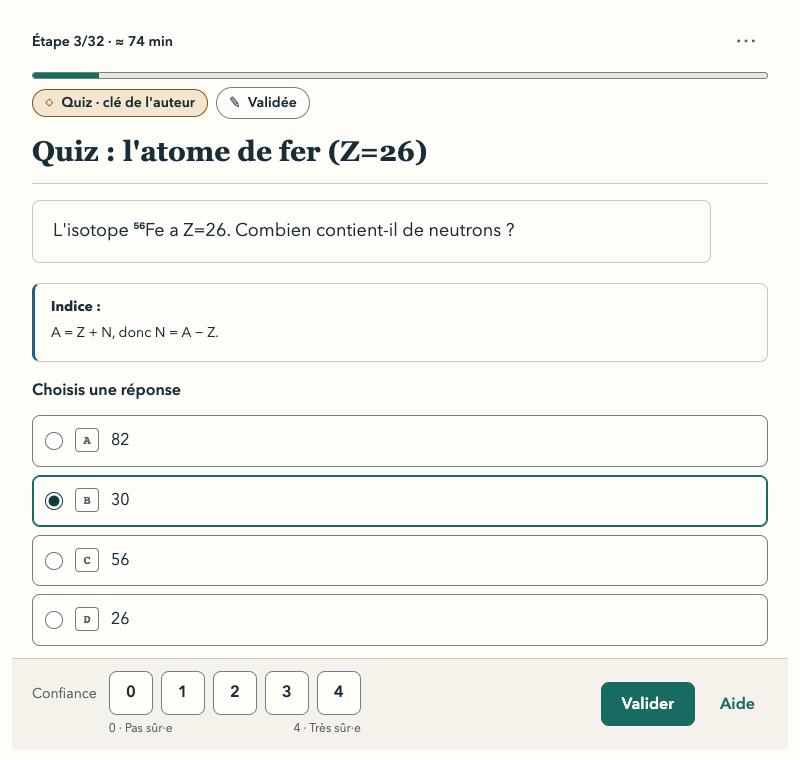

English · [Français](browser.fr.md)

# Play a lesson in your browser

**Status: experimental.** The browser player plays an existing Studium lesson in an ordinary web browser,
with no VS Code and no AI assistant. It runs on your own computer, or on a classroom workstation, and
answers only that computer. It does not build lessons: that still needs an assistant (see
[Quickstart](quickstart.md)). You start it with one command, or an assistant offers it
([From your assistant](#from-your-assistant)). Read [Limits](#limits) before you rely on it.

<picture>
  <source media="(prefers-color-scheme: dark)" srcset="../assets/screenshots/browser-player-quiz-dark.png">
  
</picture>

## Before you start

| Needed | Why |
|---|---|
| Node.js 20 or later (22 recommended) | it runs the player; one command in a terminal starts it |
| A folder of lessons (optional) | each lesson is a folder with its `lesson.json`; without one, the page lists your library and the short demo lesson shipped with Studium; more demo lessons are the `fixtures` folder of the [repository archive](https://github.com/HolobiomicsLab/studium/archive/refs/heads/main.zip) |
| A recent web browser | the lesson opens in it |

No VS Code, no assistant and no AI account are needed.

## Start the player

```bash
npx -y studium-mcp play /path/to/lessons
```

The player prints where it reads the lessons, where it keeps progress, and an address such as
`http://127.0.0.1:53817/play#token=…`, which it opens in your default browser. Keep the terminal open:
closing it, or Ctrl+C, stops the player. If no browser opens, copy the address into one.

The `play` command is in `studium-mcp` 0.6.4 and later.

| Option | Effect |
|---|---|
| `folder` | the folder of lessons; without it, your library (`~/.studium/library`) |
| `--port N` | the port on 127.0.0.1; without it, a free port chosen by the system |
| `--no-open` | print the address without opening the browser |

The same environment variables as the server apply: `STUDIUM_HOME`, `STUDIUM_DATA_DIR`,
`STUDIUM_LEARNER_ID`, `STUDIUM_EPHEMERAL=1` (see [Configuration](../reference/configuration.md)).

## From your assistant

When an assistant runs Studium without the Studium VS Code extension (OpenCode, Mistral Vibe, Copilot
configured by hand, among others), its Studium server offers this player too, with no command to type. The
first time it offers a lesson (one it has just built, or the one the study plan says to start or continue),
it starts the player on 127.0.0.1, on a free port, and the assistant shows an address such as
`http://127.0.0.1:53817/play#k=…&from=assistant&lesson=…`. Open it in your browser: the lesson opens at
your current step. Or say "here" to play it in the chat. Studium never opens the browser itself.

- **One learner per address.** The address plays the learner the assistant named in that call (its
  `learner_id`, else `STUDIUM_LEARNER_ID`, else `anonymous`): a step answered in the browser is that
  learner's progress in the chat, and the reverse. The page cannot play another learner. An assistant that
  names you differently from one call to the next makes two learners: ask it to keep one name.
- **What comes first.** An assistant that draws Studium's panel (Codex Desktop) offers the panel first and
  this address second. After you answered in the chat, the chat comes first and the address is given once;
  after you answered in the browser, the address comes first again
  ([Where a lesson is offered first](harness-panels.md#where-a-lesson-is-offered-first)). A lesson the
  assistant starts in the chat ends its first step with one line that gives this address.
- **The address lives as long as the assistant session.** When the assistant quits, the player stops with
  its server, and the page says so: ask the assistant for your lesson again to get a new address. If the
  server answers but refuses the address (cut, mistyped, or from an earlier session), the page says that too:
  ask the assistant for it again. Progress is kept as below.
- **Your answers stay on your computer.** Studium checks the answers you give in the browser on your
  computer and does not send them to the assistant's model. This holds only with no judge model configured
  (`LITELLM_BASE_URL` empty, the default): with one, your written answers go to that model to be assessed.
  Back in the chat, the assistant sees where you are in the lesson, as after any step.
- **To turn it off** (a classroom, an IT policy), set `STUDIUM_BROWSER_PLAYER=off` in the server's
  environment: lessons are then played in the chat only. If the player cannot start (a sandbox, a refused
  port), the assistant offers the chat as before, and the server writes one line on its error output.
- The Studium VS Code extension offers its own pane instead and starts no player
  ([Configuration](../reference/configuration.md)).

## Play

1. The page lists the lessons of the folder and of your library, then the demo lesson shipped with
   Studium in the browser's language (English when the browser is set to English, French otherwise), with their number of steps, whether a teacher approved them, and how far you got. While this
   list is on screen, it is read again each time you come back to its tab or its window: a lesson your
   assistant saved in your library meanwhile appears without a reload.
2. Choose one. It opens at your first unfinished step.
3. Answer in the page. Each step is drawn by the same renderer as the VS Code pane, with the same notices:
   who wrote the lesson and its answer key, and, after an answer, whether the key or a judge assessed it,
   or nobody. You also have hints, the confidence scale, recall ratings, the concept map, French or
   English (**⋯**, **Settings**), and the end-of-lesson summary.
4. **⋯**, **Choose another course** opens a list of courses read when it opens, not again when you come
   back to the tab, and without the demo lesson; **Forget me** erases your learning data after a
   confirmation.

What the page does not do: capsule reproduction steps need the VS Code terminal, and the page says so;
there is no assistant to ask, so **Ask a question** is not offered and the explanation rung of **Help**
is closed with its reason.

## Where progress is kept

Progress is kept in `~/.studium/data` (or `STUDIUM_DATA_DIR`), as for the server your assistant starts,
so a lesson reopened after a restart resumes where you stopped. With `STUDIUM_EPHEMERAL=1` nothing is
written and progress ends with the player. One player is one learner: `STUDIUM_LEARNER_ID`, else
`anonymous`. People who share a computer account share that record; on a shared workstation, give each
student an account or set `STUDIUM_HOME` per student.

## Who can reach it

- It listens on 127.0.0.1 only: other computers, on the room's network or elsewhere, cannot reach it.
- Its address carries a key made for this run (from an assistant, a key for each learner it names). Without it, nothing is answered; the key means nothing
  once the player stops. The address works only on this computer, and only while the player runs (from an
  assistant, while that assistant session runs): do not share it with other people, in a message or a shared
  document.
- Other web sites open in the same browser cannot call it: it refuses requests from other origins and
  answers none of them with permission to read.
- The page never receives an answer key before you answer: grading stays in the player.

The [design record](../design-records/specs/2026-11-25-browser-player.md) gives the details and what a
hosted, multi-user version would need (sign-in, one identity per learner, data protection).

## Limits

- **The address an assistant gives was tried by scripts only**: an end-to-end test that talks to the server
  over stdio as an assistant does, and a headless Chrome on macOS that opened the address and answered a
  step. No model in OpenCode, Vibe or Copilot has offered it to a person yet.
- **Tried by scripts only, on macOS.** No person has used the player yet. A headless Google Chrome
  driven by Playwright:
  - from this repository's build of the server, opened the list, played the first five steps of
    `fixtures/atomistique-l1` (an introduction, a concept, a quiz with a hint, graded by the author's key,
    and a summary audit, with its « not certified » notice and the recall rating), in light and dark themes,
    and resumed the same step after a page reload; a second run checked that progress kept on disk resumes
    at the same step after the player restarts;
  - from the published `studium-mcp` 0.6.4 (`npx`), played the Discover Studium demo lesson to its end,
    once with the CDN (`cdn.jsdelivr.net`) reachable and once with it blocked;
  - the list read again on return to the tab was checked with simulated tab and window events only, never
    by switching from another application to the browser.
- **Not tried:** Windows and Linux (the browser opener uses `cmd /c start` and `xdg-open`), Firefox and
  Safari, a screen reader, a computer without network access, the plain-text fallback of equations, charts
  and molecules (the demo lesson played with the CDN blocked has none of them), a teaching room, several
  students on one workstation.
- After a recall rating, the rating box closes without showing « Noted »; the rating is recorded.
- Starting the player still needs Node and one command. Nothing yet starts it from a desktop shortcut or
  from VS Code.
- Report what you meet: [Report a problem or contribute](report-and-contribute.md).
