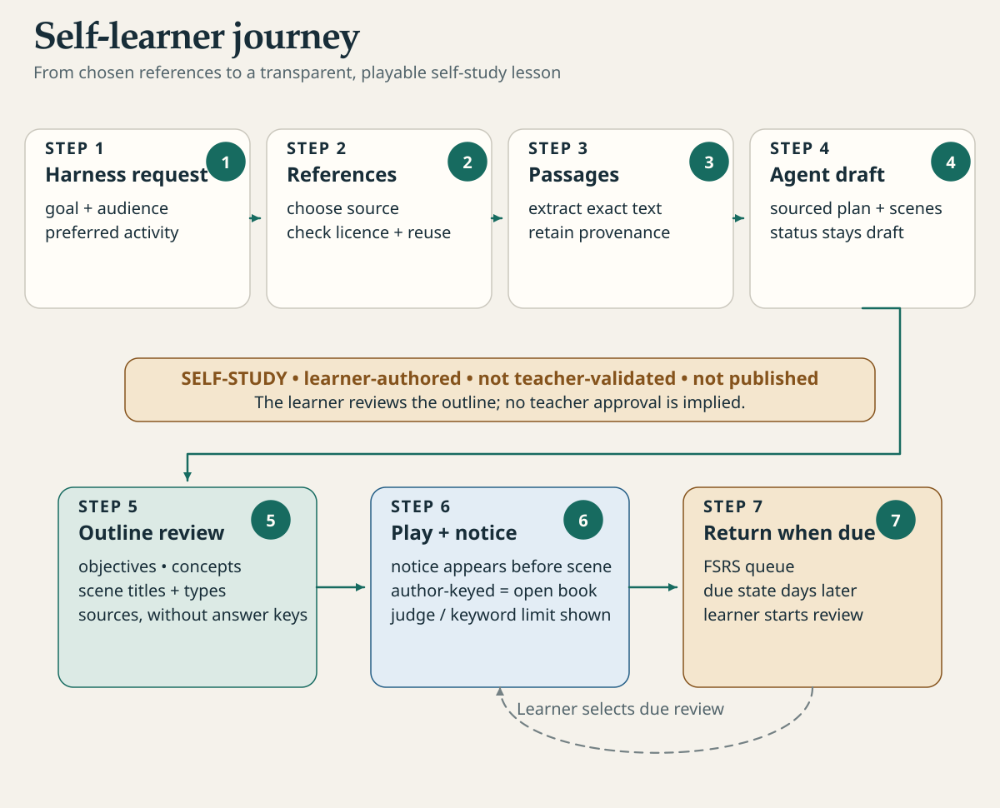

[English](quickstart.md) · Français

# Démarrage rapide

En un quart d'heure environ, vous pouvez demander à un assistant IA de vous enseigner un sujet à partir
des sources que vous choisissez, répondre à la première question d'une leçon préparée pour vous, puis
revenir quelques jours plus tard réviser ce que vous êtes sur le point d'oublier. Cette page part d'un
clone du dépôt, qui vous donne aussi les leçons de démonstration. Pour connecter un assistant avec Node
seulement, sans clone, voir
[Ajouter le serveur à votre assistant](installation.fr.md#ajouter-le-serveur-à-votre-assistant). Chaque
étape renvoie à la page détaillée.

## Sans terminal

Pour voir comment fonctionne Studium, installez l'extension Studium depuis la vue Extensions et lancez
**Studium : Essayer la leçon de démonstration** (ou **Essayer la leçon de démonstration** dans sa vue **Leçons**
vide) : « Découvrir Studium », une dizaine de minutes, est livrée avec l'extension ; un agent d'IA l'a rédigée
à partir de la documentation de Studium et aucun enseignant ne l'a encore vérifiée. Pour jouer une leçon donnée
par un enseignant, ou les leçons de démonstration du dépôt, VS Code suffit aussi : lancez **Studium : Choisir un cours**, choisissez **Choisir un
autre dossier de cours…** et sélectionnez le dossier de leçons ; les leçons de démonstration sont le dossier
`fixtures` de l'[archive du dépôt](https://github.com/HolobiomicsLab/studium/archive/refs/heads/main.zip). Ni Node, ni terminal, ni compte d'assistant IA n'interviennent.
Détails : [VS Code](vscode.fr.md#obtenir-votre-première-leçon) ; pour une salle d'enseignement,
[Postes de salle de TP](classroom-workstations.fr.md). Sans VS Code, [Jouer dans votre navigateur](browser.fr.md)
(expérimental) ouvre une leçon dans un navigateur web ; il demande Node et une commande.
Pour construire une leçon à partir de vos propres sources sans terminal, utilisez Copilot dans VS Code 1.101
ou plus récent : l'extension propose son propre serveur Studium au mode agent de Copilot, vous n'installez
donc ni Node ni rien d'autre, et vous demandez à Copilot Chat « je veux apprendre … avec Studium ». Il vous
faut un abonnement Copilot. Cette voie n'a pas été essayée dans une vraie session Copilot ; voir
[Connecter Copilot](copilot.fr.md). La suite de cette page construit une leçon avec n'importe quel
assistant, depuis un clone, ce qui demande un terminal.

<picture>
  <source media="(prefers-color-scheme: dark)" srcset="../assets/diagrams/self-learner-journey-dark.svg">
  
</picture>

## Ce qu'il vous faut

| Élément | Pourquoi |
|---|---|
| Node 22 (20 au minimum) et pnpm 9.15.9 | construire et lancer le serveur Studium |
| Git | cloner le dépôt |
| Un assistant IA compatible MCP : Codex, Claude Code, Copilot dans VS Code, OpenCode ou Cursor | il vous présente la leçon |
| VS Code (facultatif) | le panneau de leçon, avec figures, équations et révisions |

Studium lui-même ne demande aucune clé d'API de modèle. Votre assistant garde son propre compte et ses
propres conditions. MCP (Model Context Protocol) est la manière standard dont un assistant appelle des
outils externes ; voir le [glossaire](../concepts/glossary.fr.md).

## 1. Installer et construire

```bash
git clone https://github.com/HolobiomicsLab/studium.git
cd studium
./setup.sh
```

`setup.sh` installe l'espace de travail, construit les bibliothèques et l'extension VS Code, puis vérifie
le résultat. Il produit `apps/studium-vscode/dist/lesson-mcp.cjs`, le serveur Studium que votre assistant
lancera. Détails et équivalent manuel : [Installation](installation.fr.md).

## 2. Connecter votre assistant

Déclarez le serveur une fois. Avec Claude Code, depuis le dépôt :

```bash
claude mcp add --scope project studium -e LITELLM_BASE_URL= -- node "$PWD/apps/studium-vscode/dist/lesson-mcp.cjs"
claude mcp list
```

Avec Codex :

```bash
codex mcp add studium --env LITELLM_BASE_URL= -- node "$PWD/apps/studium-vscode/dist/lesson-mcp.cjs"
codex mcp list
```

`LITELLM_BASE_URL=` (vide) indique à Studium de n'utiliser aucun modèle juge, même si votre shell en définit un ; l'étape 3 en dépend. Copilot, OpenCode et Cursor ont leur propre page, listée dans
[Connecter votre assistant](harnesses.fr.md) ; l'API HTTP directe est dans la [référence de l'API HTTP](../reference/http-api.fr.md). Sans autre réglage, le serveur range vos leçons dans `~/.studium/library` et
votre progression dans `~/.studium/data` : elle survit à un redémarrage.

## 3. Demander à apprendre

Ouvrez une nouvelle conversation et écrivez, avec vos mots :

```text
Je veux apprendre comment une table de hachage gère les collisions avec Studium.
```

Les clients qui prennent en charge les prompts MCP proposent aussi le prompt `learn` du serveur.
L'assistant, ensuite :

1. lit votre plan d'étude (`get_study_plan`), qui indique la suite ;
2. vous demande des sources (une page web, un PDF, des notes) si aucune leçon ne couvre encore le sujet ;
3. construit une leçon à partir d'elles (`get_authoring_guide`, `prepare_sources`, `create_lesson`) :
   chaque citation est vérifiée caractère par caractère contre vos sources avant l'écriture de la leçon ;
4. la démarre (`start_lesson_session`) et affiche la première question.

Le premier écran indique que la leçon a été rédigée par un agent et n'a pas été vérifiée par un
enseignant. Répondez avec vos propres mots ; l'assistant transmet votre texte (`submit_response`) et
affiche le retour. Sans modèle juge, les réponses ouvertes ne sont pas notées : vous recevez la référence
pour vous comparer vous-même. Le parcours complet est dans le tutoriel
[Apprendre un sujet dans une conversation](../tutorials/learn-a-topic-in-a-conversation.fr.md).

## 4. Revenir réviser

Quelques jours plus tard, demandez :

```text
Qu'est-ce que je dois réviser aujourd'hui avec Studium ?
```

L'assistant appelle `get_study_plan`, puis `start_review_session` pour jouer toutes les révisions dues,
toutes leçons confondues. Quand vous notez votre rappel (again, hard, good, easy), seule la date de la
prochaine révision change ; votre maîtrise mesurée ne bouge pas. Voir
[Réviser dans la durée](../learn/review-over-time.fr.md).

## Préférer un panneau visuel

Pour jouer les mêmes leçons dans VS Code, installez l'extension (voir [VS Code](vscode.fr.md)). Une leçon
construite par votre assistant apparaît dans sa vue **Leçons** dès qu'elle est prête, quelques minutes après
votre demande, et VS Code vous prévient. Vous pouvez aussi lancer **Studium : Choisir un cours**, ou faire un
clic droit sur un `lesson.json` d'un dossier ouvert et choisir **Studium : Ouvrir cette leçon**. Votre
assistant peut aussi vous transmettre une leçon par un lien `vscode://`.

## Et ensuite

| Vous êtes | Page suivante |
|---|---|
| Apprenant autonome | [Apprendre avec votre assistant](../learn/learn-with-your-assistant.fr.md) |
| Étudiant avec un cours fourni | [Guide de l'étudiant](../learn/student-guide.fr.md) |
| Enseignant | [Guide de l'enseignant](../teach/teacher-guide.fr.md) |
| Bloqué | [Dépannage](troubleshooting.fr.md) |
