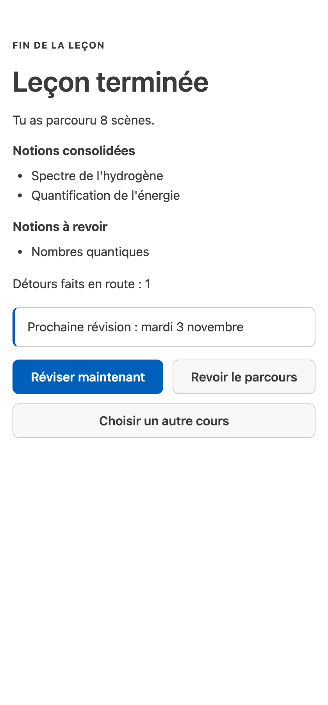

[English](vscode.md) · Français

# VS Code

L'extension Studium joue une leçon dans un panneau à côté de votre éditeur : chaque étape affiche ses
figures, équations, graphiques et modèles 3D, pose une question à la fois, donne son retour dans une étape
à part et vous signale les révisions dues. Elle suit le thème et la langue de votre éditeur (français ou
anglais) et s'utilise au clavier comme avec un lecteur d'écran (objectif : WCAG 2.2 AA).

Installez-la d'abord : construisez et installez le VSIX comme indiqué dans
[Installation](installation.fr.md#installer-lextension-vs-code).

## Ouvrir une leçon

| Moyen | Quand l'utiliser |
|---|---|
| Icône **Studium** de la barre d'activité, puis la vue **Leçons** | parcourir les leçons de votre dossier de leçons |
| **Studium : Choisir un cours** | choisir un cours, ou un autre dossier de leçons ; le choix est enregistré dans l'espace de travail |
| **Studium : Ouvrir une leçon** | rouvrir le cours courant (propose le sélecteur s'il n'y en a pas) |
| Clic droit sur un `lesson.json`, **Studium : Ouvrir cette leçon** | ouvrir directement ce fichier, depuis l'explorateur ou l'onglet de l'éditeur, sans changer les réglages |
| Un lien `vscode://` donné par votre assistant | ouvrir la leçon que votre assistant vient de préparer (ci-dessous) |
| **Studium : Prise en main** | un parcours en cinq étapes : ouvrir une leçon, apprendre avec votre assistant, juger une production d'IA, exécuter une reproduction, réviser |

Quand `studium.bundlesRoot` est vide, le dossier de leçons est le `fixtures/` du dépôt si l'extension
tourne depuis un clone de Studium, sinon votre bibliothèque personnelle, `~/.studium/library` (ou
`<STUDIUM_HOME>/library`), où sont écrites les leçons qu'un assistant prépare pour vous.

### De la conversation au panneau

Après avoir préparé une leçon avec vous, un assistant peut vous la transmettre :

```bash
code --open-url "vscode://holobiomicslab.studium-vscode/open?bundle=<chemin absolu de lesson.json, encodé pour une URL>"
```

Le lien doit désigner un chemin absolu, sans `..`, vers un fichier `.json` existant ; sinon il est refusé
avec un message et rien ne s'ouvre. Si la fenêtre se recharge pendant une leçon, le panneau revient et
reprend à partir de votre progression enregistrée.

## Ce que vous voyez

<picture>
  <source media="(prefers-color-scheme: dark)" srcset="../assets/screenshots/vscode-pane-choices-dark.png">
  
</picture>

- **Avis.** La première étape indique qui a écrit le corrigé (un enseignant, l'apprenant ou un agent) et si
  un modèle juge évalue les réponses ouvertes.
- **En-tête.** Le type de l'étape et sa classe de corrigé, le nombre de révisions dues, et un menu avec
  **À propos de cette leçon** et **M'oublier**.
- **Ligne d'état.** Une ligne au-dessus de la barre de progression, de 80 caractères au plus, dit où vous
  en êtes : la leçon, l'étape sur le total (ou quelle question de contrôle d'une contestation), un détour,
  les minutes restantes, les révisions dues et ce qui est attendu de vous (à lire, votre réponse, votre
  auto-évaluation, un calcul à lancer, terminé). La barre de progression garde ses segments sans répéter
  l'étape. Pendant une leçon, la barre d'état de VS Code affiche cette même ligne ; ce qui est dû en
  révision passe alors dans son info-bulle (voir [Révisions](#révisions)).
- **Voix.** Au-dessus de la scène, une ligne dit qui signe la leçon : le nom d'un enseignant quand elle a
  été validée, ou qu'elle n'a pas été relue, qu'elle a été rédigée par une IA ou par vous, ou qu'elle a
  changé depuis son approbation. Au-dessus d'un verdict, une ligne dit qui a évalué la réponse : la clé de
  l'auteur, un modèle juge, ou un texte que l'assistant a produit hors de la leçon ; un verdict de clé
  nomme une clé rédigée par l'IA ou une clé que vous avez écrite.
- **Progression.** « Étape 3 sur 8 », sans jamais reculer ; un détour vers un prérequis est signalé comme
  tel.
- **Réponse.** Quand le focus est dans la liste des choix, `A`–`D` ou `1`–`4` choisissent et `Entrée`
  valide ; la ligne sous les choix l'indique (« Dans la liste des choix : … »). La confiance (de 0 à 4) est
  facultative.
- **Échelle d'aide.** Sous les contrôles de réponse, quatre barreaux dans l'ordre où les essayer :
  **Relire**, **Indice**, **Explication** et **Référence**. Chacun affiche son coût ou la raison pour
  laquelle il est fermé : une explication attend que vous ayez tenté une réponse, et la référence
  n'apparaît qu'avec un verdict, après votre réponse. Un barreau fermé prend quand même le focus au clavier
  et dit pourquoi, mais n'envoie rien. **Poser une question** transmet votre question à l'assistant. Une
  bonne réponse après un indice compte moins pour la maîtrise et revient plus tôt en révision.
- **Réglages.** À la fin de la scène, là où la leçon les propose : le niveau d'**attention**
  (**Silencieux**, **Normal** ou **Accompagné**) règle ce que la séance peut proposer ; la **langue**
  bascule le texte propre au panneau (libellés, ligne d'état) entre français et anglais sans traduire le
  contenu de la leçon ; et les **minutes disponibles** avec **Replanifier** répondent par une proposition
  qui cite le temps dont vous disposez : si la leçon y tient, et si une révision due doit venir d'abord.
  Ces contrôles ne répondent à rien : ils restent utilisables tant qu'une réponse est attendue.
- **Carte des notions.** **Carte des notions** ouvre la liste des notions de la leçon avec leur état
  (acquise, à revoir, en cours, vue mais pas encore évaluée, à venir), les prérequis de chacune et, une fois
  dépliée, ses preuves et ce que son état établit ou n'établit pas. Vous pouvez contester une notion que
  vous avez atteinte — « Je la connais » ou « J'ai un doute » — et la leçon pose une ou deux questions de
  contrôle tirées de scènes notées sur la clé ; la déclaration seule ne change jamais la maîtrise et ne
  saute aucune scène. Voir [Carte des notions](../learn/concept-map.fr.md).

<picture>
  <source media="(prefers-color-scheme: dark)" srcset="../assets/screenshots/vscode-pane-feedback-dark.png">
  
</picture>

- **Le retour** forme une étape à part. ✓ n'apparaît que sur une réponse jugée juste et ✗ que sur une
  réponse jugée fausse. Sans modèle juge, une réponse ouverte est marquée **À comparer toi-même** et
  **Non certifié** : vous voyez les points clés et pouvez déplier la réponse modèle, et la réponse ne change
  pas votre maîtrise. Aucun décompte de mots-clés n'est affiché.
- **Source citée.** Les passages cités par une étape notée n'apparaissent qu'une fois que vous avez répondu
  et quitté l'étape pour de bon : ils ne soufflent jamais la réponse. La licence de la source suit son titre
  quand la leçon en indique une. Quitter un quiz sur une mauvaise réponse affiche de la même façon
  **La bonne réponse**.
- **Évalue ton rappel** (Je ne savais pas, Difficile, Bien, Facile) fixe seulement la date de votre
  prochaine révision ; cela ne change jamais votre maîtrise. Voir
  [Réviser dans la durée](../learn/review-over-time.fr.md).

<picture>
  <source media="(prefers-color-scheme: dark)" srcset="../assets/screenshots/vscode-pane-completion-dark.png">
  
</picture>

- **Fin de leçon.** Les notions sont nommées, sans score, en trois listes : **Notions consolidées** (au
  moins trois réponses notées et une maîtrise suffisante), **Notions travaillées** (avec leur nombre de
  réponses notées) et **Pas encore mesurées**. Viennent ensuite la date de la prochaine révision et trois
  actions : **Réviser maintenant**, **Revoir le parcours**, **Choisir un autre cours**.

## Révisions

Si vous avez déjà étudié et qu'aucune leçon n'est ouverte, la barre d'état affiche **Studium · 2 à
réviser**, ou **Studium · 3 à travailler** quand certaines notions en attente sont à reprendre ou pas encore
mesurées ; son info-bulle nomme chaque groupe. Pendant une leçon, la barre affiche la ligne d'état de
cette leçon ; les groupes de révision passent alors dans son info-bulle. Un clic ouvre la barre
latérale Studium, dont l'entrée **Révisions** liste les notions par groupe (à réviser, à reprendre, pas
encore mesurées), ou la date de la prochaine révision. Le décompte est rafraîchi au démarrage, à la
fermeture ou à la fin d'une leçon, et avec le bouton de rafraîchissement de la vue Leçons. Sans
historique, rien n'est affiché.

## Chat et notebook

- **`@studium` dans le panneau de chat** (avec Copilot Chat ou un autre fournisseur de chat) joue la leçon
  tour par tour, avec `/start`, `/hint` et `/discuss`. Il affiche le texte du serveur et lui transmet ce que
  vous tapez comme votre réponse : une lettre, un nombre, vos propres mots, ou des numéros comme `1,3` sur un
  jeu d'affirmations. Quand le serveur ne peut pas lire une réponse, le chat le dit et rappelle comment
  répondre. Les contenus riches s'ouvrent toujours dans le panneau. Aucun corrigé n'atteint le chat.
- **Studium : Ouvrir la leçon en notebook** joue la leçon dans un notebook : exécutez la cellule de pilotage
  avec `next`, une lettre de choix, `0`–`4`, un texte libre, `hint` ou `forget`.

Le panneau et un client MCP que vous avez configuré vous-même (Copilot en mode agent, par exemple) lancent
chacun leur propre serveur et ne partagent pas l'étape courante. Pilotez une leçon depuis l'un des deux à
la fois.

## Exécuter une reproduction

Certaines étapes vous demandent d'exécuter une vraie capsule. Avant toute exécution, une fenêtre montre la
commande exacte, les paquets à installer et le dossier d'exécution. Rien ne démarre avant que vous
choisissiez **Exécuter**, ou **Exécuter et faire confiance à ce cours** (mémorisé pour cette version exacte
de la leçon). Un dossier de travail donné en chemin absolu ou contenant `..` est refusé, et le motif qui
contrôle la sortie s'exécute sous une limite de 50 ms : une leçon défectueuse ne peut pas figer l'éditeur.
**Studium : Exécuter la reproduction** lance la capsule de l'étape courante.

## Réglages

| Réglage | Par défaut | Rôle |
|---|---|---|
| `studium.bundlesRoot` | vide | dossier de leçons ; vide signifie le `fixtures/` du dépôt, sinon `~/.studium/library` |
| `studium.bundleRef` | `atomistique-l1/lesson.json` | le cours courant, relatif au dossier de leçons |
| `studium.repoRoot` | vide | un clone de Studium, pour lancer le serveur depuis ses sources (développement) |
| `studium.communityBundlesRoot` | vide (comme `bundlesRoot`) | où **Contributions de la classe** trouve les leçons d'apprenants approuvées |
| `studium.assets` | `vendor` | charger KaTeX et Vega hors ligne (`vendor`) ou depuis un CDN (`cdn`) |
| `studium.learnerId` | `vscode-learner` | votre identifiant d'apprenant ; il sale votre pseudonyme sur le disque |
| `studium.telemetryConsent` | `false` | consentir à l'enregistrement d'une télémétrie de classe pseudonymisée dans le dossier de données de l'extension (rien n'est envoyé) |
| `studium.modalityPreference` | `balanced` | `visual` ou `textual` réordonne le contenu de chaque étape ; rien n'est retiré |
| `studium.showGraph` | `true` | ouvrir un panneau compagnon avec le graphe d'apprentissage en direct |
| `studium.graphView` | `student` | `student` montre votre voisinage, `teacher` le graphe entier |
| `studium.showMastery` | `false` | afficher la barre de maîtrise par notion ; pour les démonstrations enseignantes seulement, car elle peut révéler les réponses d'un quiz |

## Commandes

| Commande | Effet |
|---|---|
| Studium : Choisir un cours | choisir et ouvrir un cours |
| Studium : Ouvrir une leçon | ouvrir le cours courant dans le panneau |
| Studium : Ouvrir cette leçon | ouvrir le `lesson.json` sélectionné |
| Studium : Ouvrir la leçon en notebook | jouer le cours dans un notebook |
| Studium : Contributions de la classe | ouvrir une leçon d'apprenant approuvée |
| Studium : Exécuter la reproduction (capsule de la scène courante) | lancer la capsule de l'étape courante, après confirmation |
| Studium : Prise en main | ouvrir le parcours de prise en main |
| Studium : Oublier mes données | effacer ce que l'extension garde (ci-dessous) |

## Vos données

La progression et les révisions sont gardées dans le stockage d'extension de VS Code, propre à votre
compte utilisateur, jamais dans le dossier de leçons, que le consentement à la télémétrie soit activé ou
non ; ce réglage décide seulement de l'envoi de télémétrie de classe pseudonymisée. **M'oublier**, dans le
menu du panneau, efface votre état enregistré pour la leçon courante. **Studium : Oublier mes données**
efface, après confirmation, tout ce que garde l'extension (progression, révisions, cours auxquels vous avez
fait confiance, dernière leçon) ; elle ferme d'abord chaque séance de leçon, de chat ou de notebook ouverte
par l'extension, pour que rien ne réécrive son état. Elle ne touche pas aux données que le serveur Studium d'un assistant garde
dans `~/.studium/data` ; la confirmation nomme ce dossier. Voir
[Vie privée et limites](../concepts/privacy-and-limits.fr.md).
