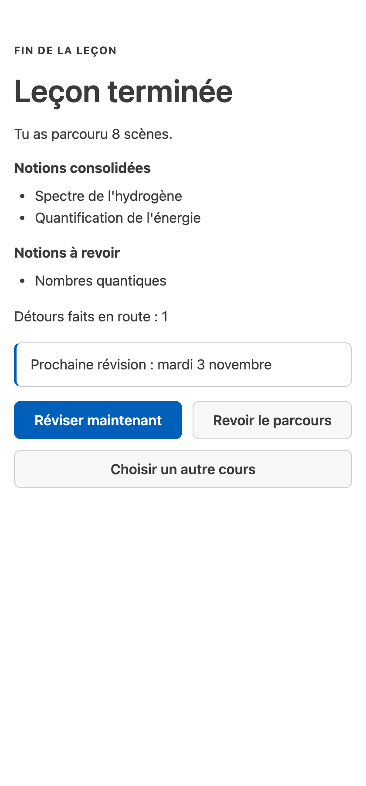

English · [Français](vscode.fr.md)

# VS Code

The Studium extension plays a lesson in a pane beside your editor: each step shows its figures, equations,
plots and 3D models, asks one question at a time, gives feedback as a step of its own, and tells you when
reviews are due. It follows your editor theme and language (English or French), and works with the
keyboard and a screen reader (target: WCAG 2.2 AA).

Install it first: build and install the VSIX as described in [Installation](installation.md#install-the-vs-code-extension).

## Open a lesson

| Way | When to use it |
|---|---|
| **Studium** icon in the activity bar, then the **Lessons** view | browse the lessons found in your lessons folder |
| **Studium: Pick a course** | choose a course, or another folder of lessons; the choice is saved in the workspace |
| **Studium: Open lesson** | reopen the current course (offers the picker if none is set) |
| Right-click a `lesson.json`, **Studium: Open this lesson** | open that file directly, in the explorer or on the editor tab, without changing settings |
| A `vscode://` link from your assistant | open the lesson your assistant has just built (below) |
| **Studium: Getting started** | a five-step walkthrough: open a lesson, learn with your assistant, judge AI output, run a reproduction, review |

When `studium.bundlesRoot` is empty, the lessons folder is the checkout's `fixtures/` if the extension runs
from a Studium checkout, and otherwise your personal library, `~/.studium/library` (or
`<STUDIUM_HOME>/library`), where the lessons an assistant builds for you are written.

### From a conversation to the pane

After building a lesson with you, an assistant can hand it over:

```bash
code --open-url "vscode://holobiomicslab.studium-vscode/open?bundle=<percent-encoded absolute path of lesson.json>"
```

The link must name an absolute path, without `..`, to an existing `.json` file; anything else is refused
with a message and nothing opens. If the window reloads while a lesson is open, the pane comes back and
resumes from your saved progress.

## What you see

<picture>
  <source media="(prefers-color-scheme: dark)" srcset="../assets/screenshots/vscode-pane-choices-dark.png">
  
</picture>

- **Notice.** The first step says who wrote the answer key (a teacher, the learner or an agent) and whether
  a judge model assesses open answers.
- **Header.** The step type and its key class, the number of reviews due, and a menu with
  **About this lesson** and **Forget me**.
- **Status line.** One line above the progress rail, at most 80 characters, says where you are: the lesson,
  the step out of the total (or which check question of a contest), a detour, the minutes left, the reviews
  due and what is expected of you (to read, your answer, to rate your recall, a run to launch, done). The
  progress rail keeps its segments without repeating the step. While a lesson plays, the VS Code status bar
  shows this same line; what is due for review then moves into its tooltip (see [Reviews](#reviews)).
- **Voices.** Over the scene, a line says who signs the lesson: a teacher's name when it was validated, or
  that it is unreviewed, was written by an AI or by you, or changed since its approval. Over a verdict, a
  line says who assessed the answer: the author's key, a judge model, or text the assistant generated
  outside the lesson; a key verdict names a key an AI drafted or one you wrote yourself.
- **Progress.** "Step 3 of 8", never moving backwards; a detour to a prerequisite is labelled as such.
- **Answer.** While the focus is in the list of choices, `A`–`D` or `1`–`4` choose and `Enter` submits; the
  line under the choices says so ("In the list of choices: …"). Confidence (0 to 4) is optional.
- **Help ladder.** Under the answer controls, four rungs in the order to try them: **Read again**,
  **Hint**, **Explanation** and **Reference**. Each shows its cost or the reason it is closed: an
  explanation waits until you have tried an answer, and the reference appears only with a verdict, after
  your answer. A closed rung can still take the keyboard focus and says why, but sends nothing. **Ask a
  question** hands your question to the assistant. A right answer after a hint counts less toward mastery
  and comes back sooner.
- **Settings.** At the end of the scene, where the lesson offers them: **attention** (**Quiet**, **Normal**
  or **Coached**) sets how much the session may propose; **language** switches the pane's own text (labels,
  status line) between French and English without translating the lesson's content; and **minutes
  available** with **Replan** answers with a proposal that cites the time you have: whether the lesson
  fits in it, and whether a due review should come first. These controls answer nothing, so they stay
  usable while an answer is owed.
- **Concept map.** **Concept map** opens a list of the lesson's concepts with their state (acquired, to
  review, in progress, seen but not assessed yet, upcoming), each one's prerequisites, and, unfolded, its
  evidence and what its state does and does not establish. You can contest a concept you have reached —
  "I know it" or "I am not sure" — and the lesson asks one or two check questions taken from key-graded
  scenes; the claim alone never changes mastery or skips a scene. See [Concept map](../learn/concept-map.md).

<picture>
  <source media="(prefers-color-scheme: dark)" srcset="../assets/screenshots/vscode-pane-feedback-dark.png">
  
</picture>

- **Feedback** is its own step. ✓ appears only on an answer marked right and ✗ only on one marked wrong.
  Without a judge model, an open answer is marked **Check it yourself** and **Not certified**: you see the
  key points and can unfold the model answer, and the answer does not change your mastery. No keyword count
  is shown.
- **Cited source.** The passages a graded step cites appear only once you have answered and leave the step
  for good, so they never give the answer away; the source's licence follows its title when the lesson
  records one. Leaving a quiz on a wrong answer shows **The right answer** in the same way.
- **Rate your recall** (I didn't know, Hard, Good, Easy) sets only your next review date; it never changes
  your mastery. See [Review over time](../learn/review-over-time.md).

<picture>
  <source media="(prefers-color-scheme: dark)" srcset="../assets/screenshots/vscode-pane-completion-dark.png">
  
</picture>

- **Completion.** Concepts are named, not scored, in three lists: **Concepts consolidated** (at least three
  graded answers and enough mastery), **Concepts practised** (with their number of graded answers) and
  **Not measured yet**. Then come the next review date and three actions: **Review now**, **Go through it
  again**, **Choose another course**.

## Reviews

When you have studied before and no lesson is open, the status bar shows **Studium · 2 to review**, or
**Studium · 3 to work on** when some of the concepts waiting are to take up again or not measured yet; its
tooltip names each group. While a lesson plays, the bar shows that lesson's status line instead, and the
review groups move into its tooltip.
Clicking it opens the Studium sidebar, whose **Reviews** entry lists the concepts by group (to review, to
take up again, not measured yet), or the date of the next review.
The count is refreshed at startup, when a lesson closes or completes, and with the refresh button of the
Lessons view. With no history, nothing is shown.

## Chat and notebook

- **`@studium` in the chat panel** (with Copilot Chat or another chat provider) plays the lesson turn by
  turn, with `/start`, `/hint` and `/discuss`. It shows the server's own text and passes what you type to
  the server as your reply: a letter, a number, your own words, or numbers such as `1,3` on a claims deck.
  When the server cannot read a reply, the chat says so and repeats how to answer. Rich artifacts still
  open in the pane. No answer key reaches the chat.
- **Studium: Open lesson as notebook** plays the lesson in a notebook: run the driver cell with `next`, a
  choice letter, `0`–`4`, free text, `hint`, or `forget`.

The pane and an MCP client you configured yourself (Copilot agent mode, for example) each start their own
server and do not share the current step. Drive a lesson from one of them at a time.

## Running a reproduction

Some steps ask you to run a real capsule. Before anything runs, a dialog shows the exact command, the
packages to install and the folder it runs in. Nothing starts until you choose **Run**, or **Run and trust
this course** (remembered for that exact version of the lesson). A working folder given as an absolute path
or containing `..` is refused, and the pattern that checks the output runs under a 50 ms time limit, so a
faulty lesson cannot freeze the editor. **Studium: Run reproduction** starts the current step's capsule.

## Settings

| Setting | Default | Meaning |
|---|---|---|
| `studium.bundlesRoot` | empty | lessons folder; empty means the checkout's `fixtures/`, else `~/.studium/library` |
| `studium.bundleRef` | `atomistique-l1/lesson.json` | the current course, relative to the lessons folder |
| `studium.repoRoot` | empty | a Studium checkout, to run the server from its sources (development) |
| `studium.communityBundlesRoot` | empty (same as `bundlesRoot`) | where **Community contributions** finds approved learner-written lessons |
| `studium.assets` | `vendor` | load KaTeX and Vega offline (`vendor`) or from a CDN (`cdn`) |
| `studium.learnerId` | `vscode-learner` | your learner id; it salts your on-disk pseudonym |
| `studium.telemetryConsent` | `false` | opt in to recording pseudonymised class telemetry in the extension's data folder (nothing is sent) |
| `studium.modalityPreference` | `balanced` | `visual` or `textual` reorders each step's material; nothing is removed |
| `studium.showGraph` | `true` | open a companion pane with the live learning graph |
| `studium.graphView` | `student` | `student` shows the area around you, `teacher` the whole graph |
| `studium.showMastery` | `false` | show the per-concept mastery bar; for teacher demos only, as it can leak quiz answers |

## Commands

| Command | Effect |
|---|---|
| Studium: Pick a course | choose and open a course |
| Studium: Open lesson | open the current course in the pane |
| Studium: Open this lesson | open the selected `lesson.json` |
| Studium: Open lesson as notebook | play the course in a notebook |
| Studium: Community contributions | open an approved learner-written lesson |
| Studium: Run reproduction (current scene's capsule) | run the current step's capsule, after confirmation |
| Studium: Getting started | open the walkthrough |
| Studium: Forget my data | erase what this extension keeps (below) |

## Your data

Progress and reviews are kept in VS Code's per-user extension storage, never in the lessons folder,
whether telemetry consent is on or off; the consent setting only controls whether pseudonymised class
telemetry is sent. **Forget me** in the pane's menu erases your saved state for the current lesson.
**Studium: Forget my data** erases everything the extension keeps (progress, reviews, the courses you chose
to trust, the last lesson) after a confirmation; it first closes every lesson, chat or notebook session the
extension opened, so nothing writes its state back. It does not touch the data an assistant's Studium server
keeps in `~/.studium/data`; the confirmation names that folder. See
[Privacy and limits](../concepts/privacy-and-limits.md).
