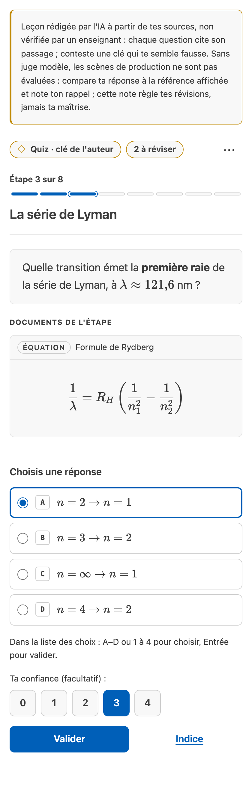
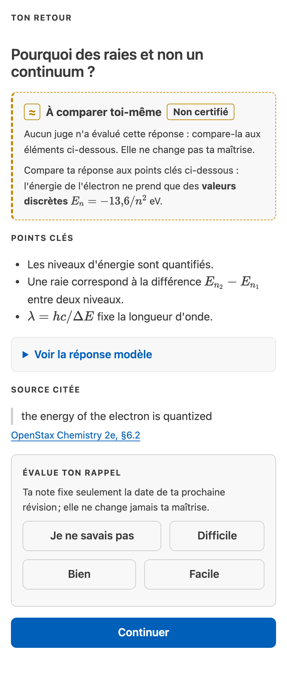
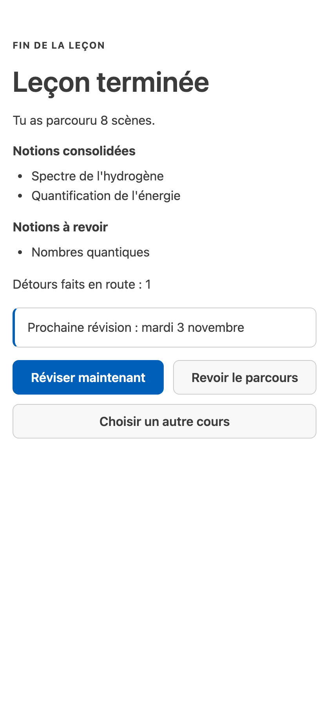

English · [Français](vscode.fr.md)

# VS Code

The Studium extension plays a lesson in a pane, as a tab of the editor area: each step shows its figures, equations,
plots and 3D models, asks one question at a time, gives feedback as a step of its own, and tells you when
reviews are due. It follows your editor theme and language (English or French), and works with the
keyboard and a screen reader (target: WCAG 2.2 AA).

Install it first, from the Visual Studio Marketplace or Open VSX:

```bash
code --install-extension holobiomicslab.studium-vscode
```

From a release file: `code --install-extension studium-vX.Y.Z.vsix`. To build it from source, see
[Installation](installation.md#build-the-vs-code-extension). The registries that carry the extension are
listed in [Where the packages are](installation.md#where-the-packages-are).

## Get your first lesson

The extension shows lessons; it does not build them. Right after installation the **Lessons** view says
"No lesson of your own yet" and offers **Try the demo lesson**. Pick the line that matches what you have:

| You have | Do this |
|---|---|
| Nothing yet, and you want to see how Studium works | **Try the demo lesson** in the empty **Lessons** view, or **Studium: Try the demo lesson**: « Discover Studium », about ten minutes, in VS Code's display language (English or French). It ships with the extension; an AI agent drafted it from Studium's documentation and the project's owner approved it, under the name beta-testeur, without reading it. It is not saved as your course and never replaces a lesson of yours |
| Copilot in VS Code 1.101 or later | Nothing to connect: the extension offers its own Studium server to Copilot (see [Connect Copilot](copilot.md)). In Copilot Chat's agent mode, ask "I want to learn … with Studium" and name your sources. Building the lesson takes a few minutes: the status bar says **Studium · preparing a lesson…**, then VS Code tells you the lesson is ready, with **Open**, and it appears in the **Lessons** view. At the first Studium tool, allow Studium's tools for the session (see [Connect Copilot](copilot.md)) |
| Another AI assistant (Claude Code, Codex, Cursor) | Connect it to Studium with [one command](installation.md#add-the-server-to-your-assistant), then ask "I want to learn … with Studium" and name your sources. The lesson is written to your personal library, `~/.studium/library`; VS Code tells you when it is ready, and it appears in the **Lessons** view |
| A lesson a teacher gave you | **Studium: Pick a course**, **Choose another course folder…**, then choose its folder; or right-click its `lesson.json` and choose **Studium: Open this lesson** |
| The demo lessons, without a checkout | download the [repository archive](https://github.com/HolobiomicsLab/studium/archive/refs/heads/main.zip) and unzip it, then **Studium: Pick a course**, **Choose another course folder…**, and choose its `fixtures` folder |
| A checkout of the repository | **Studium: Pick a course**, then choose `fixtures` for the demo lessons |

With Copilot in agent mode everything stays inside VS Code, with no terminal: see [Connect Copilot](copilot.md),
which also says what has not been tried. What the
assistant does, step by step, is in [Learn with your assistant](../learn/learn-with-your-assistant.md).

## Open a lesson

| Way | When to use it |
|---|---|
| **Studium** icon in the activity bar, then the **Lessons** view | browse the lessons found in your lessons folder |
| **Studium: Pick a course** | choose a course, or another folder of lessons; the choice is saved in the open folder's settings, or in your user settings when no folder is open. The list also offers the demo lesson shipped with Studium, labelled as such |
| **Studium: Open lesson** | reopen the current course (offers the picker if none is set) |
| Right-click a `lesson.json`, **Studium: Open this lesson** | open that file directly, in the explorer or on the editor tab, without changing settings |
| A `vscode://` link from your assistant | open the lesson your assistant has just built (below) |
| **Studium: Getting started** | a five-step walkthrough: open a lesson, learn with your assistant, judge AI output, run a reproduction, review |

When `studium.bundlesRoot` is empty, the lessons folder is the checkout's `fixtures/` if the extension runs
from a Studium checkout, and otherwise your personal library, `~/.studium/library` (or
`<STUDIUM_HOME>/library`), where the lessons an assistant builds for you are written. The extension creates
that library at startup if it is missing, and watches it: a lesson an assistant writes there is listed and
opens in the Studium pane by itself, as a tab of the editor area, while the focus stays in the chat; a notice says
so, and its button turns `studium.openLessonWhenReady` off. With that setting off, the lesson is announced instead,
with **Open**, **Later** and **Don't show again**. Lessons that land together share one notice,
whose **Show** opens the Studium view. A lesson you copy there yourself is listed but not announced.
**Don't show again** turns off the `studium.notifyLessonReady` setting: turn it back on in the Settings
editor to see the notices again. If `studium.bundlesRoot` names another folder, the library's lessons are
listed apart, under **Your library**.

### From a conversation to the pane

After building a lesson with you, an assistant can hand it over:

```bash
code --open-url "vscode://holobiomicslab.studium-vscode/open?bundle=<percent-encoded absolute path of lesson.json>"
```

The link must name an absolute path, without `..`, to an existing `.json` file in your library, in the
`studium.bundlesRoot` folder or among the lessons shipped with Studium; anything else is refused with a
message and nothing opens. To open a lesson file kept elsewhere, right-click it and choose
**Studium: Open this lesson**. If the window reloads while a lesson is open, the pane comes back and
resumes from your saved progress.

## What you see

<picture>
  <source media="(prefers-color-scheme: dark)" srcset="../assets/screenshots/vscode-pane-choices-dark.png">
  
</picture>

- **Notice.** The first step says who wrote the answer key (a teacher, the learner or an agent) and whether
  a judge model assesses open answers.
- **Header.** The step type and its key class, the number of reviews due, and a menu with
  **About this lesson** and **Forget me**.
- **Status line.** One line above the progress rail, at most 80 characters, says where you are: the lesson,
  the step out of the total (or which check question of a contest), a detour, the minutes left (the lesson's
  stated duration times the share of steps left, the length the chat gives when the lesson is ready), the reviews
  due and what is expected of you (to read, your answer, to rate your recall, a run to launch, done). The
  progress rail keeps its segments without repeating the step. While a lesson plays, the VS Code status bar
  shows this same line; what is due for review then moves into its tooltip (see [Reviews](#reviews)).
- **Voices.** Over the scene, a line says who signs the lesson: a teacher's name when it was validated, or
  that it is unreviewed, was written by an AI or by you, or changed since its approval. Over a verdict, a
  line says who assessed the answer: the author's key, a judge model, or text the assistant generated
  outside the lesson; a key verdict names a key an AI drafted or one you wrote yourself.
- **Progress.** "Step 3 of 8", never moving backwards; a detour to a prerequisite is labelled as such.
- **Steps already done.** Under the rail, each step of the lesson's main path you already did is a numbered
  button (a screen reader reads "Review step 3: <title>"). It shows that step again as it was, read only, under
  a banner "Step 3 of 12, already done: review only": its text and figures, your answer and the feedback you
  got (for the answers given since the server started; after a restart, only whether the answer was right,
  wrong or not assessed). Nothing can be answered there and nothing changes: not your progress, your mastery,
  your reviews, nor the step you are on. **Back to where I was** returns to your current step as you left it,
  a half-typed answer included. Steps not reached yet and the steps of a detour are not offered.
- **Answer.** While the focus is in the list of choices, `A`–`D` or `1`–`4` choose and `Enter` submits; the
  line under the choices says so ("In the list of choices: …"). Confidence (0 to 4) is optional.
- **Help ladder.** Under the answer controls, four rungs in the order to try them: **Read again**,
  **Hint**, **Explanation** and **Reference**. Each shows its cost or the reason it is closed: an
  explanation waits until you have tried an answer, and the reference appears only with a verdict, after
  your answer. A closed rung can still take the keyboard focus and says why, but sends nothing. **Ask a
  question** hands your question to the assistant. A right answer after a hint counts less toward mastery
  and comes back sooner.
- **Settings.** At the end of the scene, where the lesson offers them: **attention** (**Quiet**, **Normal**
  or **Coached**) sets how much the session may propose; **language** switches the pane's own text (labels,
  status line) between French and English without translating the lesson's content; and **minutes
  available** with **Replan** answers with a proposal that cites the time you have: whether the lesson
  fits in it, and whether a due review should come first. These controls answer nothing, so they stay
  usable while an answer is owed.
- **Concept map.** **Concept map** opens a list of the lesson's concepts with their state (acquired, to
  review, in progress, seen but not assessed yet, upcoming), each one's prerequisites, and, unfolded, its
  evidence and what its state does and does not establish. You can contest a concept you have reached —
  "I know it" or "I am not sure" — and the lesson asks one or two check questions taken from key-graded
  scenes; the claim alone never changes mastery or skips a scene. See [Concept map](../learn/concept-map.md).

<picture>
  <source media="(prefers-color-scheme: dark)" srcset="../assets/screenshots/vscode-pane-feedback-dark.png">
  
</picture>

- **Feedback** is its own step. ✓ appears only on an answer marked right and ✗ only on one marked wrong.
  Without a judge model, an open answer is marked **Check it yourself** and **Not certified**: you see the
  key points and can unfold the model answer, and the answer does not change your mastery. No keyword count
  is shown.
- **Cited source.** The passages a graded step cites appear only once you have answered and leave the step
  for good, so they never give the answer away; the source's licence follows its title when the lesson
  records one. Leaving a quiz on a wrong answer shows **The right answer** in the same way.
- **Rate your recall** (I didn't know, Hard, Good, Easy) sets only your next review date; it never changes
  your mastery. See [Review over time](../learn/review-over-time.md).

<picture>
  <source media="(prefers-color-scheme: dark)" srcset="../assets/screenshots/vscode-pane-completion-dark.png">
  
</picture>

- **Completion.** Concepts are named, not scored, in three lists: **Concepts consolidated** (at least three
  graded answers and enough mastery), **Concepts practised** (with their number of graded answers) and
  **Not measured yet**. Then come the next review date and three actions: **Review now**, **Go through it
  again**, **Choose another course**.

## Reviews

When you have studied before and no lesson is open, the status bar shows **Studium · 2 to review**, or
**Studium · 3 to work on** when some of the concepts waiting are to take up again or not measured yet; its
tooltip names each group. While a lesson plays, the bar shows that lesson's status line instead, and the
review groups move into its tooltip.
Clicking it opens the Studium sidebar, whose **Reviews** entry lists the concepts by group (to review, to
take up again, not measured yet), or the date of the next review.
The count is refreshed at startup, when a lesson closes or completes, and with the refresh button of the
Lessons view.

When nothing is due, the bar offers the lesson you were playing instead, for example
**Studium · continue Discover Studium**; clicking it reopens that lesson at the step where you stopped. The
**Lessons** view shows the same lesson first, as **Continue: …**, with the next step and, when the lesson
gives its duration, the minutes left; each lesson in the list shows its progress (**6/12**, or **done**).
This is the progress VS Code keeps under `studium.learnerId`: in the pane, in `@studium`, and in Copilot
when it uses the Studium server this extension offers, which plays the same learner in the same storage (a
lesson played there shows here at the next refresh). Lessons played with another assistant, the browser
player or a Studium server added to VS Code by hand keep their progress elsewhere and do not show here. A
lesson being prepared and a due review come first. With no history and no lesson in
progress, nothing is shown.

## Chat and notebook

- **`@studium` in the chat panel** (with Copilot Chat or another chat provider) plays the lesson turn by
  turn, with `/start`, `/hint` and `/discuss`. It shows the server's own text and passes what you type to
  the server as your reply: a letter, a number, your own words, or numbers such as `1,3` on a claims deck.
  When the server cannot read a reply, the chat says so and repeats how to answer. Rich artifacts still
  open in the pane. No answer key reaches the chat.
- **Studium: Open lesson as notebook** plays the lesson in a notebook: run the driver cell with `next`, a
  choice letter, `0`–`4`, free text, `hint`, or `forget`.

The pane and Copilot's agent mode each start their own server, whether Copilot uses the one the extension
offers or one you configured yourself, and they do not share the current step. Drive a lesson from one of
them at a time. With the server the extension offers, Copilot plays the pane's learner (`studium.learnerId`):
a lesson goes on in the pane where it stopped in the chat, and Copilot offers a lesson it built in the pane
first ([Connect Copilot](copilot.md)).

## Running a reproduction

Some steps ask you to run a real capsule. Before anything runs, a dialog shows the exact command, the
packages to install and the folder it runs in. Nothing starts until you choose **Run**, or **Run and trust
this course** (remembered for that exact version of the lesson). A working folder given as an absolute path
or containing `..` is refused, and the pattern that checks the output runs under a 50 ms time limit, so a
faulty lesson cannot freeze the editor. **Studium: Run reproduction** starts the current step's capsule.

## Settings

| Setting | Default | Meaning |
|---|---|---|
| `studium.bundlesRoot` | empty | lessons folder; empty means the checkout's `fixtures/`, else `~/.studium/library` |
| `studium.bundleRef` | `atomistique-l1/lesson.json` | the current course, relative to the lessons folder |
| `studium.repoRoot` | empty | a Studium checkout, to run the server from its sources (development) |
| `studium.communityBundlesRoot` | empty (same as `bundlesRoot`) | where **Community contributions** finds approved learner-written lessons |
| `studium.assets` | `vendor` | load KaTeX and Vega offline (`vendor`) or from a CDN (`cdn`) |
| `studium.learnerId` | `vscode-learner` | your learner id; it salts your on-disk pseudonym |
| `studium.registerMcpServer` | `true` | offer the extension's own server to Copilot's agent mode (VS Code 1.101 or later); none is offered when you already added a Studium server yourself |
| `studium.notifyLessonReady` | `true` | tell you when a lesson your assistant built is ready; **Don't show again** on that notice turns it off, and turning it back on brings the notices back. A user setting, for every window |
| `studium.offerVibeConnection` | `true` | when Mistral Vibe is installed, offer once to connect it to Studium; **Studium: Connect Mistral Vibe** works whatever this setting says. A user setting |
| `studium.openLessonWhenReady` | `true` | open a lesson your assistant built in the Studium pane as soon as it is ready, as a tab of the editor area, leaving the focus in the chat; off, a notice offers **Open** instead. A user setting |
| `studium.telemetryConsent` | `false` | opt in to recording pseudonymised class telemetry in the extension's data folder (nothing is sent) |
| `studium.modalityPreference` | `balanced` | `visual` or `textual` reorders each step's material; nothing is removed |
| `studium.showGraph` | `true` | open the live learning graph as a tab next to the lesson |
| `studium.graphView` | `student` | `student` shows the area around you, `teacher` the whole graph |
| `studium.showMastery` | `false` | show the per-concept mastery bar; for teacher demos only, as it can leak quiz answers |

## Commands

| Command | Effect |
|---|---|
| Studium: Pick a course | choose and open a course |
| Studium: Try the demo lesson | open « Discover Studium », the demo lesson shipped with the extension |
| Studium: Open lesson | open the current course in the pane |
| Studium: Open this lesson | open the selected `lesson.json` |
| Studium: Open lesson as notebook | play the course in a notebook |
| Studium: Community contributions | open an approved learner-written lesson |
| Studium: Run reproduction (current scene's capsule) | run the current step's capsule, after confirmation |
| Studium: Getting started | open the walkthrough |
| Studium: Forget my data | erase what this extension keeps (below) |
| Studium: Connect Mistral Vibe | let Mistral Vibe (its VS Code extension, Vibe Desktop, its CLI) use this extension's Studium server, with no Node; see [Connect Mistral Vibe](vibe.md) |
| Studium: Disconnect Mistral Vibe | remove the entry that command wrote |
| Studium: Connect an Assistant… | let Mistral Vibe, Codex, Claude Code, Claude Desktop or OpenCode use this extension's Studium server, with no Node: tick the assistants in the list; see [Connect your assistant](harnesses.md#choose-your-client) |
| Studium: Disconnect an Assistant… | remove the entries that command wrote |

## Your data

Progress and reviews are kept in VS Code's per-user extension storage, never in the lessons folder,
whether telemetry consent is on or off; the consent setting only controls whether pseudonymised class
telemetry is sent. **Forget me** in the pane's menu erases your saved state for the current lesson.
**Studium: Forget my data** erases everything the extension keeps (progress, reviews, the courses you chose
to trust, the last lesson) after a confirmation; it first closes every lesson, chat or notebook session the
extension opened, so nothing writes its state back. It does not touch the data an assistant's Studium server
keeps in `~/.studium/data`; the confirmation names that folder. It does not stop the server VS Code started for
Copilot, which keeps its progress in the same storage: stop **Studium** in **MCP: List Servers** first. See
[Privacy and limits](../concepts/privacy-and-limits.md).
