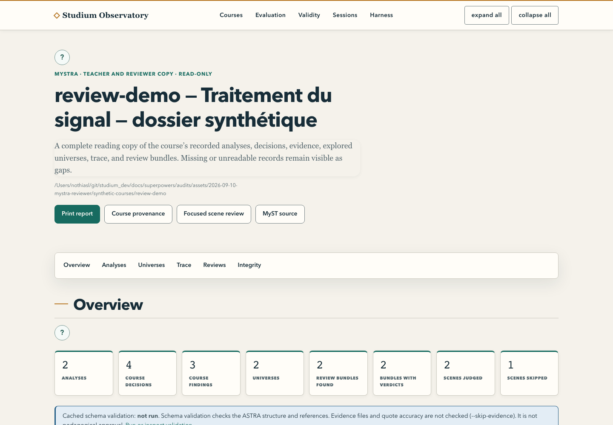

[English](observatory.md) · Français

# Observatoire

L'Observatoire est une page locale unique sur tout ce que Studium a produit : la provenance de chaque
cours généré (décisions, alternatives écartées, preuves), son rapport de relecture MySTRA, les
évaluations, les suites de validité, les données de sessions de classe et les sessions agentiques en
cours. Enseignants et relecteurs s'en servent surtout pour **MySTRA**, la vue imprimable de la façon
dont un cours a été construit. L'Observatoire est en lecture seule, et aucun apprenant ne le voit.

<picture>
  <source media="(prefers-color-scheme: dark)" srcset="../assets/screenshots/observatory-mystra-dark.png">
  
</picture>

## Le lancer

```bash
.venv/bin/python services/observatory/observatory_app.py --course-root work/courses --port 8004
```

Ouvrez `http://127.0.0.1:8004/`. La racine des cours contient un dossier par cours, chacun avec un
`astra.yaml` (écrit par `tools/experience_review.py`, voir [rédiger une leçon](author-a-lesson.fr.md)).

| Option | Variable d'environnement | Rôle |
|---|---|---|
| `--course-root DIR` | | Dossier dont les sous-dossiers sont des cours |
| `--course DIR` (répétable) | `STUDIUM_OBS_COURSES` | Un dossier de cours |
| `--eval-root DIR` | `STUDIUM_OBS_EVAL_ROOT` | Dossiers d'évaluations |
| `--validity-root DIR` | `STUDIUM_OBS_VALIDITY_ROOT` | Suites de validité |
| `--analytics-data-dir DIR` | `STUDIUM_OBS_ANALYTICS_DATA_DIR` | Le stockage du collecteur d'analyses, en chemin absolu |
| `--sessions-root DIR` | `STUDIUM_OBS_SESSIONS_ROOT` | Un dossier de flux de télémétrie |
| `--session-dir DIR` (répétable) | | Un espace de session agentique à suivre |
| `--host`, `--port` | `STUDIUM_OBS_HOST`, `STUDIUM_OBS_PORT` | Par défaut `127.0.0.1:8004` |

Le service écoute l'interface locale ; un autre `--host` affiche d'abord un avertissement. Il n'y a
pas de connexion : ne l'exposez pas. Une racine absente est signalée sur la page ; seule une racine de
cours absente sans `--course` empêche le démarrage. Les racines sont relues à chaque requête.

## Relire un cours avec MySTRA

Ouvrez un cours, puis **MySTRA** (`/courses/<id>/mystra`). Le rapport présente toutes les analyses et
les relectures de chaque bundle, avec des citations tirées des preuves enregistrées. Un document absent
ou illisible apparaît comme tel. La page s'imprime proprement ; **MyST source**
(`/courses/<id>/provenance.myst.md`) donne le même contenu en Markdown pour un document MyST. La page
de relecture du tableau de bord enseignant renvoie ici quand un dossier de cours du même nom est servi
(voir [suivre une classe](follow-a-class.fr.md)).

Ouvrir MySTRA ne lance aucun modèle et ne modifie aucun fichier. Le HTML est construit par des lecteurs
structurés, sans exécuter le Markdown, les liens de preuve ni le code des artefacts. Un verdict de
modèle ou une validation ASTRA ne vaut pas relecture pédagogique : la décision de diffuser vous
appartient ([relire et approuver](review-and-approve.fr.md)).

**La validation** (`/courses/<id>/validation`) ne s'exécute qu'à votre demande. Elle appelle
`astra validate --skip-evidence` (schéma et références structurelles, sans réseau, interrompue après
soixante secondes) : elle ne vérifie donc ni les fichiers de preuve ni leurs citations. Le verdict est
mis en cache jusqu'à la modification d'un fichier du cours. `astra-spec` et `astra-tools` sont épinglés
dans `requirements.txt` et doivent être installés dans le même environnement que le serveur.

## Autres pages

| Page | Montre |
|---|---|
| Index | Tous les cours, évaluations et suites trouvés, et toute racine illisible |
| Cours (`/courses/<id>`) | Décisions, constats, univers, trace d'exploration, lignes de relecture des scènes |
| Relecture (`/courses/<id>/review`) | Chaque scène jugée avec ses verdicts et sa citation d'appui, la pire d'abord, et la calibration du juge sur une scène corrompue |
| Évaluation (`/eval/runs/<id>`) | Scores, constats, signaux du harnais et personas synthétiques ; une persona arrivée au plafond de tours est signalée |
| Validité (`/eval/validity`) | Une carte par suite |
| Sessions (`/sessions/<cours>`) | Stockage du collecteur et flux de sessions côte à côte |
| Harnais (`/harness`) | Sessions agentiques en cours |

Chaque page a un jumeau JSON sous `/api/`. Un fichier illisible s'affiche sous la forme
`(unreadable <fichier>: <raison>)` et le reste de la page se charge.

## Chiffres de classe et seuil

L'Observatoire ne lit jamais d'identifiant d'apprenant, de pseudonyme ni de texte libre dans une vue,
et n'ouvre jamais le journal d'événements des sessions. Chaque chiffre tiré de la télémétrie passe le
même seuil que le rapport de classe : cinq apprenants distincts, appliqué par leçon puis pour chaque
chiffre. Une mesure de jugement (calibration de la confiance, excès de confiance, autonomie) donne sa
cohorte par tranche (`5–9`, `10–19`, `20+`) et précise en toutes lettres qu'elle ne porte pas sur un
étudiant ; une valeur retenue dit pourquoi, jamais combien. `measured: false` signifie que la mesure
n'avait rien à mesurer, ce qui n'est pas un zéro. Le seuil freine l'identification ; ce n'est pas une
garantie d'anonymat, puisque vous connaissez votre classe.

Sur la page des sessions, l'effectif et la paire de confiance sont comparés entre les deux sources. Un
signalement indique que les deux lecteurs divergent sur le même artefact (stockage périmé, arborescence
partielle, processus lancé dans un autre dossier), pas un fait sur les apprenants. Achèvement et
autonomie sont affichés avec leur formule et jamais signalés : les deux chiffres « d'autonomie » sont
des mesures différentes, nommées à part (équilibre critiques/indices pour le collecteur, indépendance
vis-à-vis de l'étayage pour le rapport de classe). Aucune comparaison n'est faite si les deux côtés ne
couvrent pas exactement une même leçon et une même version. Une colonne est dans l'un de quatre états :
absente, illisible, cassée (un défaut de l'Observatoire lui-même) ou retenue.

## Suivre une session agentique

```bash
.venv/bin/python services/observatory/observatory_app.py --course-root work/courses \
  --session-dir chemin/vers/espace
```

L'onglet Harnais lit le dossier `.studium-session/` de chaque espace : le tableau des étapes
d'`index.json`, le `task.md` courant, le dernier `feedback.md` et la date de modification de chacun.
Une étape à `awaiting_response` attend l'opérateur ; à `awaiting_run`, un résultat d'exécution. La page
se recharge toutes les cinq secondes (`--harness-refresh 0` l'arrête). Elle n'ouvre jamais
`response.json` ni `run_result.json`, le travail propre de l'apprenant, et ne liste les artefacts
produits que par leur nom de fichier.

## Essayer sans vos propres données

```bash
.venv/bin/python tools/audit-mystra-fixtures.py reports/review-demo
.venv/bin/python services/observatory/observatory_app.py \
  --course-root reports/review-demo/courses --eval-root reports/review-demo/eval \
  --validity-root reports/review-demo/validity --sessions-root reports/review-demo/sessions \
  --analytics-data-dir reports/review-demo/analytics --port 8114
```

Le chemin ne doit pas encore exister. Les trois cours sont synthétiques : l'un avec deux analyses et
deux relectures, un sans relecture, un avec un fichier volontairement illisible. Serveur lancé,
`OBSERVATORY_URL=http://127.0.0.1:8114 node tools/audit-mystra-ui.mjs reports/review-demo reports/review-evidence`
capture les vues bureau, mobile et impression, et vérifie les citations, la navigation au clavier,
l'absence de requêtes externes et qu'aucun artefact n'a changé (Chrome requis ; le succès, c'est un code
de sortie 0 et `passed: true`).

Tests : `.venv/bin/python -m pytest services/observatory -q` ; le contrôle de conformité ASTRA de la
CI est `.venv/bin/python tools/astra_validate_check.py`. Code :
[`services/observatory/`](../../services/observatory/).
