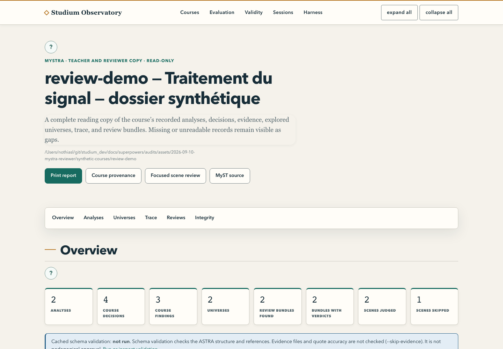

English · [Français](observatory.fr.md)

# Observatory

The Observatory is one local page over what Studium produced: the provenance of each generated
course (decisions, rejected alternatives, evidence), its MySTRA review report, evaluation runs,
validity suites, class session data and live agentic sessions. Teachers and reviewers use it mostly
for **MySTRA**, the printable view of how a course was built. It is read-only, and no learner ever
sees it.

<picture>
  <source media="(prefers-color-scheme: dark)" srcset="../assets/screenshots/observatory-mystra-dark.png">
  
</picture>

## Start it

```bash
.venv/bin/python services/observatory/observatory_app.py --course-root work/courses --port 8004
```

Open `http://127.0.0.1:8004/`. The course root holds one folder per course, each with an
`astra.yaml` (written by `tools/experience_review.py`, see [author a lesson](author-a-lesson.md)).

| Option | Environment variable | Meaning |
|---|---|---|
| `--course-root DIR` | | Folder whose child folders are courses |
| `--course DIR` (repeatable) | `STUDIUM_OBS_COURSES` | One course folder |
| `--eval-root DIR` | `STUDIUM_OBS_EVAL_ROOT` | Evaluation run folders |
| `--validity-root DIR` | `STUDIUM_OBS_VALIDITY_ROOT` | Validity suites |
| `--analytics-data-dir DIR` | `STUDIUM_OBS_ANALYTICS_DATA_DIR` | The analytics collector's store, as an absolute path |
| `--sessions-root DIR` | `STUDIUM_OBS_SESSIONS_ROOT` | One folder of telemetry streams |
| `--session-dir DIR` (repeatable) | | An agentic session workspace to watch |
| `--host`, `--port` | `STUDIUM_OBS_HOST`, `STUDIUM_OBS_PORT` | Default `127.0.0.1:8004` |

It binds the loopback interface; another `--host` prints a warning first. There is no login: do not
expose it. A missing root is reported on the page; only a missing course root with no `--course`
stops start-up. Roots are rescanned on every request.

## Review a course with MySTRA

Open a course, then **MySTRA** (`/courses/<id>/mystra`). The report presents every analysis and the
reviews of each bundle, with quotes taken from the recorded evidence. A missing or unreadable document
shows as such. The page prints cleanly; **MyST source** (`/courses/<id>/provenance.myst.md`) gives the
same content as Markdown for a MyST document. The teacher dashboard's review page links here when a
course folder of the same name is served (see [follow a class](follow-a-class.md)).

Opening MySTRA runs no model and changes no file. The HTML is built from structured readers, without
executing the Markdown, the evidence links or any code in the artefacts. A model verdict or an ASTRA
validation is not a pedagogical review: the decision to distribute stays yours
([review and approve](review-and-approve.md)).

**Validation** (`/courses/<id>/validation`) runs only when you ask. It calls `astra validate
--skip-evidence` (schema and structural references, no network, killed after sixty seconds), so it
does not check evidence files or their quotes. The verdict is cached until a course file changes.
`astra-spec` and `astra-tools` are pinned in `requirements.txt` and must be installed in the same
environment as the server.

## Other pages

| Page | Shows |
|---|---|
| Index | Every course, run and suite found, and any root it could not read |
| Course (`/courses/<id>`) | Decisions, findings, universes, exploration trace, scene-review rows |
| Review (`/courses/<id>/review`) | Each judged scene with its verdicts and grounded quote, worst first, and the judge's calibration on a corrupted scene |
| Run (`/eval/runs/<id>`) | Scores, findings, harness signals and synthetic personas; a persona that hit the turn cap is flagged |
| Validity (`/eval/validity`) | One card per suite |
| Sessions (`/sessions/<course>`) | Collector store and session streams side by side |
| Harness (`/harness`) | Live agentic sessions |

Every page has a JSON twin under `/api/`. An unreadable file renders as `(unreadable <file>: <reason>)`
and the rest of the page still loads.

## Class numbers and the floor

The Observatory never reads a learner identifier, a pseudonym or free text into a view, and never
opens the session event log. Every number derived from telemetry passes the same floor as the class
report: five distinct learners, applied per lesson and again per number. A judgement metric (trust
calibration, over-trust, autonomy) gives its cohort as a band (`5–9`, `10–19`, `20+`) and says in words
that it is not about a student; a withheld value says why, never how many. `measured: false` means
the metric had nothing to measure, which is not a zero. The floor restrains singling out; it is not an
anonymity guarantee, since you know your class.

On the sessions page, the learner count and the trust pair are compared between the two sources. A
flag means the two readers disagree about the same artefact (a stale store, a partial tree, a process
started in another folder), not something about learners. Completion and autonomy are shown with
their formulas and never flagged: the two "autonomy" figures are different measures, named apart
(critique-over-hint balance for the collector, scaffolding independence for the class report). No
comparison is made unless both sides cover exactly one identical lesson and version. A column is in
one of four states: absent, unreadable, broken (a fault in the Observatory itself) or suppressed.

## Watch an agentic session

```bash
.venv/bin/python services/observatory/observatory_app.py --course-root work/courses \
  --session-dir path/to/workspace
```

The Harness tab reads the `.studium-session/` folder of each workspace: the step table from
`index.json`, the current `task.md`, the last `feedback.md` and when each changed. A step at
`awaiting_response` waits for the operator; at `awaiting_run`, for a run result. The page reloads every
five seconds (`--harness-refresh 0` stops it). It never opens `response.json` or `run_result.json`,
the learner's own work, and lists produced artefacts by file name only.

## Try it without your own data

```bash
.venv/bin/python tools/audit-mystra-fixtures.py reports/review-demo
.venv/bin/python services/observatory/observatory_app.py \
  --course-root reports/review-demo/courses --eval-root reports/review-demo/eval \
  --validity-root reports/review-demo/validity --sessions-root reports/review-demo/sessions \
  --analytics-data-dir reports/review-demo/analytics --port 8114
```

The path must not exist yet. The three courses are synthetic: one with two analyses and two reviews,
one without review, one with a deliberately unreadable file. With the server running,
`OBSERVATORY_URL=http://127.0.0.1:8114 node tools/audit-mystra-ui.mjs reports/review-demo reports/review-evidence`
captures desktop, mobile and print views and checks quotes, keyboard navigation, the absence of
external requests and that no artefact changed (needs Chrome; success is exit 0 and `passed: true`).

Tests: `.venv/bin/python -m pytest services/observatory -q`; the ASTRA conformance check used in CI
is `.venv/bin/python tools/astra_validate_check.py`. Code:
[`services/observatory/`](../../services/observatory/).
