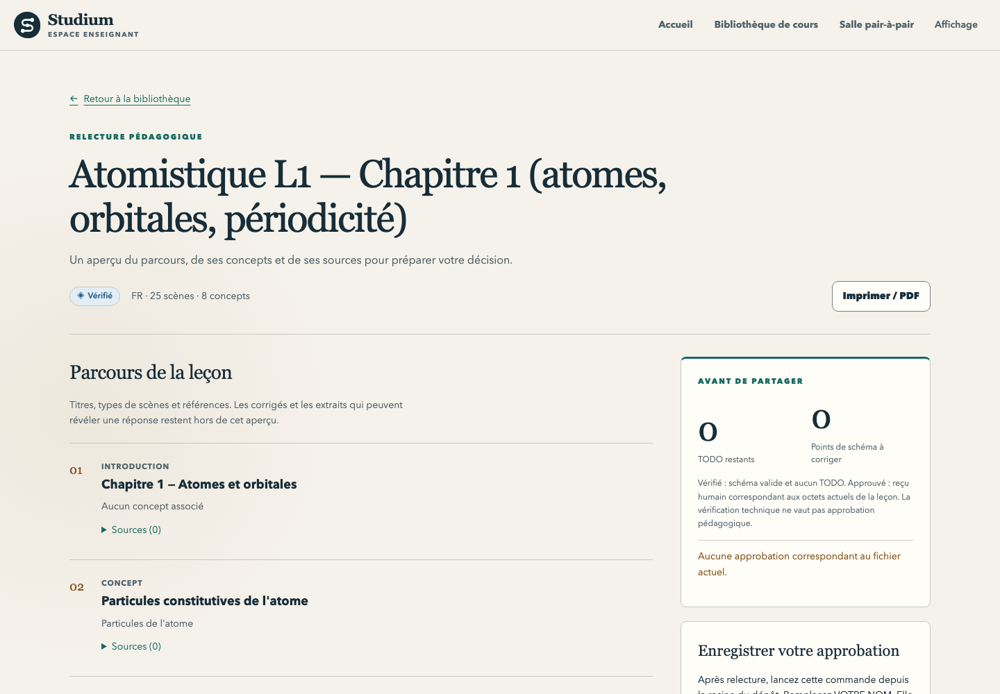

[English](review-and-approve.md) · Français

# Relire et approuver

Avant qu'une leçon parvienne aux étudiants, vous la lisez et enregistrez votre décision pour le
fichier exact que vous avez lu. Studium vous offre quatre vues pour relire, puis une commande pour
approuver. L'approbation écrit `approval.json`, lié aux octets de `lesson.json` : modifiez un seul
caractère et l'approbation ne correspond plus. C'est la règle 003 en pratique : une relecture humaine
avant toute diffusion.

| Vue | Commande ou lieu | Ce qu'elle vous apprend |
|---|---|---|
| Contrôle du brouillon | `experience_packet.py check` | Scènes, concepts, citations, licences, ce qu'aucune citation ne couvre |
| Relecture de la leçon | Outil MCP `review_lesson`, ou page de relecture du tableau de bord | Plan, détenteur de chaque clé de réponse, TODO, lint, état de l'approbation |
| Linter | `node tools/bundle_lint.mjs` | Erreurs et avertissements sur le fichier de leçon |
| Provenance | MySTRA dans l'[Observatoire](observatory.fr.md) | Décisions, alternatives et preuves derrière le plan |

## Lire le contrôle du brouillon

`check` (voir [rédiger une leçon](author-a-lesson.fr.md#3-contrôler-le-brouillon-et-produire-sa-provenance))
affiche le nombre de scènes par type, les concepts, les liens vers les sources, les passages cités ou
non, la licence de chaque source et la langue du plan.

| Ligne | Signification | Votre action |
|---|---|---|
| `ERROR` | Une citation n'est pas une sous-chaîne exacte de son passage, un identifiant est inconnu, ou le brouillon revendique une approbation ou des résultats | Corriger la réponse et relancer `check` (code de sortie 1) |
| `WARN` | Licence `NC`, `ND` ou inconnue ; ancienne scène `simulation` ; scène reliée à aucun concept | Décider si c'est acceptable |
| `Not verifiable by quote:` | Scènes avec des notes `TODO review` ou `evidence_override: "skip"` | Vérifier ces faits vous-même |

Une citation est marquée `en` quand elle semble anglaise dans un plan rédigé dans une autre langue :
c'est un indice de relecture peu coûteux, pas une détection de langue. `--json` produit un rapport
lisible par machine, `--quiet` seulement le chemin de sortie.

## Relire le fichier de leçon

Après `bundle` et la rédaction des champs `TODO:`, demandez à votre assistant d'appeler
`review_lesson` avec le dossier du cours (`course_ref`). Le serveur le cherche dans son dossier de
leçons (`BUNDLES_ROOT`), puis dans la bibliothèque de l'apprenant (`<STUDIUM_HOME>/library`). L'outil
renvoie le plan des scènes, la classe de clé de chaque scène (clé de l'auteur, production, référence
externe), les TODO restants, le verdict du linter (exécuté dans le serveur même), l'existence d'un
enregistrement d'approbation pour ce fichier exact (`approval.matches`) et `ready_for_approval`.
`ready_for_approval` vaut true quand le schéma est valide, qu'il ne reste aucun TODO et que le linter
ne signale aucune erreur : le fichier peut être approuvé, ce qui ne dit rien de la justesse de son
contenu. Il ne renvoie jamais les clés de réponse, les indices ni les corrections, pas même cités dans
un constat : le même serveur peut dialoguer avec un apprenant. Les clés se lisent dans le fichier lui-même. Pour vérifier le seul
schéma depuis un terminal :

```bash
apps/lesson-mcp/node_modules/.bin/tsx tools/bundle_validate.ts work/library/my-course/lesson.json
```

`review_lesson` renvoie aussi une boîte de relecture (`inbox`) : un élément par scène, d'abord les
scènes qui bloquent l'approbation, puis celles qui portent une clé de réponse (`grading`), puis le
texte seul (`wording`), puis celles qui ont une figure ou un autre fichier (`media`). Chaque élément
indique si la scène est nouvelle (`new`), modifiée (`changed`) ou inchangée (`unchanged`) depuis le
dernier reçu de relecture du dossier `reviews/` du cours, et quelles vérifications (schéma, TODO, lint)
elle passe. Une scène qui porte une clé n'a pas d'empreinte (`sha256`) dans la réponse : une empreinte
de ses clés permettrait à un apprenant d'y tester ses hypothèses. Le reçu sur disque garde toutes les
empreintes.

Le tableau de bord enseignant affiche le même état pour chaque leçon, en lecture seule :

<picture>
  <source media="(prefers-color-scheme: dark)" srcset="../assets/screenshots/teacher-review-dark.png">
  
</picture>

| Statut | Signification |
|---|---|
| Brouillon | Le fichier ne respecte pas son schéma ou contient encore un TODO |
| Vérifié | Schéma valide et aucun TODO ; ni lint complet ni approbation humaine |
| Approuvé | Un enregistrement `approval.json` correspond au SHA-256 du `lesson.json` actuel |

Le lancement du tableau de bord est décrit dans [suivre une classe](follow-a-class.fr.md#le-tableau-de-bord-enseignant).

Au-delà des contrôles, regardez : si chaque lien entre source et scène dit bien ce que dit la source,
les prérequis proposés, la charge cognitive, les critères d'évaluation et les représentations. Essayez
un étudiant hésitant, une réponse en partie juste, un outil indisponible et un résultat nul.

## Approuver le fichier exact

```bash
.venv/bin/python tools/experience_packet.py approve \
  --bundle work/library/my-course/lesson.json --validated-by "Votre Nom" \
  --checklist sources=lues cles=verifiees
```

`approve` refuse une leçon qui contient encore un champ à compléter, une leçon avec des erreurs de
lint et toute leçon d'auto-apprentissage. Elle renseigne ensuite `validated_by` et `validated_at` dans
`lesson.json`, réécrit le fichier sous une forme normalisée (clés triées, indentation standard, si bien
que son SHA-256 change une fois) et écrit `approval.json` à côté. Elle affiche qui a approuvé et quand,
le SHA-256, le nombre d'erreurs et d'avertissements du lint et un rappel : toute modification rend
l'approbation périmée ; puis, en dernière ligne, le chemin d'`approval.json`. L'enregistrement
contient :

| Champ | Contenu |
|---|---|
| `schema` | `studium-approval/1` |
| `bundle_sha256` | SHA-256 des octets du `lesson.json` approuvé |
| `reviewer`, `reviewed_at` | Le nom indiqué et l'heure UTC |
| `checklist` | Vos entrées facultatives `clé=valeur` |
| `lint` | Nombre d'erreurs et d'avertissements au moment de l'approbation |
| `tool` | L'outil et sa version |

Les lecteurs (serveur MCP, tableau de bord) traitent un enregistrement absent, mal formé ou étranger
comme une absence d'approbation, et un enregistrement dont l'empreinte ne correspond pas comme périmé
(`review_lesson` indique alors `approval.matches: false`).
Toute modification après approbation, même d'un espace, demande une nouvelle relecture et une nouvelle
approbation. Le texte libre de `validated_by` n'accorde jamais le statut Approuvé, et l'approbation
n'envoie la leçon à personne : la diffusion est une étape distincte
([guide enseignant](teacher-guide.fr.md#diffuser-une-leçon)).

`approve` écrit aussi un reçu de relecture, `reviews/<date>-<12 premiers caractères du SHA-256>.json`
à côté de `lesson.json` : un élément par scène avec son empreinte, sa conséquence (`grading`,
`media`, `wording`) et le fait que vous l'avez ouverte ou non. Nommez les scènes lues avec
`--opened ID[,ID...]` (un identifiant qui n'est pas une scène est refusé avant toute écriture) et
ajoutez au besoin `--note TEXTE` ; le résumé indique `opened N of M items` et signale chaque scène
`grading` que vous n'avez pas ouverte. L'approbation reste possible, le reçu garde le fait.
`review_lesson` compare la version suivante à ce reçu pour marquer les scènes nouvelles, modifiées ou
inchangées. Pour renvoyer plutôt la leçon à son auteur, `receipt --decision returned --reviewer NOM`
écrit le reçu seul, sans `approval.json`.

## Facultatif, approuver un plan avant synthèse

Si vous faites générer les scènes par un orchestrateur de synthèse configuré au lieu de compléter le
squelette, [`tools/experience_approval.py`](../../tools/experience_approval.py) fige le plan relu
jusqu'à la synthèse :

```bash
.venv/bin/python tools/experience_approval.py import work/courses/my-course work/review
.venv/bin/python tools/experience_approval.py approve work/review --teacher "teacher-local:nom"
.venv/bin/python tools/experience_approval.py verify work/review
.venv/bin/python tools/experience_approval.py synthesize work/review --orchestrator mon_module:orchestrator
```

`approve` écrit `plan-approval.json` avec les empreintes du plan et de ses fichiers d'appui ; toute
modification sémantique le rend périmé. `synthesize` refuse un reçu absent ou périmé, transmet le plan
approuvé sans rappeler le planner et consigne le résultat dans `synthesis.json` (les échecs vont dans
`synthesis-attempts.jsonl`) ; une nouvelle approbation archive le `synthesis.json` précédent dans
`synthesis-history/`. `attach-exploration ESPACE RECU` ajoute le résumé d'un
[reçu d'exploration](literature-and-evidence.fr.md#conserver-les-preuves-dans-un-reçu-portable) scellé.
La leçon générée demande toujours votre relecture et `experience_packet.py approve`.

## Limites

- Le nom du relecteur est déclaré, pas authentifié ; le dossier local fait autorité et l'empreinte
  détecte les modifications.
- MySTRA présente la provenance ; il n'exécute aucun des codes qu'il décrit et n'approuve rien.
- Un verdict de modèle ou une validation ASTRA ne vaut pas relecture pédagogique.
