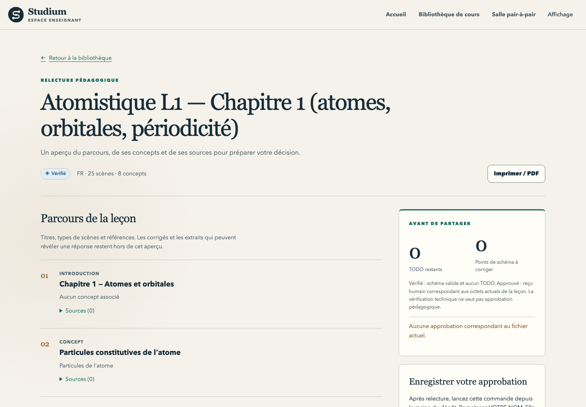

English · [Français](review-and-approve.fr.md)

# Review and approve

Before a lesson reaches students, you read it and record your decision for the exact file you
read. Studium gives you four views to review with, then one command to approve. Approval writes
`approval.json`, bound to the bytes of `lesson.json`: change one character and the approval no
longer matches. This is rule 003 in practice: a human reviews before any distribution.

| View | Command or place | What it tells you |
|---|---|---|
| Draft check | `experience_packet.py check` | Scenes, concepts, quotes, licences, what no quote covers |
| Lesson review | `review_lesson` MCP tool, or the dashboard review page | Plan, who holds each answer key, TODOs, lint, approval status |
| Linter | `node tools/bundle_lint.mjs` | Errors and warnings on the lesson file |
| Provenance | MySTRA in the [Observatory](observatory.md) | Decisions, alternatives and evidence behind the plan |

## Read the draft check

`check` (see [author a lesson](author-a-lesson.md#3-check-the-draft-and-render-its-provenance))
prints the number of scenes per type, the concepts, the source links, cited and uncited passages,
the licence of each source and the plan's language.

| Line | Meaning | Your action |
|---|---|---|
| `ERROR` | A quote is not an exact substring of its passage, an identifier is unknown, or the draft claims approval or results | Fix the response and run `check` again (exit code 1) |
| `WARN` | `NC`, `ND` or unknown licence; a legacy `simulation` scene; a scene linked to no concept | Decide whether it is acceptable |
| `Not verifiable by quote:` | Scenes with `TODO review` notes or `evidence_override: "skip"` | Check these facts yourself |

A quotation is labelled `en` when it looks English in a plan written in another language; this is a
cheap review hint, not language detection. `--json` prints one machine-readable report, `--quiet`
only the output path.

## Review the lesson file

After `bundle` and filling the `TODO:` fields, ask your assistant to call `review_lesson` with the
course folder (`course_ref`). The server looks for it in its lessons folder (`BUNDLES_ROOT`), then
in the learner library (`<STUDIUM_HOME>/library`). It returns the scene plan, the key class of each
scene (author-keyed, production, externally grounded), remaining TODOs, the linter's verdict (the
linter runs inside the server), whether an approval record matches this exact file
(`approval.matches`) and `ready_for_approval`. `ready_for_approval` is true when the schema is valid,
no TODO remains and the linter reports no error: the file can be approved, which says nothing about
whether its content is right. It never returns answer keys, hints or reveals, not even quoted in a
finding: the same server may be talking to a learner. You read the keys in the file itself. To
check the schema alone from a terminal:

```bash
apps/lesson-mcp/node_modules/.bin/tsx tools/bundle_validate.ts work/library/my-course/lesson.json
```

`review_lesson` also returns an `inbox`: one item per scene, the scenes that block approval first,
then those that hold an answer key (`grading`), then plain text (`wording`), then those with a figure
or another asset (`media`). Each item says whether the scene is `new`, `changed` or `unchanged` since
the last review receipt in the course's `reviews/` folder, and which checks (schema, TODO, lint) it
passes. A scene that holds a key gets no fingerprint (`sha256`) in the response: a hash of its keys
would let a learner test guesses against it. The receipt on disk keeps every fingerprint.

The teacher dashboard shows the same status per lesson, read-only:

<picture>
  <source media="(prefers-color-scheme: dark)" srcset="../assets/screenshots/teacher-review-dark.png">
  
</picture>

| Status | Meaning |
|---|---|
| Draft | The file fails its schema or still contains a TODO |
| Checked | Valid schema and no TODO; not a full lint run, not a human approval |
| Approved | An `approval.json` record matches the SHA-256 of the current `lesson.json` |

Starting the dashboard is described in [follow a class](follow-a-class.md#the-teacher-dashboard).

What to look at, beyond the checks: whether each source-to-scene link says what the source says,
the proposed prerequisites, cognitive load, assessment criteria and representations. Try a hesitant
student, a partly right answer, an unavailable tool and a null result.

## Approve the exact file

```bash
.venv/bin/python tools/experience_packet.py approve \
  --bundle work/library/my-course/lesson.json --validated-by "Your Name" \
  --checklist sources=read keys=checked
```

`approve` refuses a lesson that still has a placeholder, a lesson with lint errors, and any
self-study lesson. It then sets `validated_by` and `validated_at` in `lesson.json`, rewrites the file
in a normalised form (keys sorted, standard indentation, so its SHA-256 changes once) and writes
`approval.json` next to it. It prints who approved and when, the SHA-256, the lint counts and a
reminder that any edit makes the approval stale, then the path of `approval.json` as its last line.
The record holds:

| Field | Content |
|---|---|
| `schema` | `studium-approval/1` |
| `bundle_sha256` | SHA-256 of the approved `lesson.json` bytes |
| `reviewer`, `reviewed_at` | The name you gave and the UTC time |
| `checklist` | Your optional `key=value` entries |
| `lint` | Error and warning counts at approval time |
| `tool` | The tool and its version |

Readers (the MCP server, the dashboard) treat a missing, malformed or foreign record as no approval,
and a record whose digest does not match as stale (`review_lesson` then reports
`approval.matches: false`). Any edit after approval, even whitespace, means
you review and approve again. Free-form `validated_by` text never grants the Approved status, and
approval does not send the lesson to anyone: distribution is a separate step
([teacher guide](teacher-guide.md#distribute-a-lesson)).

## Optional: approve a plan before synthesis

If you generate scenes with a configured synthesis orchestrator rather than filling the skeleton,
[`tools/experience_approval.py`](../../tools/experience_approval.py) keeps the reviewed plan fixed
until synthesis:

```bash
.venv/bin/python tools/experience_approval.py import work/courses/my-course work/review
.venv/bin/python tools/experience_approval.py approve work/review --teacher "teacher-local:name"
.venv/bin/python tools/experience_approval.py verify work/review
.venv/bin/python tools/experience_approval.py synthesize work/review --orchestrator my_module:orchestrator
```

`approve` writes `plan-approval.json` with the hashes of the plan and its supporting files; any
semantic change makes it stale. `synthesize` refuses a missing or stale receipt, passes the approved
plan without calling the planner again, and records the result in `synthesis.json` (failures go to
`synthesis-attempts.jsonl`); a new approval archives the previous `synthesis.json` in
`synthesis-history/`. `attach-exploration WORKSPACE RECEIPT` adds a summary of a sealed
[exploration receipt](literature-and-evidence.md#keep-the-evidence-in-a-portable-receipt). The
generated lesson still needs your review and `experience_packet.py approve`.

## Limits

- The reviewer name is declared, not authenticated; the local folder is the authority and the
  digest detects changes.
- MySTRA presents provenance; it runs none of the code it describes and approves nothing.
- A model verdict or an ASTRA validation is not a pedagogical review.
