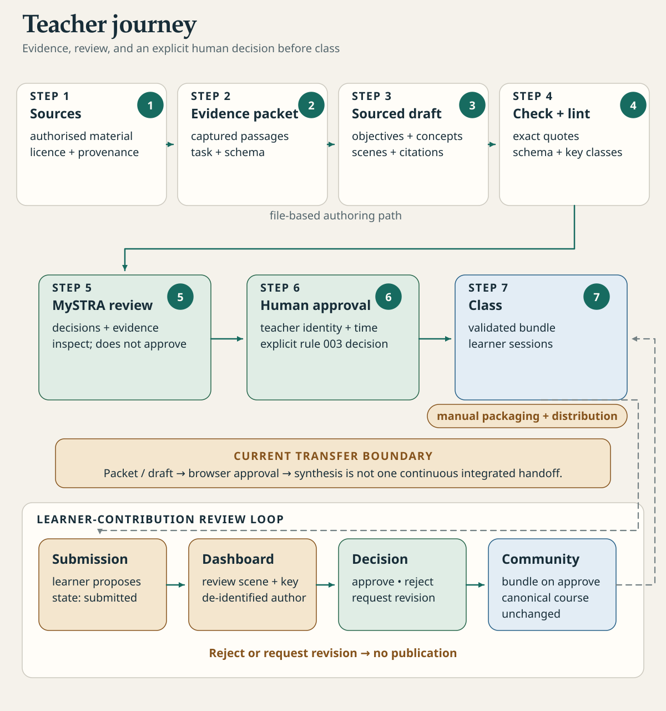

[English](teacher-guide.md) · Français

# Guide enseignant

Studium vous aide à transformer des sources de confiance en une leçon que vos étudiants peuvent
suivre, chaque item noté étant rattaché à un passage vérifiable. C'est vous qui décidez de ce qui
est enseigné, de ce que les sources permettent d'affirmer et du moment où une leçon parvient aux
étudiants. Une leçon qui passe tous les contrôles techniques reste un brouillon tant que vous ne
l'avez pas approuvée : cette décision humaine avant toute diffusion est la règle 003 du projet.

Cette page décrit l'ensemble du parcours et renvoie à la page de chaque étape. Pour que votre
assistant vous y accompagne, chargez le skill `studium-teacher` (voir [skills](../start/skills.fr.md)).

## Le parcours en un coup d'œil

<picture>
  <source media="(prefers-color-scheme: dark)" srcset="../assets/diagrams/teacher-journey-dark.svg">
  
</picture>

| Étape | Ce que vous faites | Résultat | Page |
|---|---|---|---|
| Préparer | Choisir une question, un public et les sources autorisées | Un plan de pilote | [ci-dessous](#préparer-lactivité) |
| Rédiger | Faire rédiger la leçon par votre assistant à partir de passages capturés | Un brouillon contrôlé | [Rédiger une leçon](author-a-lesson.fr.md) |
| Relire | Lire le plan, les citations, les clés et la provenance | Vos corrections | [Relire et approuver](review-and-approve.fr.md) |
| Approuver | Enregistrer votre décision pour le fichier exact | `approval.json` | [Relire et approuver](review-and-approve.fr.md#approuver-le-fichier-exact) |
| Diffuser | Remettre le dossier de la leçon aux étudiants | Des leçons dans leur bibliothèque | [ci-dessous](#diffuser-une-leçon) |
| Suivre une classe | Lire des agrégats de classe, jamais un étudiant isolé | Un rapport de classe | [Suivre une classe](follow-a-class.fr.md) |
| Modérer | Relire ce que les apprenants proposent d'ajouter | Des items communautaires | [Contributions des apprenants](learner-contributions.fr.md) |

## Avant de commencer

1. Installez Studium : [installation](../start/installation.fr.md).
2. Suivez vous-même une leçon pour voir ce que reçoit un étudiant : [première leçon](../tutorials/first-lesson.fr.md).
3. Connectez votre assistant (Codex, Claude Code, Copilot, OpenCode ou un autre client MCP) :
   [harnais](../start/harnesses.fr.md). Aucun fournisseur de modèle supplémentaire n'est nécessaire
   pour rédiger par ce biais.
4. Faites une fois le [tutoriel de la littérature au cours](../tutorials/literature-to-course.fr.md)
   sur l'exemple fourni, avant d'utiliser vos propres matériaux.

## Préparer l'activité

Partez d'une question qui demande plus qu'un résultat calculé, par exemple « Une similarité
spectrale élevée suffit-elle à identifier une molécule ? ». Puis distinguez :

- le concept à comprendre et la tâche à réaliser ;
- l'observation attendue et la limite à discuter ;
- un cas nouveau pour vérifier le transfert.

Fixez le pilote : public, prérequis, durée, question de jugement, ce que les étudiants peuvent
explorer, les matériaux autorisés et le mode de restitution. Une consigne de cadrage pour votre
assistant peut ressembler à ceci :

> Prépare un brouillon Studium pour [public], en [durée], sur [question]. Utilise seulement les
> passages et matériaux du dossier. Sépare résultats de l'article, hypothèses et données
> synthétiques. Demande une prédiction avant toute exécution, une comparaison et une question de
> transfert. Signale les preuves manquantes. Ne marque rien comme approuvé et n'invente aucun
> résultat de capsule.

Les [cas d'usage](../tutorials/use-cases.fr.md) donnent des exemples complets (annotation spectrale,
diagnostic d'une analyse, robustesse, photographies en archéologie). Des activités interactives
prêtes à adapter se trouvent dans [modèles d'activités](activity-templates.fr.md) ; figures,
équations et médias dans [médias et supports visuels](media-and-visual-support.fr.md).

## Diffuser une leçon

Une leçon est un dossier : `lesson.json`, ses `assets/` et, une fois approuvée, `approval.json`.
Gardez les trois ensemble et à la même révision. Les étudiants placent le dossier dans leur
bibliothèque Studium (par défaut `~/.studium/library/<course_id>/`, ou le dossier que désigne
`BUNDLES_ROOT`) et l'ouvrent depuis leur assistant ou depuis VS Code (voir [VS Code](../start/vscode.fr.md)).
Au démarrage de la leçon, la session indique si un enregistrement d'approbation correspond au
fichier exact.

Pour une classe :

- commencez par quelques étudiants et vérifiez la séance sur leurs machines (accès au bundle,
  affichage, langue, comportement si le modèle ou le réseau est indisponible, export) ;
- donnez des consignes écrites et une solution de repli si le compte de l'assistant ou Internet fait
  défaut ;
- le paquet VS Code simplifie l'installation du panneau de leçon, mais ne diffuse ni ne valide les
  leçons à votre place.

## Organiser une séance d'expérimentation

Quand une leçon laisse les étudiants explorer avec leur assistant, fixez un périmètre concret :
données, commandes, dépendances, accès web, contrôles interactifs et durée. Réafficher les matériaux
approuvés peut rester dans l'activité ; une affirmation, un exercice ou une scène générés au-delà de
ce périmètre sont des brouillons à relire avant usage. Studium ne fait pas encore respecter cette
frontière à votre place.

Demandez aux étudiants leur prédiction, les différences observées, une limite et un test de
transfert. Une sortie de l'agent ne prouve pas que l'étudiant a compris. Le
[tutoriel d'expérience agentique](../tutorials/agentic-experiment.fr.md) déroule une séance complète,
et [littérature et preuves](literature-and-evidence.fr.md) présente le reçu d'exploration portable.

## Ce que les étudiants peuvent vous transmettre

Un étudiant peut choisir d'exporter un [rapport d'apprenant](../learn/learner-report.fr.md) de ses
actions enregistrées, et tient un [journal d'expérience](../learn/experiment-journal.fr.md) privé.
Discutez avec lui de ce qui sera partagé et de la façon dont vous le lirez : une trace incomplète ne
mesure pas l'autonomie. Le rapport par défaut exclut les textes personnels et ne donne accès ni au
journal complet ni à l'historique de l'assistant. Voir [confidentialité et limites](../concepts/privacy-and-limits.fr.md).

## Limites

- Les contrôles techniques (schéma, citations exactes, lint) ne remplacent pas une relecture
  pédagogique ; une citation exacte peut encore être mal interprétée.
- L'enregistrement d'approbation porte le nom que vous saisissez ; Studium ne l'authentifie pas.
- Le tableau de bord, l'Observatoire et les services d'analyse sont des outils locaux sans
  connexion ; ne les exposez pas sur Internet.
