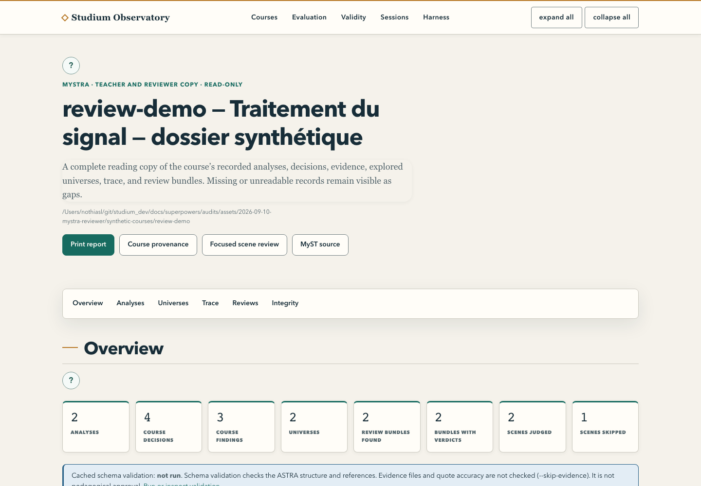

[English](literature-to-course.md) · Français

# De la littérature à un brouillon relisible

Produisez un plan de leçon sourcé qu'un enseignant peut examiner dans MySTRA, la vue de provenance
de l'Observatory, avant de décider de l'approuver. Comptez 20 à 30 minutes une fois l'environnement
Python de l'[installation](../start/installation.fr.md) prêt. Le premier passage rejoue un exemple
capturé : ni recherche web, ni appel de modèle payant.

<picture>
  <source media="(prefers-color-scheme: dark)" srcset="../assets/diagrams/teacher-journey-dark.svg">
  
</picture>

## 1. Rejouer l'exemple livré

Depuis la racine du dépôt, avec un dossier de travail neuf :

```bash
WORK="$HOME/studium-tutoriel"
.venv/bin/python tools/experience_packet.py prepare --passages examples/literature-experience/passages.json \
  --title "Que démontre une similarité spectrale ?" --target "Master" --out "$WORK/packet"
.venv/bin/python tools/experience_packet.py check --packet "$WORK/packet" \
  --response examples/literature-experience/author-response.json --out "$WORK/courses/spectral-evidence"
.venv/bin/python tools/experience_review.py "$WORK/courses/spectral-evidence"
```

Aucune sortie n'est écrasée sans le demander. L'exemple utilise un court extrait capturé de
l'article SimMS et une réponse d'auteur préparée. Ses spectres sont synthétiques : ce n'est pas une
reproduction des résultats de l'article.

| Fichier | Ce qu'il permet de vérifier |
|---|---|
| `packet/evidence.json` | Textes capturés, identifiants, provenance et empreintes |
| `packet/author-task.md` | La consigne destinée à l'assistant auteur |
| `packet/response.schema.json` | Le format imposé à la proposition |
| `plan.json` | Le plan canonique, au statut `draft` |
| `source_links.json` | Les liens entre scène, preuve et citation exacte |
| `viewers.json` | Des intentions de visualisation, pas un visualiseur exécuté |
| `review.md` | Points de revue et limites |
| `astra.yaml`, `course_provenance.myst.md` | Provenance structurée pour MySTRA |

Tous les fichiers après les trois premiers se trouvent dans le dossier du cours. `check` valide les
références et la structure ; il ne juge pas la vérité de l'interprétation.

## 2. Ouvrir la revue

```bash
.venv/bin/python services/observatory/observatory_app.py --course-root "$WORK/courses" --port 8124
```

Ouvrez `http://127.0.0.1:8124/courses/spectral-evidence/mystra`. Retrouvez la question, les
décisions et leurs preuves. Comparez une citation au passage capturé. Relevez une limite
scientifique et une amélioration pédagogique. Le statut doit rester **DRAFT**. Arrêtez le serveur
avec Ctrl-C.

<picture>
  <source media="(prefers-color-scheme: dark)" srcset="../assets/screenshots/observatory-mystra-dark.png">
  
</picture>

## 3. Remplacer l'exemple par votre littérature

Avec un connecteur Perspicacité réellement disponible et authentifié dans votre harnais, posez une
question de recherche bornée et conservez l'enveloppe JSON renvoyée par son outil de passages.
`prepare` attend ce contrat, pas une liste de titres ; voir [le format de l'exemple](../../examples/literature-experience/passages.json).
Un connecteur configuré ne prouve pas qu'une recherche a réussi. Sans connecteur, la commande
`passages` d'[Auto-apprentissage à partir de ses références](self-study-from-references.fr.md#voie-2--avec-les-outils-en-ligne-de-commande)
capture une page, un PDF ou un fichier texte dans le même rôle.

Vérifiez pertinence, identifiants, extraits disponibles et droits de réutilisation. Une notice
bibliographique n'est pas le texte intégral de l'article. Relancez ensuite `prepare` avec ce fichier
et une nouvelle destination, puis demandez au harnais :

> Lis `author-task.md`, `evidence.json` et `response.schema.json` du dossier. Propose le plan dans
> un nouveau `author-response.json`. Utilise les identifiants de preuve exacts et des citations
> présentes dans les passages. Distingue ce que chaque source soutient et ce qui manque. Garde
> `status: draft` et `validated_by: null`. Décris les interactions utiles des visualiseurs sans
> revendiquer un calcul qui n'a pas eu lieu. Ne soumets aucune réponse étudiante.

Faites pointer `--response` vers ce nouveau fichier. Corrigez les erreurs signalées par `check` dans
le brouillon, jamais en modifiant la preuve. Dans `author-response.json`, reliez chaque scène aux
identifiants de notions avec `concept_refs` et déclarez sur chaque notion celles dont elle dépend
dans `prerequisites` ; `check` ne doit signaler ni identifiant inconnu ni scène sans notion.

## 4. Ajouter une capsule ASB

Ajoutez `--capsule CHEMIN --task-id TASK_ID` à `prepare`, avec l'identifiant réel de la tâche dans la
capsule. Le préparateur capture la carte et ses contraintes, retire les valeurs d'environnement,
garde les noms utiles et n'exécute pas le code. Une capsule documentaire Perspicacité et une capsule
exécutable ASB ne sont pas interchangeables. Essayez d'abord la tâche dans un environnement prévu
pour elle et conservez commande, entrées, versions et sortie, ou l'échec. Une carte marquée
`type-checked` ne prouve pas une réussite locale. [Le tutoriel suivant](agentic-experiment.fr.md)
transforme une telle tâche en activité de jugement.

## 5. Décider de la suite

Relisez objectifs, prérequis, exactitude scientifique, questions, critères de réponse, charge de
travail et droits sur les matériaux. Le dossier vérifié n'est pas un `LessonBundle` étudiant : ne le
renommez jamais en `lesson.json`. Convertissez-le explicitement en squelette jouable :

```bash
.venv/bin/python tools/experience_packet.py bundle --course "$WORK/courses/spectral-evidence" \
  --out "$WORK/bundles/spectral-evidence/lesson.json"
apps/lesson-mcp/node_modules/.bin/tsx tools/bundle_validate.ts "$WORK/bundles/spectral-evidence/lesson.json"
```

Le squelette garde la marque `DRAFT — not validated` et contient des champs `TODO:` à remplacer et à
relire. Il recopie les `concept_refs`, dérive le graphe de prérequis (`source` = notion dépendante,
`target` = prérequis), ajoute la règle de reprise après deux erreurs `rule_2err_replay_concept`
(`--no-default-rules` l'omet) et reprend les `notes` comme questions des quiz. `check` et `bundle`
refusent une destination existante sans `--force`.

Une fois la leçon complétée et relue, enregistrez la décision :

```bash
.venv/bin/python tools/experience_packet.py approve --bundle "$WORK/bundles/spectral-evidence/lesson.json" \
  --validated-by "Votre nom"
```

`approve` refuse les textes provisoires restants et les erreurs de lint, et écrit `approval.json`
à côté de la leçon, lié aux octets exacts de `lesson.json` : modifier la leçon ensuite rompt ce
lien. Une leçon d'auto-apprentissage ne peut pas être approuvée. Depuis votre harnais, l'outil
`review_lesson` montre le plan des scènes, qui détient chaque clé, le verdict du lint et la présence
d'un enregistrement d'approbation correspondant, sans révéler aucune clé. La voie enseignant
complète est dans [Relire et approuver](../teach/review-and-approve.fr.md) ; les règles de
remplissage et les avertissements de licence, dans [Rédiger une leçon](../teach/author-a-lesson.fr.md).
