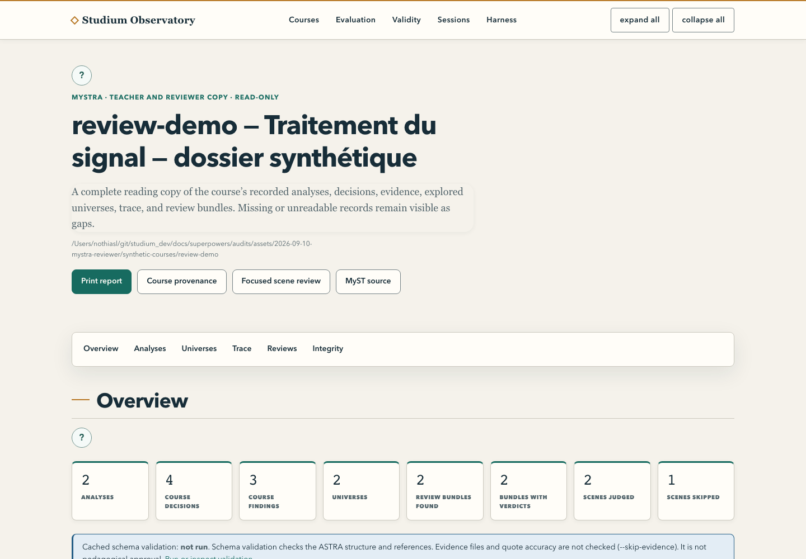

English · [Français](literature-to-course.fr.md)

# From the literature to a reviewable draft

Produce a sourced lesson plan that a teacher can inspect in MySTRA, the provenance viewer of the
Observatory, before deciding to approve it. Allow 20 to 30 minutes once the Python environment from
[Installation](../start/installation.md) is ready. The first pass replays a captured example: no web
search and no paid model call.

<picture>
  <source media="(prefers-color-scheme: dark)" srcset="../assets/diagrams/teacher-journey-dark.svg">
  
</picture>

## 1. Replay the shipped example

From the repository root, with a new working folder:

```bash
WORK="$HOME/studium-tutorial"
.venv/bin/python tools/experience_packet.py prepare --passages examples/literature-experience/passages.json \
  --title "What does spectral similarity show?" --target "Master's students" --out "$WORK/packet"
.venv/bin/python tools/experience_packet.py check --packet "$WORK/packet" \
  --response examples/literature-experience/author-response.json --out "$WORK/courses/spectral-evidence"
.venv/bin/python tools/experience_review.py "$WORK/courses/spectral-evidence"
```

Outputs are never overwritten silently. The example uses a short captured excerpt of the SimMS
article and a prepared author response. Its spectra are synthetic: this is not a reproduction of the
article's results.

| File | What it lets you check |
|---|---|
| `packet/evidence.json` | Captured texts, identifiers, provenance and hashes |
| `packet/author-task.md` | The brief for the authoring assistant |
| `packet/response.schema.json` | The format the proposal must follow |
| `plan.json` | The canonical plan, with status `draft` |
| `source_links.json` | Links between scene, evidence and exact quote |
| `viewers.json` | Visualisation intents, not an executed viewer |
| `review.md` | Review points and limits |
| `astra.yaml`, `course_provenance.myst.md` | Structured provenance for MySTRA |

Every file below the first three sits in the course folder. `check` validates references and structure; it does not
judge whether the interpretation is true.

## 2. Open the review

```bash
.venv/bin/python services/observatory/observatory_app.py --course-root "$WORK/courses" --port 8124
```

Open `http://127.0.0.1:8124/courses/spectral-evidence/mystra`. Find the question, the decisions and
their evidence. Compare a quote with its captured passage. Note one scientific limit and one
teaching improvement. The status must still read **DRAFT**. Stop the server with Ctrl-C.

<picture>
  <source media="(prefers-color-scheme: dark)" srcset="../assets/screenshots/observatory-mystra-dark.png">
  
</picture>

## 3. Replace the example with your literature

With a Perspicacité connector actually available and authenticated in your harness, ask a bounded
research question and keep the JSON envelope its passages tool returned. `prepare` expects that
contract, not a list of titles; see [the example's format](../../examples/literature-experience/passages.json).
A configured connector does not prove a search succeeded. Without one, the `passages` command of
[Self-study from your references](self-study-from-references.md#route-2-with-the-command-line-tools)
captures a page, PDF or text file in the same role.

Check relevance, identifiers, available excerpts and reuse rights. A bibliographic record is not the
article's full text. Then run `prepare` again with that file and a new destination, and ask the
harness:

> Read `author-task.md`, `evidence.json` and `response.schema.json` in the packet. Write the plan in
> a new `author-response.json`. Use the exact evidence ids and quotes present in the passages.
> Separate what each source supports from what is missing. Keep `status: draft` and
> `validated_by: null`. Describe useful viewer interactions without claiming a computation that did
> not happen. Do not submit any student answer.

Point `--response` at the new file. Fix the errors `check` reports in the draft, never by altering
the evidence. In `author-response.json`, link each scene to concept ids with `concept_refs` and
declare on each concept the ids it depends on in `prerequisites`; `check` must report no unknown id
and no scene without a concept.

## 4. Add an ASB capsule

Add `--capsule PATH --task-id TASK_ID` to `prepare`, with the real task id from the capsule. The
preparer captures the card and its constraints, drops environment values, keeps the useful names and
does not run the code. A Perspicacité documentary capsule and an executable ASB capsule are not
interchangeable. Try the task first in an environment meant for it and keep the command, inputs,
versions and output, or the failure. A card marked `type-checked` is not proof of a local success.
[The next tutorial](agentic-experiment.md) turns such a task into a judgment activity.

## 5. Decide what comes next

Review objectives, prerequisites, scientific accuracy, questions, answer criteria, workload and
material permissions. The checked folder is not a student `LessonBundle`: never rename it to
`lesson.json`. Convert it explicitly into a playable skeleton:

```bash
.venv/bin/python tools/experience_packet.py bundle --course "$WORK/courses/spectral-evidence" \
  --out "$WORK/bundles/spectral-evidence/lesson.json"
apps/lesson-mcp/node_modules/.bin/tsx tools/bundle_validate.ts "$WORK/bundles/spectral-evidence/lesson.json"
```

The skeleton keeps the mark `DRAFT — not validated` and contains `TODO:` fields to replace and
reread. It copies the `concept_refs`, derives the prerequisite graph (`source` = dependent concept,
`target` = prerequisite), adds the two-error replay rule `rule_2err_replay_concept` (omit it with
`--no-default-rules`) and reuses the `notes` as quiz questions. `check` and `bundle` refuse an
existing destination unless given `--force`.

When the lesson is filled and reviewed, record the decision:

```bash
.venv/bin/python tools/experience_packet.py approve --bundle "$WORK/bundles/spectral-evidence/lesson.json" \
  --validated-by "Your name"
```

`approve` refuses remaining placeholders and lint errors, and writes `approval.json` next to the
lesson, bound to the exact bytes of `lesson.json`: editing the lesson afterwards breaks the binding.
A self-study lesson cannot be approved. From your harness, the `review_lesson` tool shows the scene
plan, who holds each key, the lint verdict and whether an approval record matches, without revealing
any key. The full teacher route is in [Review and approve](../teach/review-and-approve.md); filling
rules and licence warnings are in [Author a lesson](../teach/author-a-lesson.md).
