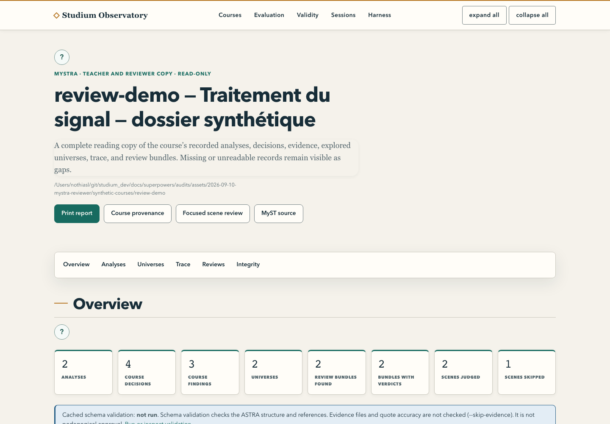

[English](README.md) · Français

# Observatory

Une page locale en lecture seule sur les artefacts que Studium écrit déjà : la provenance ASTRA de
chaque cours généré, le verdict du validateur ASTRA à la demande, le rapport de relecture MySTRA, les
évaluations sous `eval/reports/`, les tableaux de validité sous `eval/validity/`, les séances de classe
et les séances agentiques en cours. C'est une surface d'opérateur et de relecteur. Ce n'est pas le
tableau de bord enseignant, et elle n'est jamais montrée aux apprenants.

<picture>
  <source media="(prefers-color-scheme: dark)" srcset="../../docs/assets/screenshots/observatory-mystra-dark.png">
  
</picture>

| | |
|---|---|
| Statut | **maintenu** (décision D6) |
| Lancer | `.venv/bin/python services/observatory/observatory_app.py --course-root <dossier>` |
| Port | 8004 sur 127.0.0.1 (`--port`, `STUDIUM_OBS_PORT`) |
| Lit | les dossiers de cours du planner (`.lwg/<id>/astra.yaml`), `eval/reports/`, `eval/validity/`, le magasin du collecteur d'analyses sur disque, des dossiers de séance |
| Appelle | rien sur le réseau ; lance `astra validate` à la demande |
| Lié depuis | la page de relecture du [tableau de bord enseignant](../../apps/teacher-dashboard/README.fr.md) (`OBSERVATORY_BASE_URL`) |
| Tests | `.venv/bin/python -m pytest services/observatory` |

Guide d'utilisation : [L'Observatory](../../docs/teach/observatory.fr.md). La suite de cette page
s'adresse aux développeurs et aux opérateurs.

## Ce qu'il montre

| Page | Contenu |
| --- | --- |
| `/` | chaque cours, évaluation et suite de validité trouvés sur disque, avec un bandeau pour toute racine mal configurée |
| `/courses/<id>` | les analyses du cours, les décisions avec leurs options et justifications, les constats avec leurs ancres de preuve, les univers avec ce que chacun change par rapport aux valeurs par défaut, la trace d'exploration et les lignes de relecture des scènes |
| `/courses/<id>/validation` | lance `astra validate` sur ce cours et affiche le verdict ; la seule page qui démarre un sous-processus |
| `/courses/<id>/mystra` | le rapport de relecture MySTRA imprimable, construit à partir des lecteurs du cours et de la relecture |
| `/courses/<id>/provenance.myst.md` | la page MyST écrite par `tools/astra_render.py`, telle quelle |
| `/courses/<id>/review` | une section par bundle jugé, pire cas en tête : les verdicts par scène écrits par `eval/harness/scene_judge.py`, avec leur scénario d'échec et leur citation, la calibration sur scènes corrompues quand la relecture en contient une, et les mêmes verdicts sous forme de décisions ASTRA |
| `/eval/runs/<id>` | les scores par dimension, constats, signaux du banc, séances des personas synthétiques et `report.md` |
| `/eval/validity` | une carte par suite de validité avec les champs scalaires de ses fichiers de résultats |
| `/sessions` | la colonne des séances seule ; cet arbre n'a pas de dimension « cours », il n'a donc pas besoin d'identifiant |
| `/sessions/<course>` | les deux sources de séances côte à côte : le magasin du collecteur pour ce cours, les séances, les indicateurs comparables et les deux qui sont affichés sans jamais être signalés |
| `/harness` | un espace de séance agentique nommé par section : `index.json` en tableau d'étapes, le `task.md` courant, le dernier `feedback.md`, la date de modification de chaque fichier ; la page se rafraîchit seule |

Chaque page a un jumeau JSON sous `/api/…` avec les mêmes données.

## Le lancer

Depuis la racine du dépôt, avec l'environnement virtuel installé :

```bash
.venv/bin/python services/observatory/observatory_app.py --course-root services/planner/.lwg --eval-root eval/reports
```

Ou, depuis ce dossier, avec n'importe quel serveur ASGI :

```bash
uvicorn observatory_app:app --port 8004
```

Le lanceur écrit une ligne par défaut de configuration sur stderr et sort avec le code 2 s'il n'y a ni
racine de cours ni `--course`. Tout le reste est tolérant : un fichier illisible devient un marqueur dans
la page, jamais une page d'erreur. Options : `--course-root`, `--course` (répétable), `--eval-root`,
`--validity-root`, `--analytics-data-dir`, `--sessions-root`, `--session-dir` (répétable),
`--harness-refresh`, `--host`, `--port`, `--validator-timeout`.

## Configuration

Les options l'emportent sur ces variables ; chacune a une valeur par défaut qui fonctionne dans un clone
neuf.

| Variable | Valeur par défaut | Rôle |
| --- | --- | --- |
| `STUDIUM_LWG_OUT_DIR` | `services/planner/.lwg`, sinon `.lwg` | dossier dont les sous-dossiers sont des cours (la variable propre au planner) |
| `STUDIUM_OBS_COURSES` | vide | dossiers de cours supplémentaires, un par un, séparés par le séparateur de chemins de la plateforme |
| `STUDIUM_OBS_EVAL_ROOT` | `eval/reports` | dossier des évaluations |
| `STUDIUM_OBS_VALIDITY_ROOT` | `eval/validity` | dossier des suites de validité |
| `STUDIUM_OBS_HOST` | `127.0.0.1` | adresse d'écoute |
| `STUDIUM_OBS_PORT` | `8004` | port |
| `STUDIUM_OBS_VALIDATOR_TIMEOUT` | `60` | secondes avant l'arrêt forcé de `astra validate` |
| `STUDIUM_OBS_ANALYTICS_DATA_DIR` | non défini | le magasin d'événements du collecteur, en chemin **absolu** ; non défini signifie pas de colonne en direct plutôt qu'un dossier deviné |
| `STUDIUM_OBS_SESSIONS_ROOT` | non défini | **un** dossier de flux `telemetry.jsonl`, lu en entier par `class_report.build_report` ; non défini signifie pas de colonne de séances |
| `STUDIUM_OBS_SESSION_DIRS` | vide | espaces de séance agentique, un par un, séparés par le séparateur de chemins de la plateforme ; l'espace lui-même ou son `.studium-session/` sont acceptés |
| `STUDIUM_OBS_HARNESS_REFRESH` | `5` | secondes entre deux rafraîchissements de la page Harness ; `0` le désactive |

Un cours est tout dossier contenant un `astra.yaml`. Une évaluation est tout dossier contenant un
`audit.json` ou un dossier `sessions/`. Une suite est tout dossier contenant un `README.md`. Les racines
sont relues à chaque requête : une nouvelle évaluation apparaît au rechargement, sans redémarrage.

### Le magasin d'analyses, et pourquoi il a sa propre variable

Le collecteur résout son `ANALYTICS_DATA_DIR` (par défaut le chemin **relatif** `"data"`) par rapport à
*son* dossier de travail, et `tools/e2e-demo-m6.sh` le lance après un `cd`. La même chaîne désigne donc
deux dossiers différents selon l'endroit où chaque processus a démarré. L'Observatory prend sa propre
variable, la résout en chemin absolu et affiche le résultat dans le bandeau de l'index : une divergence
se voit sur la page au lieu de passer pour un magasin vide.

Il n'y a volontairement **aucune variable de jeton de cours**. Le contrôle du collecteur est une égalité
de chaînes entre l'en-tête `X-Course-Token` et le paramètre `course` : le jeton *est* l'identifiant du
cours, saisi dans le formulaire du tableau de bord et affiché à l'écran. Une variable présentée comme
« lue une fois, jamais journalisée, jamais affichée » ne protégerait rien ; l'Observatory lit le magasin
sur disque au lieu d'appeler le collecteur en HTTP (INT-STUDIUM-019).

## Les deux sources de séances

`/sessions/<course>` place deux lecteurs côte à côte, sans réimplémenter ni l'un ni l'autre :

* le **magasin du collecteur**, `<magasin>/<cours>/<AAAA-MM-JJ>.jsonl`, lu par les fonctions du
  collecteur lui-même : `metrics.compute_progress`, `compute_course_completion`, `compute_autonomy` et
  `compute_trust_calibration` ;
* les **séances**, UN dossier lu en entier par `class_report.build_report`, qui trouve ses entrées avec
  `rglob("telemetry.jsonl")` et couvre à la fois la disposition durable de l'hôte MCP
  (`<pseudonyme>/<bundle_id>/telemetry.jsonl`) et celle d'une évaluation
  (`sessions/<persona>/telemetry.jsonl`).

**Une seule des deux est rattachée à un cours.** Aucun auteur de flux de télémétrie n'y inscrit de cours :
l'arbre durable est indexé par pseudonyme et celui d'une évaluation par persona.
`STUDIUM_OBS_SESSIONS_ROOT` est donc un seul dossier, et le `<course>` de l'URL ne restreint que la
colonne du collecteur.

**Ce qui est comparé.** Deux indicateurs sont strictement comparables : le nombre d'apprenants (égalité
exacte) et la paire de confiance (l'écart à `5e-4` près, parce que le rapport de classe l'arrondit à trois
décimales et que le collecteur le garde brut, et la tranche à l'identique). Un signalement veut dire *les
deux lecteurs ne sont pas d'accord sur le même artefact* : un magasin est périmé, un arbre est partiel ou
un processus a démarré ailleurs. Ce n'est pas un constat sur les apprenants.

**Ce qui est seulement affiché.** L'achèvement et l'autonomie apparaissent dans les deux colonnes avec la
formule de chacun nommée à l'écran, et ne sont jamais signalés. Les deux côtés ne mesurent pas la même
population, et les deux définitions du « ratio d'autonomie » (celle du collecteur, rapport des événements
de critique aux adaptations par indice, et la moyenne de l'`autonomy_ratio` que le moteur inscrit sur
`lesson_completed`) partagent un nom, pas une formule. Cette collision est un défaut à part entière,
déclaré séparément ; cette page nomme les deux formules au lieu de la cacher.

**Quand rien n'est comparé.** Une comparaison exige une portée `(lesson_id, bundle_version)` identique des
deux côtés. Plusieurs leçons, des versions de bundle différentes, ou le compartiment `"unversioned"` du
collecteur pour un événement non daté : chaque colonne affiche ses propres chiffres, la page explique
pourquoi ils ne sont pas comparables, et rien n'est signalé. Un identifiant de leçon seul n'est pas unique
globalement : un signalement entre deux artefacts serait une alarme sur la portée.

**Les anciennes évaluations synthétiques n'ont pas d'identité.** Une évaluation de cette disposition ne
porte pas de `learner_pseudonym`, et `build_report` se rabat sur le chemin du fichier comme identité.
L'Observatory ne l'accepte pas : un événement sans pseudonyme et identifiant de leçon a une identité
inconnue, et la source est écartée avec cette raison au lieu d'être comptée. Dirigez `--sessions-root`
vers un arbre d'hôte durable pour obtenir une colonne.

## L'onglet Harness

`--session-dir <espace>` (répétable) ou `STUDIUM_OBS_SESSION_DIRS` nomme les espaces à suivre. Ils sont
nommés **un par un et jamais cherchés** : un dossier `.studium-session/` se trouve à la racine de
l'espace de travail qu'un opérateur pilote, et rien ne regroupe plusieurs espaces sous un parent commun ;
une convention `<racine>/<séance>` décrirait une disposition qu'aucun auteur ne produit. Les deux formes de
chemin conviennent : l'espace, ou le `.studium-session/` qu'il contient.

La page se redemande elle-même toutes les `STUDIUM_OBS_HARNESS_REFRESH` secondes. Le rafraîchissement est
celui de la page, pas du serveur : la spécification demande un rafraîchissement périodique et interdit une
dépendance de surveillance de fichiers, et une boucle côté serveur serait un état dans un service qui n'en
a pas. `--harness-refresh 0` le désactive pour une séance que l'on lit plutôt qu'on ne la suit. Le jumeau
JSON porte l'intervalle sous forme de nombre et ne pose aucun en-tête de rafraîchissement : un client qui
interroge gère son propre intervalle.

**Trois des six fichiers du protocole sont lus, et l'omission est voulue.** `.studium-session/` contient
aussi `response.json` et `run_result.json`, qui sont la réponse de l'apprenant et son propre résultat
d'exécution ; ces deux noms n'apparaissent sur la page que comme omission déclarée. `task.md` est sûr par
construction (`publicScene` retire le corrigé avant l'écriture du fichier) et `feedback.md` ne peut pas
reprendre une réponse, car `renderFeedback` est un ensemble fermé de messages de transition. `index.json`
est affiché en tableau d'étapes et jamais en texte brut : ses entrées portent des chemins d'artefacts, que
le tableau réduit à leur nom de fichier, alors que le document brut les remettrait sans filtre. Un test
écrit une chaîne témoin dans les deux fichiers de l'apprenant et vérifie qu'elle n'atteint aucune donnée
ni aucune page ; un autre relève chaque fichier ouvert dans un dossier de séance et compare cet ensemble
aux trois attendus.

Les noms de fichiers sont définis en TypeScript (`FILES` dans
`packages/lesson-session-host/src/session-workspace.ts`), que Python ne peut pas importer : les noms
Python en sont un miroir, et un miroir *vérifié* : un test lit cette source, en extrait le littéral et
échoue en nommant l'écart si un nom change ou si un septième fichier apparaît.

## Lecture seule

Chaque route est un `GET`. Le service n'écrit rien sous les racines qu'il lit et ne démarre ni leçon, ni
évaluation, ni appel de modèle. Le sous-processus du validateur est le seul processus qu'il lance, avec
`--skip-evidence`, donc sans appel réseau. Un parcours de toutes les routes vérifie qu'aucun contenu ni
aucune date de modification de fichier ne change (`tests/test_observatory_readonly_privacy.py`).

## Confidentialité

Aucun identifiant d'apprenant, pseudonyme ni champ de télémétrie en texte libre n'est jamais lu dans une
vue, sur aucune page, personas synthétiques compris. Les lecteurs filtrent avant qu'un gabarit ne voie
les données, et `sessions/*/events.jsonl` n'est jamais ouvert. Les personas d'évaluation sont
synthétiques et étiquetés comme tels à l'écran. Le service écoute sur `127.0.0.1` et n'a pas de couche
d'authentification : une autre adresse exige une option explicite et affiche un avertissement.

Chaque chiffre dérivé de la télémétrie des apprenants passe le plancher de k-anonymat de
`tools/class_report.py`, dont la valeur (`MIN_LEARNERS_DEFAULT = 5`) n'a qu'une seule définition, importée
et jamais redéclarée. Le plancher compte des **apprenants distincts**, pas des fichiers de télémétrie :
la disposition durable de l'hôte écrit un flux par `(pseudonyme, bundle)`, si bien qu'une cohorte de deux
personnes peut faire trois fichiers, et un décompte de fichiers annoncerait une cohorte plus grande que la
classe réelle, le mauvais côté d'un plancher de confidentialité. Quand les deux décomptes sont affichés
(`n_learners`, `n_streams`), la différence est lisible.

À quoi sert ce plancher : il **freine l'identification d'un individu** ; il ne rend pas les chiffres
anonymes (INT-STUDIUM-030). Le k-anonymat protège d'un lecteur qui ne connaît pas la population, et le
lecteur de cette surface est un enseignant qui a déjà sa liste de classe. Cinq pseudonymes derrière un
chiffre sont cinq personnes qu'il peut souvent nommer. Le rôle du plancher est d'empêcher l'instrument de
devenir un rapport par étudiant, par accident, par exploration ou par lecture patiente dans le temps, et
il vaut la peine de le garder à cinq précisément pour cela. Un lecteur qui comparerait plusieurs classes
serait un autre lecteur, et cette analyse ne s'applique pas à lui.

Le plancher s'applique à deux niveaux, et il protège désormais une **paire** de colonnes :

* **Par leçon, sur les identités.** `learner_pseudonym` vaut `HMAC(learnerId:lessonId)` : il identifie une
  personne *au sein d'une leçon*. Chaque partition par leçon doit atteindre le plancher seule ; une union
  de leçons compte des paires apprenant-leçon et ne peut jamais faire passer une leçon au-dessus. Une
  personne qui détient cinq pseudonymes salés par leçon reste masquée, et l'agrégat entre leçons est
  étiqueté `n_learner_lesson_pairs` avec `n_learners` à null.
* **Par famille de mesures, sur les contributeurs.** Un cours peuplé ne prouve pas qu'une mesure l'est :
  cinq participants dont un seul a fait un audit publieraient le résultat de confiance de cette personne.
  Chaque famille est conditionnée aux pseudonymes distincts qui ont réellement produit les événements que
  son lecteur consomme, par leçon, et en plus par scène pour une valeur fondée sur les scènes. Une famille
  sans aucun contributeur est déclarée *non mesurée*, jamais zéro mesuré.

Une colonne masquée ne porte **aucun chiffre**, pas même l'effectif de sa cohorte, et chaque famille
masquée ou omise porte sa raison dans la page et dans le jumeau JSON. Si une source lisible est masquée,
l'autre l'est avec elle : un chiffre affiché d'un côté et retenu de l'autre livrerait le chiffre retenu
par soustraction. Une source *absente* ou *illisible* ne retient rien, et l'autre colonne s'affiche donc
seule. Une source illisible n'indique qu'un nom de fichier et une classe d'exception : chaque segment de
chemin au-dessus d'un `telemetry.jsonl` est un pseudonyme, et un message d'exception contient le chemin.
Un lecteur mal appelé par cette page est un sixième état, `broken`, distinct d'une source illisible :
l'ancien libellé envoyait l'opérateur chercher dans sa propre télémétrie un défaut qui se trouve dans la
projection.

### Ce qu'un chiffre publié peut dire des personnes qu'il recouvre (INT-STUDIUM-030, R1)

* **Une seule règle d'identité, celle du contrôle préalable.** L'effectif publié pour la colonne des
  séances est la population que cette page a effectivement soumise au plancher, jamais le chiffre propre
  de `build_report` : ce lecteur se rabat sur le chemin du fichier quand un flux n'a pas de pseudonyme, si
  bien que son décompte peut inclure un apprenant synthétique par flux sans pseudonyme. Le chiffre de
  `build_report` reste affiché, sous le nom qu'il mérite : `n_streams`. La ligne de divergence compare donc
  deux populations comptées de la même façon, ou ne compare rien.
* **Une mesure de jugement nomme sa population par une tranche.** Calibration de la confiance,
  sur-confiance, sur-méfiance et autonomie portent `cohort_band` (`5–9`, `10–19`, `20+` au plancher par
  défaut), `cohort_counts` qui précise si la tranche compte des personnes ou des paires apprenant-leçon,
  et une phrase `non_attribution` qui rappelle que le chiffre est une lecture de classe et non un constat
  sur un étudiant. Un effectif exact bouge à chaque contributeur (dix-neuf transitions sur une classe de
  vingt-quatre, chacune datable face à la liste de classe) ; la tranche bouge deux fois. Les décomptes de
  participation restent exacts : « six de vos vingt-quatre étudiants ont fait cette leçon » est une
  information que l'enseignant a déjà par la salle.
* **Ce qui a été retenu est une raison, jamais un nombre.** `withheld_below_floor`, `withheld_unseen` et
  `withheld_unreadable` remplacent `n_withheld_scenes` et `n_withheld_lessons`, et le texte voisin ne porte
  pas non plus de nombre. Un lecteur ne confond toujours pas un cours de huit scènes avec un de douze, et
  apprend toujours pourquoi une clé manque ; ce qui disparaît, c'est l'entier monotone. Un booléen par
  raison rend aussi impossible l'ancien désaccord : les entiers additionnaient trois populations aux causes
  différentes alors que la phrase les distinguait.
* **`ok` signifie qu'un chiffre a été calculé.** Chaque famille porte `measured`. Quand il vaut faux, la
  famille dit pourquoi le null est lui-même la mesure (aucune leçon commencée, ou tous les audits sans
  ancrage) au lieu de publier un blanc qu'un opérateur lirait comme un zéro. L'indicateur est calculé à
  partir de la valeur effectivement publiée et jamais recopié de l'affirmation d'un lecteur ; quand le
  `measured` propre au rapport de classe diverge, la page le signale.

## Tests

```bash
.venv/bin/python -m pytest services/observatory -q
```

Les deux tests du validateur demandent `astra-tools` ; ils échouent sous `CI` et sont ignorés en local
quand la ligne de commande est absente.

## Vue de relecture MySTRA

`/courses/{id}/mystra` présente un rapport imprimable à partir des lecteurs partagés du cours et de la
relecture ; `/api/courses/{id}/mystra` expose le même contexte structuré. La route existante
`/courses/{id}/provenance.myst.md` exporte la source MyST. Toutes restent en `GET` seul. Ouvrir la vue lit
le verdict de validation en cache ; seules les routes de validation lancent le validateur. Voir le
[guide de l'Observatory](../../docs/teach/observatory.fr.md).
